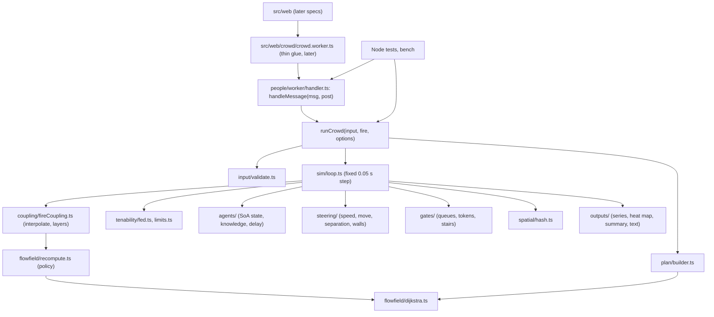
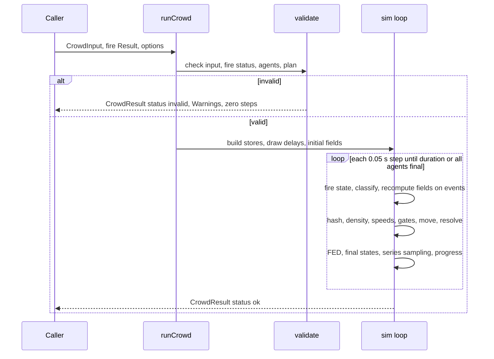

# Design Document
## Overview
The crowd feature simulates how people move out of a multi-floor building while a fire develops. It lives in `src/core/people/` as pure functions with no DOM and no globals. It runs unchanged in Node 24 and in a Web Worker, and it is deterministic for a given seed.
The fire model runs to completion first. The crowd model reads the finished fire `Result` (`CompartmentSeries`) and never writes back to it. Each person (Agent) is a point with a radius that follows a precomputed walking-cost map (Flow_Field) to an exit, slows down in dense crowds and in smoke, queues at doors, and accumulates a Fractional Effective Dose (FED) from the gas and heat conditions of the layer at head height. The output answers: who got out, when, who did not and why.
This is a reference simulation. No output string states or implies that a building is acceptable. The notice required by Requirement 6.8 is the only place that contains the phrase "fire-safety review". Output text calls the time of the last person out "evacuation time".
| Requirement | Where in this design |
|---|---|
| 1 (plan, builder) | Plan builder, Data Models, Flow_Field computation |
| 2 (movement) | Flow_Field, Steering, Gates and queues, Stairs, Spatial hash |
| 3 (types, delay) | Agents, Pre-movement delay, Knowledge and Alert |
| 4 (fire coupling) | Fire coupling, Recompute policy |
| 5 (tenability) | Tenability |
| 6 (outputs) | Outputs, Warnings |
| 7 (determinism, worker, robustness) | Determinism, Worker wrapper, Error handling |
| 8 (performance) | Performance plan |
| 9 (tests) | Testing Strategy, Correctness Properties |
### Research findings
Values were checked against sources readable in this session. "Verified" means the number was read in a quoted or primary text. "Brief" means it comes from the project brief and was cross-checked only in part. "Estimate" means no source was found and the value is labelled as an estimate in `constants.ts` and in the UI. The full table is in "Constants and sources". Each finding below is a decision taken for this design, with its reason:
1. **Level walking speed.** The SFPE relation is `S = k − a·k·D` (Nelson and Mowrer, SFPE Handbook, "Emergency Movement"; also Gwynne and Rosenbaum in later editions) with `k = 1.40 m/s` for level routes and `a = 0.266`. It is valid for `D ≥ 0.54 persons/m²`. Below `D = 0.54` the speed is held at `S(0.54) = 1.40 × (1 − 0.266 × 0.54) ≈ 1.19 m/s`, which is the unimpeded speed. The 1.19 m/s value is therefore derived from the relation and is not a separate constant. It matches the default maximum speed in Pathfinder's SFPE verification cases ([Pathfinder stair flow test](https://www.thunderheadeng.com/docs/2025-1/pathfinder/appendices/verification-validation/flow-rate/stairs/)). Speed is 0 at `D ≥ 1/a ≈ 3.76`. Stairs use the same structure with the SFPE stair `k` (Finding 3), the same `a` and the same cap at `D = 0.54`. Fruin and Predtechenskii-Milinskii relations are the alternatives and are noted in `constants.ts`.
2. **Door flow.** The SFPE maximum specific flow is 1.316 persons/(s·m) at 1.88 persons/m². This equals `1.4 × (1 − 0.266 × 1.88) × 1.88`. SFPE applies it to an effective width that removes a 0.15 m boundary layer at each side ([Pathfinder door flow test](https://www.thunderheadeng.com/docs/2025-1/pathfinder/appendices/verification-validation/flow-rate/doors/): a 1 m door flows at 0.92 persons/s). The design decides to apply 1.3 (the requirement's rounded value) to the effective width. This is stricter than the requirement's "per metre of clear width", so Requirement 2.9 still holds.
3. **Stair speeds.** The SFPE table gives `k` in m/s along the incline for four riser/tread pairs: 1.00 (7.5/10 in), 1.08 (7/11), 1.16 (6.5/12), 1.23 (6.5/13). The table is quoted in the [Pathfinder SFPE technical reference](https://www.thunderheadeng.com/docs/2025-1/pathfinder/appendices/technical-reference/sfpe/). Pathfinder's stairway-merging test confirms `1.08 / 1.4 = 77 %` for a 7/11 stair. The table has no separate up and down values. The design uses one value for both directions and lists the direction split as an open item.
4. **Stair flow follows from the same relation.** At a 7/11 stair, `1.08 × (1 − 0.266 × 1.88) × 1.88 = 1.015 persons/(s·m)` of effective width. Pathfinder reports 0.71 persons/s for a 1 m stair with 0.7 m effective width, which is the same number (0.71 / 0.7 = 1.014). So stair entry can be limited by the same gate mechanism as doors, with this derived specific flow.
5. **Pre-movement.** NIST's smoke alarm analysis (Cleary, [NIST pub 906889](https://www.nist.gov/customcf/get_pdf.cfm?pub_id=906889)) models pre-movement as log-normal with a geometric standard deviation of 1.6 and medians of 16 s (easily alerted, mobile), 35 s (slower to respond) and 55 s (elderly or impaired). The populations are residential. The design uses 16 s for staff and 35 s for visitors and states that sleeping guests need an input override (Requirement 3.10).
6. **Smoke speed.** Jin's walking data, as fitted in the SFPE Handbook 6th ed. Ch. 70 (Purser and McAllister, quoted in the [pyFDS-Evac walking speed notes](https://github.com/PedestrianDynamics/pyFDS-Evac/blob/main/site/content/fundamentals/walking-speed.md)), give `v = 1.0573 − 0.4326 K` m/s in non-irritant smoke (data 0.5 to 1.13 1/m, R² = 0.27) and `v = 1.1517 − 0.9578 K` in irritant smoke (data 0.32 to 0.47 1/m, R² = 0.035). Jin takes 0.3 m/s as the speed in darkness (Jin 1978, p. 148, citing Togawa 1969). The scatter is large. The design uses the non-irritant line as a fraction of its own intercept, with a floor at the darkness speed, and offers the irritant line as an input option.
7. **Fractional effective dose.** The CO term `3.317e-5 × C^1.036 × RMV × t / D` with `RMV = 25 L/min` and `D = 30 %COHb` is the FDS source comment, equal to `2.764e-5 × C^1.036` per minute ([FDS discussion](https://groups.google.com/g/fds-smv/c/vzEBnmF3Bhg), [pyFDS-Evac FED model](https://github.com/PedestrianDynamics/pyFDS-Evac/blob/main/site/content/models/fed.md)). The low-oxygen term `1 / exp(8.13 − 0.54 (20.9 − O2))` per minute is verified in the same page. The CO2 hyperventilation factor in the brief, `exp(0.2496 C + 1.9086) / 6.8`, could not be read in a primary text. The FDS+Evac form `exp(0.1903 C + 2.0004) / 7.1` is verified. Both are close to 1 at ambient CO2. The design uses the brief's form and lists the other as the alternative.
8. **Convective heat.** ISO 13571:2012 Eq. (9), fully clothed: `t = 4.1e8 × T^−3.61` minutes with `T` in °C. Eq. (10), unclothed: `t = 5e7 × T^−3.4` ([pyFDS-Evac heat model](https://github.com/PedestrianDynamics/pyFDS-Evac/blob/main/site/content/models/heat.md), which cites the standard). The brief's `exp(5.1849 − 0.0273 T)` was not found in any source readable here and is not used. It gives 11.6 min at 100 °C, between Eq. (9) (24.7 min) and Eq. (10) (7.9 min).
9. **Tenability limits.** The Engineers Australia practice note for tenability criteria (version 2.0, 2014, Section 5.2) gives a visibility limit of 10 m for large enclosures and 5 m for small ones (dimensions of about 10 m), a convective-heat limit equal to a constant 100 °C exposure for 10 minutes, and evaluates conditions at 2.0 m. A conference slide (Rosberg, FEMTC 2018) pairs the 10 m value with spaces above 100 m². The 120 °C value in the brief appears in that note only as a 10-minute limit for fire fighters, not for occupants, so the design uses 100 °C.
10. **Eye height.** 1.6 m is the `HUMAN_SMOKE_HEIGHT` default of FDS+Evac (pyFDS-Evac smoke-speed notes). The practice note uses 2.0 m. The requirement fixes 1.6 m.
11. **Fire Result status.** `ResultStatus` in `src/core/fire/types.ts` is `"ok" | "invalid" | "failed"`. Requirement 4.1 says "completed". The design maps "completed" to `status === "ok"` and recommends the requirement text use that value (Open item 1).
12. **Fire visibility.** The fire module computes `visibilityM = 3 / K` (FDS `VIS_C0 = 3`, light-reflecting signs) and stores `opticalDensityPerM = K / ln 10`. Visibility is `Infinity` at zero soot, so it cannot be interpolated. The crowd model interpolates `K = opticalDensityPerM × ln 10`, which is always finite, and derives visibility as `3 / K`.
## Architecture
### Layering

Dependency rules:
- `src/core/people/` imports only from `src/core/` (Requirement 7.7): types from `../fire/types`, `createPrng` from `../fire/prng`, molar masses and `K_VIS` from `../fire/constants`. No `node:*`, no DOM, no runtime dependency.
- Physics-like modules (`tenability/`, `steering/speed.ts`) are pure functions on numbers. They know nothing about the loop.
- The loop owns time. Only `sim/loop.ts` mutates agent arrays.
- Every user-visible string is built in `outputs/text.ts`. A test scans that module (Requirement 9.10).
### Module layout
```
src/core/people/
  index.ts                 public API: buildPlan, runCrowd, type re-exports
  constants.ts             every constant with its source (Constants and sources)
  types.ts                 Plan, CrowdInput, CrowdResult, CrowdWarning (types only)
  warnings.ts              warning codes and constructors (same shape as fire Warning)
  plan/
    builder.ts             buildPlan(input): PlanResult; limits, stair links, compartments
    ascii.ts               floorFromAscii(rows, legend) helper for tests and fixtures
    grid.ts                index helpers, neighbour tables, wall clearance, fit test
    gatesFromPlan.ts       door runs, exit groups and stair links become Gate descriptors
    reachability.ts        unreachable regions (Requirement 1.8)
  flowfield/
    dijkstra.ts            binary-heap Dijkstra on the multi-floor graph
    costs.ts               per-node weight from compartment multipliers and clearance
    recompute.ts           recompute policy, quantised multipliers, event detection
    choose.ts              exit choice with switch margin (Requirement 4.7)
  coupling/
    fireCoupling.ts        CompartmentSeries lookup, time cursor, interpolation
    layers.ts              eye-height layer selection, extinction, mole fractions
  tenability/
    fed.ts                 FED rates and per-step increments
    limits.ts              visibility and temperature limits, step classification
  agents/
    state.ts               structure-of-arrays agent store
    delay.ts               log-normal pre-movement delay from the seeded PRNG
    knowledge.ts           known exits, Alert
  steering/
    speed.ts               speed-density, stair speed, smoke factor
    move.ts                desired velocity, gate checks, step
    separation.ts          agent-agent and agent-wall resolution
  gates/
    gate.ts                token accumulator, 10 s window, FIFO queue, armed agent
    stairs.ts              stair channel (progress, density, transfer)
  spatial/
    hash.ts                counting-sort spatial hash, density and neighbour queries
  sim/
    loop.ts                the time loop, progress events
    stats.ts               counters for the benchmark
  outputs/
    series.ts              per-gate series, FED history
    heatmap.ts             congestion counts
    summary.ts, text.ts    summary counts and all output strings
  worker/
    protocol.ts            ToWorker, FromWorker types
    handler.ts             handleMessage(msg, post): validation, progress, one result
tests/people/              unit tests, props/*.property.test.ts, arbitraries.ts, bench/
```
### Run lifecycle

`runCrowd` never throws for an object argument. An internal error is caught and returned as `status: "failed"` with an `INTERNAL_ERROR` Warning and the data collected so far. It throws a `TypeError` only when an argument is not an object (programmer error, `tech.md`).
### Key decisions
| Decision | Rationale |
|---|---|
| Flow_Field per exit over a multi-floor node graph, stairs as link edges | One Dijkstra gives cost to go from every cell on every floor. Floor choice, stair use and exit choice fall out of the costs (Property 8). |
| Smoke cost is per compartment, not per cell | The fire model is two-zone. All cells of a compartment share one layer state, so a recompute depends on at most 100 multipliers, which are quantised. |
| Doors, exits and stair entries are one `Gate` abstraction | One implementation of the flow limit and queue serves Requirements 2.9 to 2.11 and the stair bottleneck. |
| Stairs are 1-D channels, not walked cells | Stair speed and flow depend on riser/tread and density along the incline. A channel with uniform density is the SFPE flow-model treatment and costs O(1) per agent. |
| Structure-of-arrays agents, integer step counters | Speed (Requirement 8) and exactness (heat map and window counts use integers, Requirements 6.5, 9.6). |
| Fixed step 0.05 s, no adaptive stepping | Requirement 2.1. The maximum displacement is `1.19 × 0.05 = 0.06 m`, a quarter of a cell, so no step can skip a wall cell. |
| No feedback to the fire | Requirement 4 and the scope statement. Open doors in the crowd model do not change fire vents. |
## Components and Interfaces
### Public API
```ts
// src/core/people/index.ts
export function buildPlan(input: PlanInput, limits?: PlanLimits): PlanResult;
export function runCrowd(input: CrowdInput, fire: Result, options?: CrowdRunOptions): CrowdResult;
export type { Plan, PlanInput, CrowdInput, CrowdResult, CrowdWarning, /* ... */ };
export interface CrowdRunOptions {
  onProgress?: (e: ProgressEvent) => void; // ProgressEvent from ../fire/types
  recordStats?: boolean;                   // fills CrowdResult.stats (benchmark)
}
```
## Data Models
### Plan input and built Plan
```ts
export type CellTypeName = "wall" | "free" | "door" | "exit" | "stair";
export const CELL_WALL = 0, CELL_FREE = 1, CELL_DOOR = 2, CELL_EXIT = 3, CELL_STAIR = 4; // Uint8 codes
export const NO_COMPARTMENT = 0xffff;
export interface FloorInput {
  id: string;
  elevationM: number;                 // finite, -10..100 (Requirement 1.1)
  widthCells: number;
  heightCells: number;
  cells: ArrayLike<number | CellTypeName>;   // row-major, y * widthCells + x
  compartmentIds: ArrayLike<string | null>;  // same indexing; null for none
}
export interface StairLinkInput {
  id: string;
  lowerFloorId: string;
  upperFloorId: string;               // adjacent floor
  riserM?: number;                    // default 0.178 (7 in)
  treadM?: number;                    // default 0.279 (11 in)
  widthM?: number;                    // default: shorter side of the footprint box
}
export interface CompartmentInfo { id: string; kind?: "room" | "corridor" | "shaft" }
export interface PlanInput {
  floors: FloorInput[];
  stairLinks: StairLinkInput[];
  compartments?: CompartmentInfo[];   // optional kinds for the long-corridor warning
}
export interface PlanLimits { maxFloors: number; maxCompartments: number; maxCellsPerFloor: number; }
export interface PlanResult {
  status: "valid" | "invalid";
  plan: Plan | null;                  // null when invalid
  warnings: CrowdWarning[];
}
export interface Plan {
  floors: PlanFloor[];
  compartmentIds: string[];           // index = compartment index used in Uint16 maps
  nodeOffset: Int32Array;             // first node index of each floor
  nodeCount: number;
  gates: GateSpec[];                  // doors, exits, stair entries
  exits: ExitSpec[];                  // exit groups, one Flow_Field each
  stairLinks: StairLinkModel[];
  baseFields: ExitField[];            // one per exit group, no smoke (Requirement 1.9)
}
export interface PlanFloor {
  id: string; index: number; elevationM: number; widthCells: number; heightCells: number;
  cellType: Uint8Array;
  compartment: Uint16Array;
  gateOfCell: Int16Array;             // gate id of a door or exit cell, -1 otherwise
  fitsAgent: Uint8Array;              // 1 when a body disc of Agent_Radius fits in the cell
  clearanceCost: Float32Array;        // wall-clearance cost of the cell, in cell lengths
}
export interface GateSpec {
  id: number; kind: "door" | "exit" | "stair"; label: string;
  floorIndex: number; cells: Int32Array;     // cell indices (for stairs: the entry footprint on its floor)
  widthM: number; effectiveWidthM: number;
  specificFlowPerSM: number;                 // persons / (s m) of effective width
  linkIndex: number;                         // stair link, else -1
}
export interface ExitSpec { id: string; floorIndex: number; cells: Int32Array; gateId: number; }
export interface StairLinkModel {
  id: string; lowerFloor: number; upperFloor: number;
  footprint: Int32Array;              // cell indices, identical on both floors
  inclineLengthM: number;             // dz * sqrt(1 + (tread / riser)^2)
  widthM: number;
  speedFreeMPerS: number;             // SFPE k for riser/tread (Constants)
  gateUp: number; gateDown: number;   // gate ids for the two directions
}
export interface ExitField {
  exitIndex: number;
  cost: Float64Array;                 // cost to go, in cell lengths; Infinity when unreachable
  next: Int32Array;                   // node of the cheapest neighbour, -1 at exits and unreachable nodes
}
```
Node index of cell `c` on floor `f` is `nodeOffset[f] + c`.
### Crowd input and result
```ts
export type AgentType = "visitor" | "staff";
export interface AgentInput {
  id: string;
  type: AgentType | string;           // other strings are excluded with a Warning (Requirement 3.2)
  floorId: string;
  xM: number; yM: number;             // metres from the floor's origin corner
  entryExitId?: string;               // visitors (Requirement 3.3)
}
export interface DelayParams { medianS: number; logSd: number }
export interface CrowdInput {
  schemaVersion: 1;
  durationS: number;                  // finite, > 0
  seed: number;
  plan: Plan;                         // a valid Plan from buildPlan
  agents: AgentInput[];
  alarmTimeS?: number | null;         // Alert for everyone at this time (Requirement Glossary: Alert)
  guidance?: { signExitIds?: string[] };
  delay?: { visitor?: DelayParams; staff?: DelayParams };
  smokeLaw?: "jin-non-irritant" | "jin-irritant";   // default non-irritant
  ambientTempK?: number;              // default 293.15, used where no compartment applies
  fireSites?: { floorId: string; xM: number; yM: number }[];          // for the near-fire Warning
  unmeasuredMaterialSites?: { floorId: string; xM: number; yM: number; material: string }[];
}
export type FinalState = "out" | "incapacitated" | "still inside";
export type IncapCause = "asphyxiant FED" | "heat FED" | "temperature limit";
export interface AgentRecord {
  id: string; type: AgentType;
  finalState: FinalState;
  exitTimeS: number | null; exitId: string | null;
  incapacitatedTimeS: number | null; causes: IncapCause[];
  preMovementDelayS: number;
  everBlocked: boolean;
  fedHistory: { timesS: Float64Array; fed: Float64Array };  // every 1 s plus the final sample
  finalFloorId: string; finalXM: number; finalYM: number;
}
export interface GateSeries {
  gateId: number; label: string; kind: "door" | "exit" | "stair";
  timesS: Float64Array;               // 0, 1, 2, ... duration
  flowPersonsPerS: Float64Array;      // persons crossing during the last second
  queueLength: Float64Array;          // persons waiting at the sample time
}
export interface FloorHeatMap { floorId: string; widthCells: number; heightCells: number; personSeconds: Float64Array }
export interface CrowdSummary {
  total: number; out: number; incapacitated: number; stillInside: number;
  evacuationTimeS: number | null;     // last exit time, null if nobody is out
  text: string[];                     // plain-language lines, all built in outputs/text.ts
}
export interface CrowdResult {
  status: "ok" | "invalid" | "failed";
  warnings: CrowdWarning[];
  notice: string;                     // Requirement 6.8
  summary: CrowdSummary | null;       // null when invalid
  agents: AgentRecord[];
  gates: GateSeries[];
  congestion: FloorHeatMap[];
  stats?: CrowdStats;                 // steps, field recomputes, dijkstra node count, only with recordStats
}
export type CrowdWarningCode =
  | "PLAN_LIMIT" | "PLAN_CELL_TYPE" | "PLAN_ELEVATION" | "STAIR_LINK_MISMATCH" | "STAIR_GEOMETRY_RANGE"
  | "COMPARTMENT_MISSING_IN_FIRE" | "NO_EXIT" | "AGENT_START_INVALID" | "UNREACHABLE_REGION"
  | "DOOR_TOO_NARROW" | "AGENT_TYPE_REJECTED" | "ENTRY_EXIT_ESTIMATED" | "DELAY_PARAMS_REJECTED"
  | "FIRE_STATUS" | "FIRE_RESULT_ENDED" | "FED_INPUT_INVALID" | "AGENT_BLOCKED"
  | "STAIR_RESULT" | "LONG_CORRIDOR" | "NEAR_FIRE" | "UNMEASURED_MATERIAL"
  | "INPUT_INVALID" | "WORKER_REQUEST_INVALID" | "WARNINGS_TRUNCATED" | "INTERNAL_ERROR";
export interface CrowdWarning {
  code: CrowdWarningCode;
  severity: "error" | "warning";
  message: string;                    // plain language
  location: { kind: "plan" | "floor" | "cell" | "agent" | "gate" | "stair" | "fire" | "field";
              id?: string; floorId?: string; xM?: number; yM?: number; field?: string };
  timeS: number | null;
  source?: string;
}
```
### Agent store (structure of arrays)
```ts
export interface AgentStore {
  n: number;
  x: Float64Array; y: Float64Array;            // metres on the agent's floor
  floor: Uint8Array;
  cell: Int32Array;                            // cell index on the floor
  state: Uint8Array;                           // 0 pre-move, 1 moving, 2 in stair, 3 out, 4 incapacitated
  flags: Uint8Array;                           // bit 0 blocked, 1 alerted, 2 ever blocked, 3 near-fire warned
  delaySteps: Int32Array;                      // pre-movement delay as a step index
  exitChoice: Int16Array;                      // exit index
  known: Uint8Array;                           // n * nExits, 1 when the agent knows the exit
  fedAsph: Float64Array; fedHeat: Float64Array;
  causeMask: Uint8Array;
  stairLink: Int16Array; stairS: Float64Array; stairDir: Int8Array;
  gateEnrolled: Int16Array;                    // gate id the agent is queued at, -1 none
  insideSteps: Int32Array;                     // steps spent inside the model (integer)
  exitStep: Int32Array; incapStep: Int32Array; // -1 when not set
}
```
## Algorithms
### Plan builder (Requirements 1.1 to 1.9)
`buildPlan` runs these checks in a fixed order, adds warnings, and never throws.
1. Limits: `floors ≤ 12`, `distinct compartment ids ≤ 100`, `cells per floor ≤ 1,000,000`. Elevation must be a finite number in −10 to 100 m. Each cell must be one of the five types (names or codes 0 to 4). Failures return `status: "invalid"` with a Warning that names the limit, floor or cell.
2. Compartment maps: ids are interned into `compartmentIds`. Wall cells may carry an id, which is ignored.
3. Gates: a Door is a connected run (4-neighbour) of `door` cells. Its width is the longer side of the run's bounding box in cells times 0.25 m, which assumes a door is drawn across the flow. An Exit is a connected run of `exit` cells and uses the same width rule. Stair links add two gates (one per direction).
4. Narrow passages: a cell "fits" when a disc of radius `AGENT_RADIUS_M` fits somewhere in it. The test samples 9 points of the cell (centre, edge midpoints, corners) and requires one with distance at least `AGENT_RADIUS_M` from every wall rectangle within 2 cells. A door run whose cells do not fit gets `DOOR_TOO_NARROW` and is closed in the Flow_Field. A 2-cell (0.5 m) passage fits, a 1-cell passage does not.
5. Stair links: both floors must be adjacent in the floor list and both must have `stair` cells at identical coordinates over the linked footprint. Otherwise the link is rejected with a Warning naming both floors and the unmatched coordinates (Requirement 1.4). Incline length is `Δz × sqrt(1 + (tread / riser)²)`. Riser/tread outside the SFPE table range (slope 0.5 to 0.75) clamps to the nearest table point with `STAIR_GEOMETRY_RANGE`.
6. Reachability: a flood fill from all exit cells over the base graph (with stair links) labels reached cells. Each connected region of unreached walkable cells gets one `UNREACHABLE_REGION` Warning with floor and bounding box (Requirement 1.8).
7. A Plan with no `exit` cell is valid as a Plan. `runCrowd` returns `invalid` with `NO_EXIT` (Requirement 1.6).
8. Base fields: one Flow_Field per exit group with all compartment multipliers equal to 1 (Requirement 1.9). The build is deterministic, so a second build is bit-identical.
Fire coverage (Requirement 1.5, 4.3) is checked in `runCrowd`, because the Plan does not know the fire Result.
### Flow_Field
Graph: node `(floor, cell)` for each walkable cell (`free`, `door`, `exit`, `stair`) that fits an agent. Edges:
- 8 neighbours on the same floor. Orthogonal length 1, diagonal √2, in cell lengths. A diagonal move is dropped when either adjacent orthogonal cell is a wall, so paths do not cut wall corners.
- Stair link edges between `(lower, c)` and `(upper, c)` for every footprint cell `c`, in both directions.
Cost of an edge between nodes `a` and `b` (Requirement 2.3):
```
w(n)    = mult[compartment(n)]                       // 1 when clear, section "Recompute policy"
step    = len(a,b) * 0.5 * (w(a) + w(b)) + 0.5 * (clr(a) + clr(b))
clr(n)  = WALL_CLEARANCE_COST      if a wall cell is within 1 cell (Chebyshev)
          WALL_CLEARANCE_COST / 2  if the nearest wall cell is 2 cells away
          0                        otherwise
link    = inclineLengthM * V_FREE / speedFree_stair / CELL_SIZE_M   (cell lengths, time-equivalent at free walking speed)
          * 0.5 * (w(a) + w(b))
```
`mult = Infinity` removes a node (a hot compartment, see Recompute policy). The field is the cost to go to the exit group, computed by Dijkstra started from all cells of the group at cost 0.
Dijkstra implementation:
- Binary min-heap in two typed arrays (`Float64Array` keys, `Int32Array` nodes) with lazy deletion. Ordering is by `(cost, node index)`, so ties break the same way every run.
- Neighbours are visited in a fixed order (the 8 directions in a constant table, then the link edge).
- `next[v]` stores the neighbour `u` that gave the final `cost[v]`. A strictly smaller candidate replaces it, so the first neighbour in table order wins ties.
- Complexity `O(E log V)` with `E ≈ 8 V`. For the benchmark plan (36,864 nodes) this is an estimated 5 to 10 ms per field; the benchmark task measures it (Performance plan).
Agent steering reads `next[]`: the target point is the centre of the cell of `next[node]`. For the Plan limit of 12 floors times 1,000,000 cells a field has 12 million nodes and takes seconds. The builder adds `PLAN_LARGE` (estimate threshold 250,000 nodes) so the cost is visible to the caller.
### Recompute policy for smoke costs (Requirement 4.6, 4.7)
Each compartment `c` has a class at every step, computed from the interpolated state of the layer that contains eye height (see Fire coupling):
| Class | Condition | Multiplier |
|---|---|---|
| `blocked` | active layer is the upper layer and `T_upper ≥ TEMP_LIMIT` | `Infinity` |
| `smoky` | visibility `< visLimit(c)` | `VIS_PENALTY_FACTOR / f(K)` |
| `clear or thin` | otherwise | `1 / f(K)` |
where `f(K)` is the smoke speed factor and `visLimit` is 10 m for compartments over 100 m² of floor area and 5 m otherwise. `f(K)` is quantised to steps of 0.1 for the multiplier so a compartment does not trigger a recompute for tiny changes.
Two triggers, both evaluated at the start of every step:
1. **Limit event (immediate).** A compartment's class changes (any of the three). The affected fields are recomputed in the same step, before any agent moves (Requirement 4.6). Several compartments that change in the same step cause one recompute per needed field, not one per compartment.
2. **Drift refresh (throttled).** The quantised multiplier of any compartment changed but no class changed. The refresh runs at most once per `FIELD_REFRESH_INTERVAL_S` (5 s, estimate). Agents do not re-plan faster than a person could notice a change in smoke.
A field is "needed" when at least one active agent knows its exit. Fields that no agent needs are marked stale and rebuilt when first needed. The base fields stay in the Plan and serve as the initial state.
Hysteresis: the class uses the interpolated value at the current step, and the interface-height comparison `≥ EYE_HEIGHT_M` flips the active layer once in a normal fire. No extra hysteresis is added. The recompute count is reported in `stats` so the benchmark shows a flapping compartment.
Exit choice (Requirement 4.7). After a recompute, for each active agent with more than one known exit, let `c_cur` be the field value of the current exit at the agent's node and `c_best` the smallest among known exits. The agent switches if and only if `c_best < c_cur − SWITCH_MARGIN_CELLS`. The first choice at the start of movement takes the smallest known cost with no margin. Ties go to the lowest exit index.
```ts
export function chooseExit(current: number, costs: ArrayLike<number>, known: ArrayLike<number>, marginCells: number): number
```
### Agents, knowledge and Alert
- **Visitors** know their `entryExitId`. If it is missing or not an exit of the Plan, the nearest exit by straight-line distance on the same floor, else on any floor by 3-D distance using floor elevation, is used, with `ENTRY_EXIT_ESTIMATED` (Requirement 3.4).
- **Staff** know every exit.
- **Alert** is set for an agent at the first step where (a) the extinction coefficient of the layer at the agent's eye height is above `K_ALERT_PER_M`, or (b) `alarmTimeS` is reached. When a visitor is alerted, `known` gains the exits that guidance names: `guidance.signExitIds` and the exits chosen by staff agents at that step. Exits already known stay known (Requirement 3.5).
- An agent in an unreachable position for all known exits gets the Blocked flag (Requirement 2.12).
### Pre-movement delay (Requirement 3.7 to 3.11)
At the start of the run, for each input agent in input order (including excluded agents, so exclusion does not shift later draws), the PRNG gives two uniforms `u1, u2`. The delay is
```
z      = sqrt(-2 ln(1 - u1)) * cos(2 pi u2)       // Box-Muller, 1 - u1 in (0, 1]
delayS = median * exp(logSd * z)
```
with `median` and `logSd` from the agent type. Defaults (Cleary, NIST): staff `median = 16 s`, visitor `median = 35 s`, `logSd = ln 1.6 = 0.4700` for both. Input parameters replace the defaults only when `median` is finite and above 0 and `logSd` is finite and at least 0. Otherwise the defaults are used with `DELAY_PARAMS_REJECTED` (Requirement 3.11). The delay becomes `delaySteps = ceil(delayS / dt)`. While `step < delaySteps` the agent stays at its start position.
### Spatial hash and density (Requirement 2.4 to 2.6)
A uniform grid with bucket size `DENSITY_RADIUS_M` (1.0 m, estimate), one grid per floor, built each step by counting sort into three typed arrays (`bucketStart`, `bucketFill`, `items`). Only buckets that held agents in the previous step are cleared. Agents that are Out or inside a stair channel are not in the hash. Incapacitated agents stay in the hash and count towards density, but separation ignores them (people step around a person on the floor; Open item 9).
Local density of agent `i`:
```
D_i = (number of other agents within DENSITY_RADIUS_M of agent i, same floor) / (pi * DENSITY_RADIUS_M^2)
```
`D_i = 0` for an agent with no neighbour (Requirement 2.5). One neighbour at touching distance gives `D = 0.318` persons/m². The radius is an estimate. Fruin and Predtechenskii-Milinskii measure density over an area of a walkway section, and a Voronoi measure is the alternative. Inside door and exit cells the density is not applied (the gate sets the flow), which prevents a jam at the door from holding the agent at the front at zero speed.
### Speed (Requirements 2.5 to 2.7, 4.5)
```
S(k, D)      = k * (1 - a * D)                       // SFPE: S = k - a k D, a = 0.266
v_level(D)   = S(K_LEVEL, max(D, D_FREE_CAP))        // K_LEVEL = 1.40 m/s, D_FREE_CAP = 0.54 persons/m²
             = 0 for D >= 1/a = 3.76
V_FREE       = S(K_LEVEL, D_FREE_CAP) = 1.40 * (1 - 0.266 * 0.54) = 1.19 m/s   // derived, not a constant
v_stair(D)   = S(k_stair, max(D, D_FREE_CAP))        // k_stair from the SFPE riser/tread table, m/s along the incline
             = 0 for D >= 1/a
f_smoke(K)   = clamp( (a - b*K) / a, F_MIN, 1 )      // Jin non-irritant: a = 1.0573, b = 0.4326, F_MIN = 0.3 / a
v            = v_level(D) * f_smoke(K)
```
The irritant option uses `a = 1.1517`, `b = 0.9578`, with the same floor speed of 0.3 m/s (`F_MIN = 0.3 / a`). With the non-irritant default, `f_smoke(K) = 1 − 0.409 K` and the floor is reached at `K = 1.75 1/m`, which is above the 0.5 to 1.13 1/m range of Jin's data (extrapolation, flagged in Open items). `f_smoke(K) = 1` for `K ≤ 0`.
Alternatives not used: the Frantzich-Nilsson line `v = 0.706 − 0.057 K` (data at 1.9 to 7.4 1/m, mild smoke, not valid at low `K`); Fridolf et al. 2019 Eq. 7, `w = min(v0, max(0.2, v0 − 0.34 (3 − V)))` with `V = A / K`, `A = 2` (reflecting) or 8 (emitting), calibrated mainly on tunnels and described by its authors as not recommended for buildings with many exit choices; Purser's pooled `W = −0.1364 ln K + 0.6423`.
Smoke applies to stair channels as well, using the layer state of the compartment of the current half of the channel.
### Steering and collision (Requirement 2.2, 2.4)
Per moving agent and step:
1. Target point = centre of the cell of `next[node]` on the chosen exit's field. If the agent is inside a cell whose `next` is a stair link, the agent starts the stair transition instead (see Stairs).
2. Desired displacement `= v × dt` along the unit vector to the target, limited so it does not overshoot the target.
3. **Gate check.** If the displacement would take the centre into a door or exit cell of gate `g` and the agent is not the armed agent of `g`, the agent does not enter. It is enrolled in the FIFO of `g` if it is within `GATE_ENROL_RADIUS_M` of the gate's cells and not yet enrolled.
4. Apply the displacement.
5. **Agent separation.** For each neighbour in the 3×3 buckets with centre distance below `2 × AGENT_RADIUS_M`, the moving agent moves away along the line of centres by the overlap (half the overlap when both agents move this step, full when the other is waiting or in pre-movement). Two relaxation iterations per step.
6. **Wall resolution.** For each wall cell within one cell of the agent, the disc is pushed out along the shortest normal so its centre is at least `AGENT_RADIUS_M` from the wall rectangle. Two iterations. If the centre is still inside a wall cell afterwards, the agent returns to its position at the start of the step. A centre therefore never lies in a wall cell (Property 2).
Moves are computed from the positions at the start of the step into a second buffer and then swapped, so the result does not depend on agent order except where gates and separation break ties by agent index.
### Gates and queues (Requirements 2.9 to 2.11)
A `Gate` models a door, an exit or a stair entry.
```ts
export interface GateState {
  rate: number;          // persons per step = specificFlow * effectiveWidth * dt
  credit: number;        // token accumulator, capped at max(1, rate)
  windowSteps: number;   // 200 = 10 s / 0.05 s
  maxInWindow: number;   // floor(10 * specificFlow * effectiveWidth), at least 1
  ring: Int32Array;      // step indices of the last maxInWindow crossings
  ringHead: number; ringCount: number;
  queue: Int32Array; qHead: number; qTail: number;   // FIFO of agent ids
  armed: number;         // agent id allowed to cross now, -1 none
}
```
Effective width: `W_eff = max(W − 2 × 0.15 m, 0.25 m)`. Door and exit specific flow is 1.3 persons/(s·m); a stair entry uses the derived value for its riser/tread.
Per step, for each gate:
1. `credit = min(credit + rate, max(1, rate))`. The accumulator allows no burst larger than one person.
2. If `armed < 0`, the queue is not empty, `credit ≥ 1`, and the window has room (fewer than `maxInWindow` crossings with step index greater than `step − windowSteps`), the head of the FIFO is armed. The agent at the head moves to cross.
3. When the armed agent's centre first enters a cell of the gate, the crossing is recorded in the same step: `credit −= 1`, the step index is pushed to the ring, `armed = −1`, the agent is removed from the FIFO. Credit and window room cannot get worse between arming and crossing (no other agent crosses, and the window only loosens), so the checks of step 2 still hold at the crossing.
4. If the armed agent becomes Out, incapacitated or blocked before crossing, `armed` is cleared and the next head is armed in the same step.
**Window guarantee.** Every crossing is preceded by `credit ≥ 1` and by fewer than `maxInWindow` crossings in the last 200 steps. So any half-open window of 10 s contains at most `maxInWindow = floor(10 × 1.3 × W_eff)` crossings, and also at most `10 × 1.3 × W_eff` persons, since `floor(x) ≤ x`. The accumulator alone would allow `floor(10 r) + 1`; the ring removes the extra person. Counting uses step indices (integers), so there is no floating point edge at the window boundary.
**FIFO.** Agents enrol when they come within `GATE_ENROL_RADIUS_M` (1.0 m, numerical estimate) of the gate cells. The queue order is the enrolment step, then agent index. The armed agent is always the head, so crossings follow enrolment order (Requirement 2.10). Queue length for the output is the FIFO size at the sample time.
Door cells are closed to agents that are not armed, like wall cells for their steering. An agent that has crossed is inside the gate's cells and walks on without density slowdown until it leaves them.
**Exit.** When an armed agent enters an `exit` cell it is marked Out in that step. Its exit time is `(step + 1) × dt`. It is removed from the hash and from all queues from the next step (Requirement 2.11).
### Stairs (Requirements 2.7, 2.8)
A Stair_Link is a channel of length `L = inclineLengthM` and width `W` with `n` agents inside. All agents in a channel share one density and one speed:
```
D_link = n / (L * W)
v_link = v_stair(D_link)                           // along the incline, capped at S(k_stair, 0.54) for D_link < 0.54
```
- **Entry.** An agent whose `next[node]` is a link edge walks to a footprint cell, enrols at the link's gate in that direction, and is armed like any gate agent. Entry also requires `D_link` after entry `< STAIR_MAX_DENSITY` (3.55 persons/m², Pathfinder SFPE mode default, estimate). Entry sets `state = in stair`, `stairS = 0`, and removes the agent from the hash.
- **Progress.** Each step `stairS += v_link × dt`. The agent arrives when `stairS ≥ L`.
- **Transfer.** On arrival the agent is placed in the same step at the centre of the same grid cell on the adjacent floor, `state = moving`, and re-enters the hash. Its next target comes from the field, which may lead out of the footprint or into the next link in the same shaft.
- **FED and smoke in the channel.** The first half of the channel uses the compartment of the entry cell, the second half the compartment of the arrival cell, with the usual layer selection.
- **Heat map.** An agent in a channel adds one count to its entry cell each step.
- **Warning.** Any run that uses a stair link adds one `STAIR_RESULT` Warning per link with the identifier (Requirement 6.7). Fire results for stairs and shafts are less reliable (Tech Ref 1.5), and landings, turns and merging flows at the landing are not modelled.
The channel approach uses one table value for up and down travel and does not model overtaking. The gate rate and the channel speed use the same `k_stair`, so the steady flow of a full stair is the SFPE value (Finding 4).
## Fire coupling (Requirement 4)
### Reading the Result
At start, `coupling/fireCoupling.ts`:
1. Rejects `fire.status !== "ok"` with `FIRE_STATUS` and `status: "invalid"` before any step (Requirement 4.1). A Result with `timesS.length === 0` is rejected in the same way.
2. Builds `fireIndexOfPlanCompartment: Int16Array` by matching `Plan.compartmentIds` to `fire.compartments[i].id`. A plan compartment without a match gets −1. Every such compartment is treated as ambient, and `COMPARTMENT_MISSING_IN_FIRE` is added once per cell (Requirements 1.5, 4.3) in cell index order.
3. Keeps one shared time cursor `k` into `fire.timesS` (all series share the same sample times). The cursor only moves forward.
### Interpolation and hold
At step `s` with time `t = s × dt`, find `k` with `timesS[k] ≤ t < timesS[k+1]` and `u = (t − timesS[k]) / (timesS[k+1] − timesS[k])`. Each needed quantity is `a + u (b − a)`. After the last sample the last values are held and exactly one `FIRE_RESULT_ENDED` Warning with the end time is added (Requirement 4.8). A single sample is held for all times.
Quantities read per compartment: `interfaceHeightM`, `upperTempK`, `lowerTempK`, and per layer `o2`, `co2`, `co`, `h2o`, `soot` (mass fractions), `opticalDensityPerM`. The evaluation per step covers all compartments for classification (at most 100) and the full FED inputs only for compartments that hold at least one active agent.
### Layer at eye height and extinction coefficient
- Lower layer when `interfaceHeightM ≥ EYE_HEIGHT_M` (1.6 m), upper layer otherwise (Requirement 4.4). The interface height is above the compartment floor, as in the fire model.
- `K = opticalDensityPerM × ln 10` (1/m). Equivalent to `K = K_VIS / visibilityM` with `K_VIS = 3` from the fire constants, and exactly 0 when visibility is `Infinity`. Visibility is `3 / K` for the tenability limit comparison.
- Temperature in Kelvin from the series, converted to °C by `− 273.15` for the ISO relations.
### Gas concentrations
ISO 13571 uses volume fractions. The fire layer gives mass fractions of O2, CO2, CO, H2O and soot only. With molar masses `M_i` from `../fire/constants` and the remainder assumed to be N2:
```
n_i      = Y_i / M_i                         (i = O2, CO2, CO, H2O)
n_rest   = max(0, 1 - Y_O2 - Y_CO2 - Y_CO - Y_H2O - Y_soot) / M_N2
X_i      = n_i / (n_O2 + n_CO2 + n_CO + n_H2O + n_rest)       // wet basis, soot not counted as gas
C_CO_ppm = 1e6 X_CO,  C_CO2_pct = 100 X_CO2,  C_O2_pct = 100 X_O2
```
The "rest as N2" assumption ignores unburned hydrocarbons and other products, which the fire module does carry. The error is small for the O2, CO2 and CO ranges that matter and is flagged as an estimate.
## Tenability (Requirement 5)
Per step, per layer, in per-minute rates (`dt = 0.05 s`, so each increment is `rate × dt / 60`).
**Asphyxiant FED** (ISO 13571 sum of CO, hyperventilation and low oxygen, Purser):
```
R_CO   = 3.317e-5 * C_CO_ppm^1.036 * RMV / D_COHb     // = 2.764e-5 * C_CO^1.036 with RMV = 25 L/min, D = 30 %COHb
V_CO2  = exp(0.2496 * C_CO2_pct + 1.9086) / 6.8       // hyperventilation factor
R_O2   = 1 / exp(8.13 - 0.54 * (20.9 - C_O2_pct))     // zero when C_O2_pct >= O2_FED_CUTOFF_PCT
R_asph = R_CO * V_CO2 + R_O2                          // per minute
```
`R_CO = 0` at `C_CO = 0`. Light work (`RMV = 25`, `D = 30`) is the default; the FDS source comment lists rest (8.5, 40) and heavy work (50, 20) as alternatives. The O2 term is cut to 0 at or above 20.0 % (the FDS+Evac default) so that ambient air gives exactly 0. At 15 % O2 the term is 1/140 per minute; at 10 % it is 1/9.4 per minute.
**Convective heat FED** (ISO 13571:2012 Eq. (9), fully clothed):
```
R_heat = T_C^3.61 / 4.1e8      per minute, for T_C > HEAT_FED_MIN_C, else 0
```
`HEAT_FED_MIN_C = 60 °C` is an estimate that stands in for the standard's lower threshold, which could not be read. The rate at 60 °C is 0.0063 per minute, so the omitted part is at most 0.063 FED per 10 minutes. At 100 °C the rate gives incapacitation in 24.7 min; at 150 °C in 5.7 min. Radiant heat is not included. Eq. (10) (unclothed, `5e7 T^−3.4`) is the alternative and is about 3 times faster.
**Incapacitation:**
- FED sum `fedAsph + fedHeat ≥ 1` marks the agent incapacitated. The cause list holds every term that is positive: `asphyxiant FED` if `fedAsph > 0`, `heat FED` if `fedHeat > 0`. This is the simplest rule that satisfies Requirement 5.5 ("one or more of").
- Active layer is the upper layer and `T_upper > TEMP_LIMIT_K` (100 °C, practice note Section 5.2) marks the agent incapacitated with cause `temperature limit` (Requirement 5.4).
- The incapacitation step `s` records `incapStep = s` and the time `(s + 1) × dt`. The agent's speed is 0 from the next step. FED stops accumulating.
The ISO 13571 text treats FED = 1 as the median incapacitating dose: half of a population is affected at lower FED, half at higher. The output states this next to the incapacitated count.
**Invalid inputs (Requirement 5.6).** A layer value that is NaN, infinite or negative for temperature, CO, CO2 or O2 skips the FED update for every agent in that layer for that step and adds one `FED_INPUT_INVALID` Warning per agent and input name (deduplicated).
Units: CO in ppm, CO2 and O2 in volume percent, temperature in °C, time in minutes inside the ISO relations. The conversion sits in one function per relation and each carries its source in a comment.
## Determinism and the PRNG (Requirement 7.1, 7.2)
- The only randomness is the delay draw at the start. It uses `createPrng(seed)` from `../fire/prng` and consumes exactly 2 values per input agent in input order, including agents later excluded.
- No `Math.random`, no `Date`, no `performance.now` inside `src/core/people`. The Worker wrapper takes progress timing from simulated time only.
- No data-dependent iteration order: all loops are over typed arrays in index order. Any sort uses a comparator that ends with the agent or node index.
- The Dijkstra heap breaks ties by node index. Gate queues break ties by agent index.
- Floating point: all state is Float64 and the same operations run in the same order, so two runs in one engine are bit-identical. `Math.exp`, `Math.log`, `Math.cos` and `Math.pow` are deterministic within one JavaScript engine version. Results across engines (V8, JavaScriptCore) can differ in the last bit. Tests compare runs within one process and one engine.
- Warnings are appended in event order, and each code is capped at `MAX_WARNINGS_PER_CODE` with one `WARNINGS_TRUNCATED` entry.
- Integer step counters, not accumulated floats, drive delays, windows, heat map counts and the exit step.
## Outputs (Requirement 6)
- **Per agent.** Final state, exit time and exit id, incapacitation time and causes, FED history sampled every 1 s (every 20 steps) plus one sample at the final-state step.
- **Summary.** Counts `out + incapacitated + stillInside = total`. `evacuationTimeS` is the largest exit time of agents that are Out, else `null`. Text lines are built from fixed templates, for example "Evacuation time (last person out): 2 min 41 s" and "No one got out." plus, when applicable, "3 people were incapacitated and 2 were still inside at the end of the run." as separate integers (Requirement 6.6).
- **Gate series.** One `GateSeries` per door, exit and stair entry, sampled each 1 s of simulated time: flow is the number of crossings in the preceding second (an integer count divided by 1 s), queue length is the FIFO size.
- **Congestion map.** Per floor, a `Uint32Array` of agent-step counts per cell. Each step adds 1 to the cell of every agent that has no final state at the start of that step. In-stair agents add to their entry cell. The output multiplies the counts by `dt`. The sum over the map equals `Σ insideSteps × dt` exactly, because both sides are integers times `dt` (Requirement 6.5). An agent's inside time is `exitTime` for an agent that got out and the time of incapacitation for an incapacitated agent, because both are counted up to and including the step of the final state.
- **Warnings** (Requirement 6.7), each with the location:
  - `STAIR_RESULT`: any stair link used.
  - `LONG_CORRIDOR`: an agent moved through a compartment whose `kind` is `corridor` and whose longest side exceeds `CORRIDOR_LENGTH_LIMIT_M`.
  - `NEAR_FIRE`: an agent came within 2 m of a `fireSites` entry on the same floor (once per agent).
  - `UNMEASURED_MATERIAL`: an agent came within 2 m of an `unmeasuredMaterialSites` entry (once per agent and site).
- **Notice.** A fixed string: "This is a simplified simulation for understanding risks. It does not replace a fire-safety review by the authorities or an engineer." It is the only string that contains "fire-safety review".
- **Wording.** `outputs/text.ts` is the single place that builds strings. It labels the time of the last exit "evacuation time" and never uses the words banned by Requirement 6.9. Warnings from `warnings.ts` obey the same rule.
## Worker wrapper (Requirement 7.4, 7.6)
```ts
// src/core/people/worker/protocol.ts
export interface CrowdRequest { input: CrowdInput; fire: Result }
export type ToWorker = { type: "run"; id: number; request: CrowdRequest };
export type FromWorker =
  | { type: "progress"; id: number; event: ProgressEvent }
  | { type: "result"; id: number; result: CrowdResult }
  | { type: "error"; id: number; message: string };
// handler.ts: all logic, no Worker global
export function handleMessage(msg: unknown, post: (m: FromWorker) => void): void;
```
`handleMessage` validates the shape of `msg`. A malformed message posts one `result` with `status: "invalid"` and a `WORKER_REQUEST_INVALID` Warning and no `progress`. A valid message calls `runCrowd` with an `onProgress` that posts a progress event whenever simulated time crosses a multiple of 5 s (the first at 5 s or earlier, with a short run posting only the last) and always at the end, then posts exactly one `result` as the last message. The glue file in `src/web/crowd/` (a later spec) only wires `self.onmessage` to `handleMessage`. Node tests and the benchmark call `handleMessage` directly, which is the in-process execution that Requirement 8.3 asks for.
Structured clone copies the typed arrays of the fire Result into the crowd worker. For the benchmark scenario that is about 100 series sets of 301 samples, a few megabytes, and the caller may transfer the buffers instead.
## Performance plan (Requirement 8)
### Scenario and budget
Benchmark scenario (fixture shared with the fire-zone benchmark so the Plan and the fire Scenario describe the same building): 6 floors, 5 compartments per floor (4 rooms and 1 corridor and stair hall) for 30 compartments, each floor 24 m × 16 m (96 × 64 cells = 6,144 cells), one stair shaft, 3 exits on the ground floor, 300 agents (50 per floor), duration 600 s, so `600 / 0.05 = 12,000` steps. Graph size 36,864 nodes. The fire run uses the same 30-compartment scenario as fire-zone Requirement 11.8.
| Item | Budget (median of 5, M-series Mac, Node, in-process) |
|---|---|
| Fire run (measured: fire-zone benchmark, 30 rooms, 600 s, median) | 4.76 s |
| Plan build, base fields (3 to 4 exits) | 0.3 s |
| Crowd time loop (12,000 steps) | 3.0 s |
| Field recomputes during the run | 0.7 s |
| Output assembly, FED history, summary | 0.3 s |
| Margin | 0.94 s |
| **Total** | **10.0 s limit** |
The fire-zone benchmark measured a median of 4.76 s for the 30-room, 600 s fire run, so about 5 s remain for the crowd (plan build, loop, recomputes, outputs and margin: 5.24 s). The 10 s limit is kept. The fire share is expected to be about 48 % of the limit, and the performance test reports the measured share (Requirement 8.2). The crowd estimates in the table are own estimates and are checked by the benchmark.
### Crowd loop cost model
- **Agent steps.** The upper bound is `300 × 12,000 = 3.6 M` agent-steps. The loop stops early when every agent is Out or incapacitated, and agents in pre-movement or waiting cost far less than moving agents. A realistic run has about 0.7 M moving agent-steps. The budget of 3.0 s needs at most 0.8 µs per agent-step in the worst case, which is about 100 simple array operations. The hot path per moving agent is: one hash query (about 9 buckets, a few agents each), one density count, one speed multiply, one `next[]` read, one cell-type read for the gate check, up to 8 wall-cell reads, and one separation pass over the same neighbours.
- **Structure of arrays.** All agent state is in `Float64Array`, `Int32Array` and `Uint8Array`. No objects are allocated in the loop. Scratch buffers (second position buffer, hash arrays, gate rings) are allocated once.
- **Fire coupling per step.** One cursor move and one interpolation per compartment (at most 100) for classification: about 1.2 M interpolations over the run, an estimated 0.1 s. FED rates (`pow`, `exp`) are computed once per occupied compartment and layer per step, not per agent, and skipped when the layer is at ambient (zero soot, `T ≤ 60 °C`, CO exactly 0, O2 at or above 20 %). Each agent then adds `rate × dt / 60`.
- **Hash.** Counting sort over active agents each step. Only buckets touched in the previous step are cleared, so cost does not scale with plan area.
- **Heat map and series.** One integer increment per active agent per step. Gate series are written every 20 steps.
### Flow-field recompute throttling
A full field costs an estimated 5 to 10 ms for this graph. The policy of "Recompute policy" bounds the work:
1. Immediate recomputes occur only at class changes. A compartment changes class a small number of times in a run (clear to smoky to blocked, with the interface crossing eye height once). With 30 compartments and coalescing per step, the expected count is 10 to 30 recomputes, each over the 2 to 4 needed fields: 0.2 to 1.2 s.
2. Drift refreshes run at most every 5 s: at most 120 per 600 s, and normally far fewer because they need a quantised change. The worst case is 120 × 4 × 10 ms = 4.8 s, which exceeds the budget. For this reason the refresh is skipped when no agent is moving, and `FIELD_REFRESH_INTERVAL_S` is the first constant to raise if the benchmark shows a problem.
3. Only fields that an active agent needs are recomputed. Visitors know one exit, so most steps need one field per distinct known exit.
4. Dijkstra stops early when the heap holds only nodes farther than the farthest active agent's cost plus a margin of the switch margin. This is an optimisation to consider after measurement, not part of the first implementation.
### Fire run risk
The fire run takes about half of the budget. The fire-zone benchmark measured a median of 4.76 s, which leaves about 5 s for the crowd. The risk is that the crowd run needs more than that allowance, or that the fire median grows on another machine or after a fire-zone change. The crowd then cannot fit in 10 s unless a lever below is used. Levers, in the order to try them:
1. **Coarser fire output interval.** Use `printIntervalS = 2 s` (or 5 s) for crowd runs. The fire step is bounded by the sample interval (fire-zone design, "Samples land exactly on sample times"), so a longer interval lets quiet periods use larger steps. The crowd interpolates linearly, so a 2 s interval moves the smoke arrival by under 1 s, about 1.2 m of walking. This changes no fire physics.
2. **Fire solver levers** named in the fire-zone design (Jacobian refresh thresholds, banded LU, cached vent geometry). They belong to the fire spec.
3. **Shorter simulated time** for real use: the 600 s case is the benchmark, not the default for the app, because evacuations that finish earlier end the crowd loop early. The fire run has to cover the crowd duration, so the fire duration cannot be cut while the crowd duration is 600 s.
4. If none of these is enough, the budget is reported as not met with the measured medians, and the decision to change the budget or the scenario is taken by the owner. The test never loosens the 10 s limit silently (`tech.md`: tolerance changes need a written reason in the spec).
The benchmark reports, for each of the 5 runs, the fire time, the crowd time, and the counts in `stats` (steps, field recomputes, Dijkstra nodes settled), so the cost of the recompute policy is visible. The 5-run benchmark is opt-in (`CROWD_BENCH=1`, script `test:bench:crowd`, which runs `CROWD_BENCH=1 vitest run tests/people/bench`) because 5 runs of about 10 s are too slow for `npm test`. A reduced smoke version of the case (same 6-floor, 30-room, 300-agent Plan, 60 s simulated, 1200 steps) runs in default `npm test`. It must build, complete, and return fire status "ok", and it has no time limit, so it catches a broken fixture or a fire-run failure without the 5-run cost. Open item 8 records this.
## Error handling
Core functions never throw on bad input. They return results with warnings.
| Condition | Result |
|---|---|
| Argument not an object | `TypeError` (programmer error) |
| Wrong type, missing field, bad `durationS`, bad `seed` | `status: "invalid"`, `INPUT_INVALID` naming the field, zero steps (Requirement 7.5) |
| Fire status not `"ok"` or no samples | `status: "invalid"`, `FIRE_STATUS` with the received status (Requirement 4.1) |
| Plan with no exit cell | `status: "invalid"`, `NO_EXIT` (Requirement 1.6) |
| Agent start on a wall cell or outside the grid | `status: "invalid"`, `AGENT_START_INVALID` naming agent and position (Requirement 1.7) |
| Unknown agent type | agent excluded, `AGENT_TYPE_REJECTED`, run continues (Requirement 3.2) |
| Bad delay parameters | defaults used, `DELAY_PARAMS_REJECTED` (Requirement 3.11) |
| Unknown compartment id | ambient conditions, `COMPARTMENT_MISSING_IN_FIRE` per cell |
| No descending path | agent held, Blocked flag, `AGENT_BLOCKED`, not a final state (Requirement 2.12) |
| Fire Result ends early | last sample held, one `FIRE_RESULT_ENDED` |
| Non-finite layer value | FED unchanged for the step, `FED_INPUT_INVALID` (Requirement 5.6) |
| Exception inside the loop | `status: "failed"`, `INTERNAL_ERROR`, data collected so far |
| Malformed worker message | one `result` with `status: "invalid"`, no `progress` (Requirement 7.6) |
All state arrays are checked for non-finite values at the end of each sampling second in debug builds only (test mode). In release builds the loop trusts its own arithmetic and relies on the properties.
## Constants and sources
All constants live in `src/core/people/constants.ts`, one comment each with source and alternative. "Verified" means read in a source this session; the text names it.
| Constant | Value | Source and status | Alternative or note |
|---|---|---|---|
| `CELL_SIZE_M` | 0.25 m | Requirement 1.1 | |
| `TIME_STEP_S` | 0.05 s | Requirement 2.1 | |
| `AGENT_RADIUS_M` | 0.23 m | Half of the 0.457 m (18 in) Fruin body ellipse width. Estimate, not re-checked in a source | Pathfinder default of 0.23 m was not verified |
| `K_LEVEL_M_PER_S` | 1.40 | Requirement 2.6. Nelson and Mowrer, SFPE Handbook, "Emergency Movement"; also Gwynne and Rosenbaum (verified in the Pathfinder SFPE notes) | Fruin and Predtechenskii-Milinskii relations |
| `SPEED_DENSITY_SLOPE` | 0.266 | Nelson and Mowrer, SFPE Handbook, `S = k − a k D`. Consistent with 1.316 = `1.4 × 0.9398 × 1.88` (verified arithmetic) | Fruin and Predtechenskii-Milinskii relations |
| `D_FREE_CAP` | 0.54 persons/m² | Requirement 2.5. Lower limit of validity of the SFPE relation. Below it the speed is held at `S(0.54)` | |
| `V_FREE_M_PER_S` | derived: `K_LEVEL × (1 − SPEED_DENSITY_SLOPE × D_FREE_CAP) = 1.19` m/s | Not a separate constant. Computed in `constants.ts` from the three values above. Matches Pathfinder's verification speed (verified there) | |
| `D_ZERO_SPEED` | `1 / SPEED_DENSITY_SLOPE = 3.76` persons/m² | Requirement 2.6 | |
| `STAIR_K_TABLE` | (rise/tread in) 7.5/10: 1.00, 7/11: 1.08, 6.5/12: 1.16, 6.5/13: 1.23 m/s | SFPE Handbook table, verified through the Pathfinder SFPE technical reference. Used as `k` with the same `a` and the same `D_FREE_CAP` as level routes | Fraction of level speed (`k / 1.4`) as Pathfinder applies; one value for up and down |
| `STAIR_DEFAULT_RISER_M`, `STAIR_DEFAULT_TREAD_M` | 0.178, 0.279 | 7 in and 11 in, the 178/279 mm stair of the Pathfinder stair flow test (verified) | |
| `DOOR_SPECIFIC_FLOW_PER_S_M` | 1.3 persons/(s·m) | Requirement 2.9. SFPE maximum 1.316 (verified in Pathfinder door test) | NFPA 101 capacity factors, Fruin level of service |
| `DOOR_BOUNDARY_LAYER_M` | 0.15 m per side | SFPE effective width, verified in the Pathfinder SFPE notes | |
| `EFFECTIVE_WIDTH_MIN_M` | 0.25 m | Estimate: one cell, keeps the 10 s window bound at 3 or more persons | |
| `FLOW_WINDOW_S` | 10 s | Requirement 2.9 | |
| `STAIR_MAX_DENSITY` | 3.55 persons/m² | Pathfinder SFPE mode default (verified there). Estimate for this model | `D_ZERO_SPEED` |
| `PRE_MOVEMENT_MEDIAN_S` | staff 16, visitor 35 | Cleary, NIST (verified). Residential, awake populations | 55 s for elderly or impaired (same paper); PD 7974-6 and Purser and Bensilum tables were behind a paywall and not read |
| `PRE_MOVEMENT_LOG_SD` | `ln 1.6 = 0.4700` | Cleary, NIST (verified: geometric standard deviation 1.6) | |
| `SMOKE_LAW_NON_IRRITANT` | `a = 1.0573`, `b = 0.4326` | Jin 1976/1978 data, fit in SFPE Handbook 6th ed. Ch. 70 (verified through the pyFDS-Evac notes). R² = 0.27 | |
| `SMOKE_LAW_IRRITANT` | `a = 1.1517`, `b = 0.9578` | Same source, R² = 0.035 | Frantzich-Nilsson, Fridolf 2019, Purser (see Speed) |
| `SMOKE_DARKNESS_SPEED_M_PER_S` | 0.3 | Jin 1978, p. 148, citing Togawa 1969 (verified as quoted). Ronchi et al. 2013 put the minimum at 0.3 to 0.4 | |
| `K_ALERT_PER_M` | 0.1 1/m (visibility 30 m) | Estimate | |
| `EYE_HEIGHT_M` | 1.6 | Requirement; FDS+Evac `HUMAN_SMOKE_HEIGHT` (verified) | 2.0 m (practice note) |
| `CO_FED_COEFF`, `CO_FED_EXP` | 3.317e-5, 1.036 | FDS source comment, ISO 13571 form (verified) | |
| `RMV_L_PER_MIN`, `D_COHB_PCT` | 25, 30 | Purser, light work (verified in FDS source comment) | rest 8.5 / 40, heavy 50 / 20 |
| `VCO2_A`, `VCO2_B`, `VCO2_DIV` | 0.2496, 1.9086, 6.8 | The brief. Not read in a primary text | FDS+Evac: 0.1903, 2.0004, 7.1 (verified) |
| `O2_FED_A`, `O2_FED_B` | 8.13, 0.54 | ISO 13571 (verified in the FDS+Evac model notes) | |
| `O2_FED_CUTOFF_PCT` | 20.0 | FDS+Evac default `o2_threshold_percent` (verified). Estimate here | |
| `HEAT_FED_COEFF`, `HEAT_FED_EXP` | 4.1e8, 3.61 | ISO 13571:2012 Eq. (9), clothed (verified through the pyFDS-Evac heat notes) | Eq. (10): 5e7, 3.4 (unclothed); the brief's `exp(5.1849 − 0.0273 T)` not found |
| `HEAT_FED_MIN_C` | 60 | Estimate for the standard's lower threshold | |
| `FED_LIMIT` | 1.0 | Requirement 5.3. ISO 13571: median incapacitating dose | |
| `VIS_LIMIT_LARGE_M`, `VIS_LIMIT_SMALL_M` | 10, 5 | Engineers Australia practice note v2.0, Section 5.2 (verified) | BS 7974-6 values not read |
| `VIS_LIMIT_AREA_M2` | 100 | FEMTC 2018 slide, "Visibility > 10 m (spaces > 100 m²)" (partial) | |
| `TEMP_LIMIT_K` | 373.15 (100 °C) | Practice note Section 5.2, 10 min tolerance (verified) | 120 °C is the fire fighter 10 min value in the same note |
| `FIELD_REFRESH_INTERVAL_S` | 5 | Estimate | |
| `SWITCH_MARGIN_CELLS` | 20 (5 m) | Estimate | |
| `VIS_PENALTY_FACTOR` | 2 | Estimate | |
| `SMOKE_QUANT_STEP` | 0.1 | Numerical parameter | |
| `WALL_CLEARANCE_COST` | 1.0 cell length at 1 cell, 0.5 at 2 cells | Estimate (Requirement 2.3 asks for the label) | |
| `DENSITY_RADIUS_M` | 1.0 | Estimate (numerical) | Voronoi density |
| `GATE_ENROL_RADIUS_M` | 1.0 | Estimate (numerical) | |
| `NEAR_FIRE_M` | 2 | Requirement 6.7. Tech Ref 1.5: the point-source radiation model is less accurate within a few diameters of the fire (read) | |
| `CORRIDOR_LENGTH_LIMIT_M` | 20 | Estimate. Tech Ref 1.5 says correlations were developed for rooms and gives no hard limit (read) | |
| `PLAN_LARGE_NODES` | 250,000 | Estimate | |
| `MAX_FLOORS`, `MAX_COMPARTMENTS`, `MAX_CELLS_PER_FLOOR` | 12, 100, 1,000,000 | Requirement 1.2, estimates | |
| `MAX_AGENTS` | 2,000 | Estimate | |
| `MAX_WARNINGS_PER_CODE` | 200 | Estimate | |
| `PROGRESS_INTERVAL_S` | 5 | Requirement 7.4 | |
| `SERIES_INTERVAL_S` | 1 | Requirements 6.1, 6.4 | |
| `AMBIENT_TEMP_K` | 293.15 | CFAST default interior temperature of 20 °C. Estimate for compartments outside the fire Result | |
A test collects every exported constant in `constants.ts` and fails when its leading comment names neither a source nor the word "estimate" or "numerical parameter" (Requirements 5.7, 5.8).
## Testing Strategy
**Dual approach.** Property tests cover invariants over generated Plans and crowds. Unit tests cover single formulas and examples. Both run under `npm test` (Vitest, fast-check 4.3). Every property uses at least 100 runs (`numRuns: 100`), prints its seed on failure, and reports the shrunk counterexample (Requirement 9.11, 9.12). Each property test carries the tag `Feature: crowd, Property N: <title>`. The 5-run performance test is opt-in (`CROWD_BENCH=1`, script `test:bench:crowd`). A reduced smoke version of the same case runs in default `npm test`.
**Generators (`tests/people/arbitraries.ts`).**
- `arbPlan`: 1 to 3 floors of 8 to 30 cells per side, rooms separated by wall lines with random door gaps of 2 to 6 cells, 0 to 3 exit runs on the ground floor, 0 to 1 stair shaft with matching footprints. It shrinks toward one floor, one room and one exit. Variants add sealed pockets and remove all exits.
- `arbAgents`: up to 30 agents on free cells with a mix of types, some entry exits missing.
- `arbFire`: a synthetic `Result` with `status: "ok"` and constant or linearly changing layer states per compartment, built without running the fire solver (fast). A separate integration test runs the real `runFire` on a 2-room scenario.
- `arbNoFire`: a `Result` with ambient states only.
- Crowd and Plan sizes are small enough that each property run takes milliseconds. Durations are 30 to 120 s.
**Unit tests (Requirement 9.9).** `plan/builder` (limits, bad cells, stair mismatch, `DOOR_TOO_NARROW`, unreachable regions, base fields count), `flowfield` (against a Bellman-Ford reference on small grids, tie-breaking, stair link cost, clearance cost, blocked compartments), speed-density (`k(1 − 0.266 D)` with `k = 1.40` at D = 0, 0.3, 0.54, 1, 1.88, 3.76, 5; the maximum equals `S(0.54)`, the speed is monotone non-increasing in D and zero at `1/0.266`; stair table points with the same cap), door flow limiter (a 1 m door releases at 0.92 persons/s, a window at the boundary, FIFO, armed agent leaves), pre-movement delay (same seed same delays, sample median of 2,000 draws within 5 % of the parameter, invalid parameters), smoke factor (`f(0) = 1`, floor at K ≥ 1.75, irritant option), FED formulas (CO at 2,000 ppm gives 0.0728 per minute, O2 at 15 % gives 1/140, heat at 100 °C gives 24.7 min, zero at ambient, `V_CO2` at 0 and 5 %), flow-field recompute (a synthetic fire series that crosses the visibility limit at sample k triggers a recompute in the same step and not earlier; switch margin), fire coupling (interpolation at, between and after samples, layer selection at 1.6 m, `K` from `visibilityM = Infinity`), and the worker handler (progress at 5 s spacing, one result last, malformed request).
**Further example and integration tests.**
- Two-floor stair transfer lands at the same grid cell (Requirement 2.8).
- A 50-agent open-room run keeps all pair distances at or above `2 × AGENT_RADIUS_M` once settled.
- A 100-agent queue at a 1 m door drains in `100 / 0.92 ≈ 109 s` plus walking time within 15 %.
- Output-string scan (Requirement 9.10): `outputs/text.ts`, `warnings.ts` and every string in a generated run's result are checked against the banned words of Requirement 6.9, and the notice is the only string with "fire-safety review". The test reports each offending string and word.
- Source scans: no `Math.random`, `Date`, `performance`, `window`, `document`, `Worker` or imports from outside `src/core` in `src/core/people` (Requirements 7.2, 7.3, 7.7).
- Constants comment test (above).
- Perf-case smoke (default `npm test`, runs when `CROWD_BENCH` is not 1): the same 6-floor, 30-room, 300-agent Plan and fire Scenario as the benchmark, with 60 s of simulated time. It builds the Plan, runs fire then crowd in process through `handleMessage`, and fails unless both complete and the fire Result has `status === "ok"` (Requirement 8.5). It asserts no time limit. At 60 s the fire run and 1200 steps keep it to a fraction of the benchmark cost.
- Benchmark (opt-in, `CROWD_BENCH=1`, script `test:bench:crowd` = `CROWD_BENCH=1 vitest run tests/people/bench`; the fire `test:bench` is unchanged): the scenario of the Performance plan, 5 consecutive runs of fire plus crowd through `handleMessage` in process, prints the median combined time, the median fire time and the fire share, and fails when the combined median is 10 s or more. If any run throws or does not complete, it fails and reports the run and the error without a median (Requirements 8.1 to 8.4).
## Correctness Properties
*A property is a characteristic or behavior that should hold true across all valid executions of a system-essentially, a formal statement about what the system should do. Properties serve as the bridge between human-readable specifications and machine-verifiable correctness guarantees.*
Properties 1 to 8 are the eight properties required by Requirements 9.1 to 9.8. Properties 9 to 13 cover the remaining testable criteria.
### Property 1: Agent count conservation
For any generated Plan with status other than "invalid", any set of agents, any fire Result and any seed, at every simulation step the number of agents that are out plus the number that are incapacitated plus the number still inside equals the total number of agents in the run, and the three counts in the final summary add up to the total.
**Validates: Requirements 9.1, 6.2, 2.11**
### Property 2: No agent in or through a wall
For any generated Plan, agents, fire Result and seed, at every simulation step the centre of every agent that is not inside a stair channel lies in a cell whose type is not `wall`, and the straight segment from its position at the previous step to its position at this step crosses no wall cell.
**Validates: Requirements 9.2, 2.4**
### Property 3: Determinism
For any generated Plan, agents, fire Result, seed and duration, two runs return Crowd_Results that are bit-identical in every numeric field, every agent position at every step, every Warning and their order, and the pre-movement delays of every agent are equal between the runs. Building the same Plan twice gives bit-identical Flow_Fields.
**Validates: Requirements 9.3, 7.1, 2.1, 3.8, 1.9**
### Property 4: No exit or no reachable exit means nobody gets out
For any generated Plan that has no `exit` cell, `runCrowd` returns status "invalid" with a `NO_EXIT` Warning and reports zero agents out. For any generated Plan whose exit cells are all unreachable from every agent start cell, at every step zero agents are out, every agent is "still inside" or "incapacitated" at the end, every agent that has no finite cost to a known exit carries the Blocked flag with a `AGENT_BLOCKED` Warning, and the Plan builder adds one `UNREACHABLE_REGION` Warning per connected unreachable region.
**Validates: Requirements 9.4, 1.6, 1.8, 2.12**
### Property 5: Flow_Field is strictly descending and optimal
For any generated Plan and any walkable cell with a finite cost in the Flow_Field of an exit, following `next[]` from that cell gives a sequence of field values that is strictly decreasing and ends in a cell of the exit group with value 0. The field value of every cell equals the value from an independent Bellman-Ford reference on the same graph, with the same 8-neighbour costs 1 and √2, wall-clearance cost and stair link costs. The number of fields equals the number of edge-connected exit groups.
**Validates: Requirements 9.5, 2.2, 2.3, 1.9**
### Property 6: Door flow limit and first-in first-out release
For any generated Plan with a door or exit of clear width `W`, any crowd and any seed, for every half-open window of 10 s of simulated time the number of crossings of that gate is at most `floor(10 × 1.3 × W_eff)` with `W_eff = max(W − 0.3 m, 0.25 m)`, which is at most `1.3 × 10 × W` persons, and the crossings of a gate occur in the order of enrolment at that gate.
**Validates: Requirements 9.6, 2.9, 2.10**
### Property 7: No fire, no dose
For any generated Plan, agents and seed, when the fire Result has ambient conditions in every compartment, or when a cell has no compartment, the asphyxiant FED and the heat FED of every agent are exactly 0 at every step, no agent is incapacitated, and every FED history sample is 0.
**Validates: Requirements 9.7, 5.1, 5.2, 4.3**
### Property 8: Stair use follows a finite descending route
For any generated multi-floor Plan, agents, fire Result and seed, every stair transfer of an agent from floor `f` to floor `g` satisfies: the field value of the agent's chosen exit at the arrival cell on `g` is finite and strictly less than the field value at the departure cell on `f`, the arrival cell has the same grid position as the departure cell, and if floor `g` has no `exit` cell then the field value at the departure cell is finite only through a path that continues from `g`. Consequently an agent never transfers to a floor from which no exit is reachable, unless the chosen exit became unreachable on the agent's current floor and no other route exists.
**Validates: Requirements 9.8, 2.8**
### Property 9: FED is non-negative, monotone and consistent with incapacitation
For any layer state with finite non-negative inputs, the asphyxiant and heat FED increments are at least 0 and exactly 0 at ambient. For any run, each agent's total FED never decreases over time, stops changing from the step of incapacitation or exit, and an agent is "incapacitated" if and only if its FED sum reached 1.0 or its head-height upper layer exceeded the temperature limit, with the cause list naming at least one cause. The speed of an incapacitated agent is 0 at every later step.
**Validates: Requirements 5.1, 5.2, 5.3, 5.4, 5.5**
### Property 10: Congestion map and series conserve what they count
For any run, the sum of the congestion maps over all cells and floors equals the sum over all agents of the time each spent inside the model before reaching a final state or the end of the run (within 1e-6 relative error, and exactly in integer step counts). For every gate, the series cover every whole second from 0 to the duration, and the sum of the flow samples equals the number of crossings of that gate.
**Validates: Requirements 6.4, 6.5**
### Property 11: Speed relations are bounded and monotone
For any density `D ≥ 0`, `v_level(D)` equals `1.40 × (1 − 0.266 D)` for `0.54 ≤ D < 1/0.266`, equals `S(0.54) = 1.40 × (1 − 0.266 × 0.54)` (about 1.19 m/s) for `D < 0.54`, equals 0 for `D ≥ 1/0.266` (about 3.76), lies in `[0, S(0.54)]` and does not increase with `D`; the maximum of `v_level` over all `D` equals `S(0.54)`, and `v_level(0)` equals `S(0.54)`. For any extinction coefficient `K`, `f_smoke(K)` lies in `[F_MIN, 1]`, equals 1 for `K ≤ 0` and does not increase with `K`. For any stair table row with value `k`, `v_stair(D)` equals `k × (1 − 0.266 D)` for `0.54 ≤ D < 1/0.266`, equals `k × (1 − 0.266 × 0.54)` for `D < 0.54`, equals 0 for `D ≥ 1/0.266`, and does not increase with `D`.
**Validates: Requirements 2.5, 2.6, 2.7, 4.5**
### Property 12: Layer reading by interpolation
For any fire series and any time `t` inside the sample range, each interpolated quantity lies between the two bracketing samples, equals the sample value at a sample time, and the layer chosen for the agent is the lower layer exactly when the interpolated interface height is at least 1.6 m. For any `t` after the last sample, the values equal the last sample and exactly one `FIRE_RESULT_ENDED` Warning exists.
**Validates: Requirements 4.2, 4.4, 4.8**
### Property 13: Worker protocol and input robustness
For any run duration, the worker handler posts progress events at simulated times at most 5 s apart, the first at or before 5 s (or none before the last for a run shorter than 5 s), the last at the end of the run, and then exactly one `result` message as the final message. For any request that is malformed (wrong type, missing field, non-finite or non-positive duration), the handler and `runCrowd` return a result with status "invalid" and a Warning that names the offending field, post no progress event, and do not throw.
**Validates: Requirements 7.4, 7.5, 7.6**
## Open items and estimates
Items that are estimates or could not be verified. None of them is hidden in the UI: each is labelled as an estimate where it appears.
1. **Fire status name.** Requirement 4.1 says status "completed"; the fire `Result` has `"ok"`. The design maps `"ok"` to completed. Update the requirement wording. A `"failed"` fire Result that kept samples is rejected, which means a fire run that stopped early cannot be used.
2. **Level speed.** The unimpeded speed 1.19 m/s is derived as `S(0.54)` from the SFPE relation with `k = 1.40 m/s` and `a = 0.266`. The cap at `D = 0.54` is the lower validity limit of the relation as stated in the Handbook. Fruin and Predtechenskii-Milinskii give different speed-density curves and were not implemented. Agents all use one `k`, so results are one value inside a range (Open item 14).
3. **Stair speeds up and down.** The SFPE table gives one `k` per riser/tread. Separate up and down values (Fruin and others) were not read. Stair speeds are along the incline and landings are not modelled.
4. **Pre-movement.** The medians (16 s, 35 s) come from a residential smoke-alarm study of awake, mobile occupants. Sleeping guests, bars with music and elderly occupants need an input override. PD 7974-6 and Purser and Bensilum values were not read.
5. **Smoke speed.** Jin's non-irritant line has R² = 0.27, its data stop at `K = 1.13 1/m`, the floor at `K = 1.75 1/m` is an extrapolation, and the smoke of furniture is often irritant. The irritant line has R² = 0.035. The output shows smoke slowdown as a range between the two when the caller runs both (the `smokeLaw` option); a single run uses one line.
6. **CO2 hyperventilation factor.** The brief's form could not be read in the standard. The FDS+Evac form differs by about 20 % at 5 % CO2.
7. **Heat FED lower threshold and O2 cutoff.** `HEAT_FED_MIN_C = 60 °C` and `O2_FED_CUTOFF_PCT = 20 %` are estimates. The omitted dose is at most 0.063 per 10 minutes (heat) and 1/2090 per minute (oxygen).
8. **The 5-run performance test is opt-in; a smoke version is not.** Requirement 8.2 says the test suite includes the performance test. The 5-run test is included and gated by `CROWD_BENCH=1` (script `test:bench:crowd`, separate from the fire `test:bench`) because five runs of up to 10 s do not belong in `npm test`. Default `npm test` runs a reduced smoke version (same Plan, 60 s simulated, must build, complete and return fire status "ok", no time limit). CI should run `test:bench:crowd`. The fire share of the budget is the main risk.
9. **Incapacitated agents** do not block others (no separation against them) but count in density. This avoids permanent blockage of a door by one person and is a simplification. No source.
10. **Gas composition.** Mole fractions assume the rest of the gas is N2 and ignore unburned hydrocarbons that the fire module carries.
11. **Visibility limits.** 10 m and 5 m come from one practice note; the 100 m² boundary comes from one conference slide. The fire module's visibility uses `C = 3` (light-reflecting signs).
12. **Wall-clearance cost, visibility penalty, switch margin, refresh interval, alert threshold, density radius, enrol radius, corridor limit, plan-size warning.** Numerical or behavioural estimates, each labelled in `constants.ts`.
13. **Stair maximum density** 3.55 persons/m² is Pathfinder's SFPE-mode default and is not traced to the Handbook.
14. **Agent speed is the same for all agents.** No spread such as 1.19 ± 0.25 m/s (used in Pathfinder tests). Real crowds differ; results should be read as one value inside a range.
15. **No smoke irritation, no radiation** in the dose, no HCN or acid gases: the fire model does not produce them. FED values are lower bounds in that respect.
16. **Fire location for the near-fire Warning** and **materials without measured data** come from the caller (`fireSites`, `unmeasuredMaterialSites`), because the fire Result carries neither.

## Decisions during implementation

Record here, as a list, each choice made while implementing that this document does not already settle, with the reason for it.

- Task 1.1: `V_FREE_M_PER_S` is computed as `1.4 × (1 − 0.266 × 0.54) = 1.199` m/s. The design and requirement text say "about 1.19"; the value is derived, not typed in, so the test checks it to one decimal. Reason: the user-given speed model is the formula, and the rounded figure is only a description.
- Task 1.1: the design table gives `PRE_MOVEMENT_MEDIAN_S` as "staff 16, visitor 35". It is split into `PRE_MOVEMENT_MEDIAN_STAFF_S` and `PRE_MOVEMENT_MEDIAN_VISITOR_S`, and `WALL_CLEARANCE_COST` into `_1_CELL`, `_2_CELLS` plus `WALL_CLEARANCE_RANGE_CELLS = 2`. Reason: one scalar per exported constant keeps the comment check simple.
- Task 1.1: added constants the table does not list but later tasks need: `STAIR_K_TABLE` entries as `{riseIn, treadIn, kMPerS}`, `M_PER_INCH`, `O2_AMBIENT_PCT` (20.9, in the ISO 13571 oxygen relation), `KELVIN_AT_0C`, `ELEVATION_MIN_M` and `ELEVATION_MAX_M` (-10 and 100, Requirement 1.1, range is an estimate). Reason: Task 1.1 says no later task edits `constants.ts`.
- Task 1.1: molar masses (CO, CO2, O2, N2) and `K_VIS` are re-exported from `../fire/constants` with `export { ... } from`, not redefined. The comment check ignores them because it looks for `export const`. Reason: the task says to import them.
- Task 1.2: `PLAN_LARGE` is added to `CrowdWarningCode`. The design union omits it, but task 3.2 and the constants table (`PLAN_LARGE_NODES`) need it.
- Task 1.2: `capWarnings(warnings, maxPerCode)` keeps the first N per code and appends a single `WARNINGS_TRUNCATED` entry listing each code and the number dropped. Reason: the task says "one `WARNINGS_TRUNCATED` entry", read as one entry in total.
- Task 1.2: the no-throw constructors take plain values (strings and numbers), not objects, and format numbers to 0.1 in the message. Reason: simplest form that satisfies the plain-language requirement.
- Task 1.3: "leading comment" is the single `//` line directly above `export const`; section divider lines do not count. The source check accepts known source names or the words "estimate" / "numerical parameter". The test caught `SMOKE_LAW_IRRITANT` ("Same source as ...") and its comment now names the source.
- Task 1.3: the banned-word test checks every message from one sample per code (a `Record<CrowdWarningCode, ...>` so a new code without a sample fails typecheck) and every string literal in `warnings.ts`.
- Order of work: 2.1, 2.3, 3.1, 2.2 with 3.2, then 3.3, 2.4, 3.5, 3.4. `buildPlan` calls the Dijkstra of 3.1 for its base fields, so 3.1 came before 2.2 and the base fields were filled in the same change. No constant was added; `constants.ts` is unchanged.
- Task 2.1: a cell with no wall cell within 2 cells fits an agent without sampling the 9 points. Reason: with no wall in range every sample point passes, so the result is the same and the test is cheaper.
- Task 2.1: door and exit labels, and `ExitSpec.id`, are `<floorId>:door<k>` and `<floorId>:exit<k>`, with `k` counted from 1 in row-major order of each run's first cell. Doors get gate ids before exits on each floor, floors in order, stair gates last. Reason: the design does not name gates; this is stable, readable in Warnings, and usable as `entryExitId`.
- Task 2.1: `DOOR_TOO_NARROW` is given to any door or exit run in which no cell fits an agent. Cells that do not fit are not Flow_Field nodes, so the run is closed. Exit cells that do not fit are not Dijkstra seeds. Reason: the design applies the fit test to door runs; an exit run of the same width has the same problem, and the warning text names the run's label.
- Task 2.1: the stair gate's specific flow is `k / (4 a)`, the maximum of `S(D) × D` for `S = k (1 − a D)`. This gives 1.015 persons/(s·m) for `k = 1.08` (Finding 4) and 1.316 for `k = 1.4`. Reason: the design says "the derived value" without a formula; this formula gives the Finding 4 number.
- Task 2.1: an unreachable region is connected within one floor, using the same 8-neighbour moves and corner rule as the Flow_Field, so a region that spans floors through a stair gives one Warning per floor. A plan with no exit also gets one `UNREACHABLE_REGION` per region. Reason: Requirement 1.8 applies to every walkable cell with no path to an exit, and a plan with no exit is still a valid Plan.
- Task 2.2: `buildPlan(input, limits?)` takes the optional `PlanLimits` of the Public API. A caller value can only tighten a limit of `constants.ts`; a missing or negative value keeps the constant. Reason: Requirement 1.2 fixes the accepted maximums, and the typed arrays (`Uint16` compartments, `Int16` gate ids) cannot hold larger plans safely.
- Task 2.2: checks the design does not list return `INPUT_INVALID` and make the plan invalid: a missing or duplicate floor id, a width or height that is not a whole number above 0, and `cells` or `compartmentIds` of the wrong length. More than 32,767 gates gives `PLAN_LIMIT`. Reason: these inputs cannot be built into a Plan, and the builder must not throw.
- Task 2.2: a bad stair link is dropped and the plan stays valid, as Requirement 1.4 rejects the link and not the plan. Unknown floor ids, floors that are not adjacent (lower floor first), riser or tread not above 0, an upper floor that is not higher, and no stair cells give `INPUT_INVALID`. Floors of different grid sizes give `STAIR_LINK_MISMATCH` at cell (0, 0).
- Task 2.2: the stair footprint is every cell that is `stair` on both floors. A `stair` cell on only one of the two floors rejects the link with `STAIR_LINK_MISMATCH` naming the first such cell. Shortcut: two separate shafts between the same pair of floors count as one link, and the default width is the shorter side of the footprint's bounding box; upgrade by giving each shaft its own link id and footprint when a plan needs it.
- Task 2.2: inside the SFPE table range the stair `k` is the table point with the nearest riser/tread slope, not a linear interpolation. Outside the range (slope below 0.5 or above 0.75) it is the nearest end point, with `STAIR_GEOMETRY_RANGE`. Reason: the default 0.178/0.279 m stair then gets exactly 1.08 m/s, which is the value behind Finding 4 and the Pathfinder 0.71 persons/s check; an interpolated value would be a number no source gives.
- Task 2.2: compartment ids are interned in order of first appearance, floors in order and cells in row-major order, skipping wall cells and empty or non-text ids. Reason: a fixed order keeps the build deterministic.
- Task 2.2 and 3.2: `nodeCount`, the field array length and the `PLAN_LARGE` threshold count every cell of every floor, walls included, because the node index is `nodeOffset[f] + c`. Wall cells and cells that do not fit stay at cost `Infinity`. Reason: the Data Models define the node index this way, and the arrays are this large whatever the wall share.
- Task 2.3: `floorFromAscii(rows, legend, opts)` takes a third argument `{ id, elevationM }` (defaults `F0` and 0). A legend character is a free cell with that compartment; a legend entry for `D`, `E` or `S` gives those cells a compartment. A ragged row or an unknown character throws, because the helper is only called from code and that is a programmer error.
- Task 2.3: `syntheticFire({ durationS, sampleIntervalS = 1, compartments: [{ id, start?, end? }] })` interpolates linearly from `start` to `end` over the run. The default state is 293.15 K in both layers, interface at 2.4 m, O2 mass fraction 0.23 (the fire module's default), no CO, CO2 or soot. `visibilityM` is `K_VIS / (opticalDensityPerM × ln 10)`, and `Infinity` when the optical density is 0, as in the fire module.
- Task 3.1: `next[]` is filled in a second pass after Dijkstra has settled every node: for each node, the first neighbour in visiting order whose cost plus edge cost is smallest, with only a strictly smaller value replacing it. Reason: this is the tie rule the design states ("the first neighbour in table order wins ties"), independent of heap pop order. Edge costs are positive, so the sequence of values along `next[]` is strictly decreasing.
- Task 3.1: edge costs are symmetric in their two ends, so a field grown outward from the exit cells equals the cost to go. A stair link edge exists only for footprint cells that fit an agent on both floors.
- Task 3.2: base fields are computed by `computeFieldsForExits` in a new file `flowfield/baseFields.ts`, so the recompute policy of task 10.1 can reuse it. `index.ts` exports `buildPlan` and `export type *` from `types.ts`; `runCrowd` is added in task 14.3.
- Task 3.3: `arbPlan` builds rooms of 6 to 8 by 6 to 10 interior cells, so floors are 8 to 19 cells wide and 8 to 12 cells high, inside the design's 8 to 30. Exits are 2-cell runs, because a 1-cell exit does not fit an agent. The stair is a 2 × 2 block at the same place on every floor with one link per pair of adjacent floors. The sealed pocket (a 3 × 3 free area inside a wall ring) appears only when the room is at least 8 cells high. `exits` is drawn with `fc.constantFrom(1, 0, 2, 3)` so it shrinks to one exit.
- Task 3.3: added `arbPlanWithExit` and `planInputFromParams` to `arbitraries.ts`. The value ranges of `arbFire` (O2 mass fraction 0.15 to 0.23, CO2 0 to 0.1, CO 0 to 0.01, optical density 0 to 2 1/m, interface 0.3 to 2.4 m, upper layer 293.15 to 700 K, lower layer 293.15 to 400 K) are test ranges, not physical data. Reason: later property tests need plans that always have an exit and fires that reach the limits, and task 3.3 is the only task that writes this file.
- Task 3.3: `tests/people/arbitraries.test.ts` checks that the generators produce every variant (1 to 3 floors, stairs, doors, sealed pockets, 0 and 3 exits, both agent types, missing entry exits). Reason: a generator that silently lost a variant would weaken every property that uses it.
- Tasks 3.4 and 3.5: the Bellman-Ford reference in `tests/people/flowReference.ts` rebuilds the graph from the Plan data (cell types, fit flags, clearance costs, stair links) without importing `src/core/people/flowfield`. Values must agree within a relative 1e-9, because the two methods add the same edge costs in a different order; `Infinity` must match exactly. This is a comparison tolerance of the test, not a model tolerance.
- Test files beyond the ones the tasks name: `tests/people/ascii.test.ts` (task 2.3 helpers) and `tests/people/planGates.test.ts` (stair table lookup, stair gates, caller limits, `PLAN_LARGE`, the `index.ts` export).
- Task 4.1: `steering/speed.ts` has one generic `speedAtDensity(k, D)` and `levelSpeed`, `stairSpeed` call it, so the level and stair relations share the cap and the zero density. A density that is NaN or negative counts as 0 (free speed); `+Infinity` gives speed 0. `smokeFactor(K, law = non-irritant)` returns 1 for `K` that is NaN or not above 0. Reason: the functions must never throw or return NaN, and the design is silent on bad numbers.
- Task 4.1: the stair table lookup is not duplicated. `stairKForGeometry(riserM, treadM)` in `speed.ts` calls `stairTableK` of `plan/builder.ts` (task 2.2), which already does the nearest-slope lookup with clamping. Reason: one lookup rule for the Plan and the loop. The import goes from `steering/` to `plan/`, both inside `src/core/people`.
- Task 4.3: `smokeFactor(1.75)` is 0.2840, not yet at the floor 0.3 / 1.0573 = 0.2837; the floor is reached at K = 1.7507. The test checks equality with the floor from K = 1.76 and `1.75` within 1e-3. Reason: the design's "K ≥ 1.75" is rounded; the exact value follows from the two constants.
- Task 4.2: Property 11 is in `tests/people/props/speed.property.test.ts` with two properties (level and stair speed over D in [0, 8]; smoke factor over K in [−1, 20] for both laws). The stair `k` values are drawn from `STAIR_K_TABLE`. Reason: the property names the table rows.
- Task 5.1: `GateState` is defined in `gates/gate.ts` as functions on a plain object (`createGate`, `advanceGate`, `enrol`, `recordCrossing`, `leaveGate`, `queueLength`, `isQueued`). The queue is circular with a count `qCount` in place of `qTail`, and its capacity is the number of agents, so it cannot overflow. Reason: a count avoids the full-versus-empty ambiguity of head and tail indices.
- Task 5.1: the accumulator starts full (`max(1, rate)`), so the first agent at an idle gate crosses at once; it then refills at `rate` per step. Reason: the design caps the accumulator at `max(1, rate)` and does not give a start value; an empty start would delay the first person by about 1.1 s with no source for that delay. This allows at most one extra crossing at the start, still inside the window bound `maxInWindow`.
- Task 5.1: `enrol` appends, so the order "enrolment step, then agent index" holds when the loop enrols in agent index order within a step (the loop in task 14.2 does). Removing an agent from the middle of the queue compacts it in O(queue length). Reason: queues are short (agents within 1 m of a gate) and removal is rare (Out, incapacitated or blocked while queued).
- Task 5.1: a 1 m door has `W_eff = 0.7 m`, so the rate is `1.3 × 0.7 = 0.91` persons/s. The design and the Pathfinder check say 0.92, which comes from 1.316 × 0.7. The test checks the rate against `1.3 × W_eff` plus one person for the initial full accumulator, and against 0.92 to one decimal (±0.05). Reason: the design fixes 1.3 (Finding 2), so 0.91 is the model value and 0.92 is the reference it matches within 1 %.
- Task 5.2: `gates/stairs.ts` holds the channel state in `StairChannels` (`count` and `used` per link) and exposes `canEnterStair`, `enterStair`, `stepStairs`, `stairDensity` and `stairWarnings`. The gate arming and the hash removal stay in the loop (task 14.2); `enterStair` only checks the density limit and sets the agent fields. Reason: the gate and the channel are separate mechanisms in the design, and only the loop owns agent order.
- Task 5.2: `stepStairs` takes the speed from the density at the start of the step (all agents in a channel get the same speed), then moves agents in index order. Arrivals keep `x`, `y` and `cell` and take the other floor of the link in the same step. An optional `smokeFactorOf(agent, link, secondHalf)` callback gives the smoke factor, so the loop can use the compartment of the entry cell for the first half and the arrival cell for the second half. `stepStairs` does not touch `insideSteps` or the heat map, because the loop counts those for every agent without a final state. Reason: counting in two places would double count (Property 10).
- Task 5.2: `STAIR_RESULT` is produced by `stairWarnings(plan, channels)`, one per link with `used = 1`. Reason: Requirement 6.7 says "any run that uses a stair link"; the loop calls it once at the end.
- Task 5.3: the stair free-flow travel test compares the step count with `L / (k (1 − 0.266 × 0.54)) / dt` within 2 steps. The stair tests use the `twoFloors` sample Plan and an `AgentStore` built in the test file.
- Checkpoint 6: `npm run typecheck` passes. `npm test` does not finish in this environment: `validation/cfast.validation.test.ts` ran past 300 s and was stopped (two earlier full runs were stopped at 15 and 30 minutes). Without the validation folder, `tests/fire` and the root tests finish in about 93 s with one failure, `tests/fire/run.physics.property.test.ts` (fire-zone Property 31, mass balance, `expected 9.8e-8 to be <= 0`). Neither is caused by the crowd code (the crowd code imports only constants from the fire module; `git status` shows only crowd files changed). Nothing was loosened or changed in them.
- Task 7.1: the staff marker is bit 4 of `AgentStore.flags` (`FLAG_STAFF = 16` in `agents/state.ts`), because the design's store has no type array and the design lists only bits 0 to 3. Reason: closest to the spec, and `types.ts` stays as it is. `agents/state.ts` holds only `createAgentStore(n, nExits)` and the state and flag codes; exit choice, gate, stair link, exit step and incapacitation step start at -1.
- Task 7.1: `drawDelays(types, seed, params, dt)` makes two draws for every input agent in input order, as the design says, and gives an agent whose type is not visitor or staff a delay of 0 and 0 steps. `delaySteps = ceil(delayS / dt)` is capped at the largest Int32, so that a valid but huge median (for example 1e300) cannot wrap around in the `Int32Array`. Reason: Requirement 3.10 accepts any finite median above 0, and the run must not misbehave on it.
- Task 7.1: `DELAY_PARAMS_REJECTED` is added once per agent type whose input parameters are rejected, visitor first, and it names the agent type with the rejected values. A value that is not an object (for example `null`) is rejected too. Reason: Requirement 3.11 names the Agent_Type, not an agent.
- Task 7.1: the nearest exit for a visitor with no valid entry exit is measured to the nearest cell centre of each exit group, on the agent's own floor first and then on any floor by 3-D distance, ties to the lowest exit index. The entry exit id is matched against `ExitSpec.id`. `AgentStart.entryExitId` has the type `string | undefined` because `exactOptionalPropertyTypes` is on and the loop passes `AgentInput.entryExitId` straight through.
- Task 7.1: `agents/knowledge.ts` also holds the Alert helpers the loop needs, `isAlert(K, t, alarmTimeS)`, `signExitMask`, `guidanceMask` (sign exits plus the exits staff agents have chosen) and `addGuidance` (adds, never removes). The design leaves their signatures open.
- Task 8.1: `createFireCoupling(fire, plan, ambientTempK)` returns `{ ok: false, warnings }` with `FIRE_STATUS` for a status other than "ok", and also for an empty `timesS` (the Warning names "no samples" as the received status). Otherwise it returns `{ ok: true, coupling, warnings }`, where the warnings are the `COMPARTMENT_MISSING_IN_FIRE` ones. `coupling.read(planCompartment, out)` fills a preallocated `LayerReading`, so the loop allocates nothing. Reason: Requirement 4.1 and the performance plan.
- Task 8.1: `COMPARTMENT_MISSING_IN_FIRE` is added for each free, door or stair cell whose compartment id is not in the fire Result (Requirement 1.5 lists these three types). A cell with no compartment id at all, and an exit cell, get ambient conditions without a Warning, because there is no id to name. Reason: closest to the wording of Requirement 1.5, which names the Cell and the id.
- Task 8.1: `FIRE_RESULT_ENDED` is added the first time the time is strictly greater than the last sample time, so a run that ends exactly at the last sample gets none, and a single sample at 0 s is held and warns once when time passes 0 s. Reason: Requirement 4.8 says "ends before the crowd run ends".
- Task 8.1: an interface height that is NaN counts as the upper layer (`!(h ≥ 1.6)`). A temperature that is not finite or is negative, and a species mass fraction that is not finite or is negative, become NaN in the reading, so the FED code can report them (Requirement 5.6). `massToVolume` gives NaN for the invalid species only and counts it as 0 in the denominator of the others. Visibility is `K_VIS / K`, and `Infinity` for K = 0. `H2O` molar mass is imported from `../fire/constants` in `coupling/layers.ts`, because task 1.1 re-exported four molar masses and not H2O, and `constants.ts` is not edited after task 1.1.
- Task 9.1: `fedIncrement(tempK, coPpm, co2Pct, o2Pct, dt)` is computed once per layer reading, not per agent, and returns `{ asph, heat, invalid }` with both increments 0 and the input name (`temperature`, `CO`, `CO2` or `O2`) when an input is invalid. Reason: every agent in a layer gets the same increment (performance plan), and the loop adds the Warning per agent and name.
- Task 9.1: the cause list names the FED terms only when the FED sum has reached 1.0 (each term that is above 0), and adds `temperature limit` when the upper layer exceeds the limit. The design says "every term that is positive"; an agent that is incapacitated by the temperature limit with a tiny dose is therefore not labelled with a FED cause it did not die of. When both limits are reached in one step, all causes are listed (Requirement 5.5, "one or more of").
- Task 9.1: the temperature-limit incapacitation uses `T > 373.15 K` (Requirement 5.4, "exceeds"), and the `blocked` class of the recompute table uses `T ≥ 373.15 K` (design table). `compartmentClass(upperActive, tempK, visibilityM, floorAreaM2)` is in `tenability/limits.ts`; the caller gives the floor area of the compartment (cell count × 0.0625 m²), and the limit is 10 m above 100 m² and 5 m otherwise.
- Task 9.2: the design's figure "CO at 2,000 ppm gives 0.0728 per minute" is the rounded value of the formula. `3.317e-5 × 2000^1.036 × 25 / 30` is 0.07268 per minute (equal to `2.764e-5 × 2000^1.036`). The test checks it to 3 decimals (|difference| below 5e-4). The model value is not changed; the 0.0728 in the design text is a rounding of 0.0727.
- Task 10.1: `flowfield/recompute.ts` has `compartmentMultiplier(class, K, law)` and the class `FieldManager`. The multiplier is `Infinity` when blocked, else `1 / f` with `f` quantised to a whole number of 0.1 steps (at least 1 step), times `VIS_PENALTY_FACTOR` when smoky, so clear air gives exactly 1. `FieldManager.update(step, cls, mult, needed, anyMoving)` applies a class change at once and counts the rebuilt fields; a drift of the multiplier alone is applied only while an agent moves and at least `FIELD_REFRESH_INTERVAL_S` (100 steps) after the last applied refresh, and the first drift is allowed at once. A class change is applied even when nobody moves, and it also restarts the refresh clock. Stale fields are rebuilt on the first step in which an active agent needs them. `stats` counts rebuilt fields and Dijkstra nodes settled. Reason: the design states the two triggers and the needed-field rule and leaves the details open.
- Task 10.1: `chooseExit` returns the current exit when no known exit is reachable or none is known, and takes the cheapest known exit with no margin when the current exit is `-1` or is not known to the agent. Reason: the design states the switch rule for known exits only; these cases need an answer that never throws.
- Task 10.2: the test that a fire crossing the visibility limit at sample k rebuilds in that step runs with `anyMoving = false`, so a drift refresh (allowed at once the first time) cannot rebuild a field earlier. The visibility drops below 5 m at 2.6058 s, so the first step with a rebuild is step 53 (2.65 s) and the only one in 20 s. A separate test covers the drift throttling with `anyMoving = true`.
- Checkpoint 11: `npx vitest run tests/people` gives 16 files and 190 tests, all passing. `npm run typecheck` passes. `npx vitest run tests/` (everything except `validation/`) gives 39 files passed, 1 failed and 1 skipped, 444 tests passed, 1 failed and 2 skipped; the one failure is the fire-zone Property 31 in `tests/fire/run.physics.property.test.ts` (this run `expected 6.6e-9 to be <= 0`, earlier `9.8e-8`; a mass-balance residual of the fire solver). The crowd files are untracked and do not touch fire code, so this is recorded as an existing fire-zone failure and not edited. `npx vitest run validation` (fire-zone CFAST suite) ran once in the background for 1363 s and ended with 6 failed and 92 passed of 98 tests (`species_mass_2.in` outside tolerance, `species_mass_4.in` stopped at its 600 s wall-clock limit at 7540 s of 10000 s simulated time); a second test run was using the CPU for part of that time, so the wall-clock result is not clean. Nothing was loosened or changed in them.
- Tasks 12 to 14 were resumed after an aborted worker. Every file the aborted worker left (`spatial/hash.ts`, `steering/move.ts`, `steering/separation.ts`, `outputs/*.ts`, `input/validate.ts`, `sim/loop.ts`, `sim/stats.ts`, `tests/people/run.test.ts`, `runArbs.ts`, `runHelpers.ts`) was read against the design and the tasks and found complete. They were kept unchanged. `tests/people/debug.test.ts` was a coverage printer with no assertions and was deleted. Reason: it is scratch, and no task names it.
- Task 12.1: the hash holds agents that are pre-movement, moving or incapacitated; Out agents and agents in a stair channel are not in it. A neighbour query uses the bucket an agent had at the last `rebuild`, so the query radius has to stay below one bucket minus the distance an agent moves in a step. Separation uses a radius of `2 × AGENT_RADIUS_M` = 0.46 m, which leaves 0.5 m for the pushes. Reason: Design "Spatial hash and density" and the cost model (one rebuild per step).
- Task 12.2: three numerical parameters are named in `steering/separation.ts` and `steering/move.ts`, each with a comment: `MAX_PUSH_PER_ITERATION_M = 0.1` (the largest push of one agent in one separation iteration, so many overlapping agents cannot push one through a 0.25 m wall cell), `WALL_PUSH_MARGIN_M = 1e-9` (so rounding cannot leave the centre short of one radius), and `ENROL_HOPS = ceil(GATE_ENROL_RADIUS_M / CELL_SIZE_M)` with `KEEP_HOPS = 2 × ENROL_HOPS` (the queue is joined within 4 route cells of a gate and kept to 8, so a small push does not lose a place). Reason: the design gives the radius but not how it is measured along the route, and it gives no push limit.
- Task 12.2: the head of a gate queue (armed or waiting for credit) walks at the unimpeded speed with no density slowdown, and the agents behind it give way (its separation weight is 0). Reason: without this the head, packed into the crowd, could not reach the gate and the queue stopped. It follows the design's rule that the density is not applied at a gate. The 100-agent door test needs it to drain at the SFPE flow.
- Task 12.2: wall resolution runs only for moving agents, two iterations; `commitMove` then reverts any step whose end point is in a wall cell or whose segment meets a wall cell (`stepKeepsOutOfWalls`, a slab test against the wall squares), or that ends in a gate cell the agent is not armed for. Pre-movement and incapacitated agents do not move, so they need no wall resolution. A move covers at most two route cells per step. Reason: Property 2 asks for the end point and the segment.
- Task 13.1: the congestion count is made at the start of each step for every agent in the pre-movement, moving or in-stair state (an agent that exits or is incapacitated in step `s` is counted in step `s` and not after). The gate flow of a sample is the number of crossings since the previous sample divided by `SERIES_INTERVAL_S`, so the flow samples add up to the crossings. A run with a duration that is not a whole number of seconds gets one more sample at the end of the run. Reason: the design states the sums; this makes them exact in integer counts.
- Task 13.1: FED history is pushed every 20 steps for agents without a final state, plus one sample at the step of the final state (exit or incapacitation) and one at the end of the run for agents still inside. `outputs/text.ts` also holds `MEDIAN_DOSE_TEXT` (the ISO 13571 note the design asks to show next to the incapacitated count). It is shown only when someone is incapacitated. Reason: Design "Tenability" and "Outputs".
- Task 14.1: `validateRun` collects every shape problem first and returns them all as `INPUT_INVALID` naming the field (`agents[3]` for an agent). Only when the shape is good does it check the fire status, the missing exit and the agent starts, because those checks read fields the shape check proves. An agent whose type is not `visitor` or `staff` is not checked for its start, because it is left out of the run with `AGENT_TYPE_REJECTED`. Reason: Requirements 1.7 and 3.2 together.
- Task 14.2: the loop follows the order of the design, with the alert and recompute step before the end of the pre-movement delay, then the hash. The `Site` list for `NEAR_FIRE` and `UNMEASURED_MATERIAL` is built in `index.ts` and skips a site whose floor is not in the plan. `LONG_CORRIDOR` is given once per compartment whose `kind` is `corridor` and whose longest bounding box side is above `CORRIDOR_LENGTH_LIMIT_M`, when an agent moves in it. Reason: Design "Outputs", Warnings.
- Task 14.3: `CrowdRunOptions.onStep(view)` is a test hook added to the public options, with the type `StepView`, and is off by default. It gives the property tests of section 15 every agent position, crossing, queue join and stair transfer at every step. Reason: Properties 2, 6 and 8 are statements about every step and cannot be checked from the final result alone.
- Task 14.3: when the fire coupling is rejected (`FIRE_STATUS` found after the shape check) `runCrowd` returns `invalid` with the warnings collected so far. A run that fails inside the loop returns `status: "failed"`, `INTERNAL_ERROR` and the records, series and congestion map as they stood. Reason: Design "Error handling".
- Task 12.3: the pair-distance test calls `separateAgents` directly on 50 agents packed 0.3 m apart on an open floor, 400 steps, and requires every pair at or above `2 × AGENT_RADIUS_M − 1e-9` (the 1e-9 m is floating point rounding, not a model tolerance). It does not use a full run in an open room because the spec's "settled" has to be defined, and a direct call with a fixed step count is exact. The wall test uses a 2 × 2 cell block and points beside each of its four corners.
- Task 13.2: the congestion test compares the map total with the sum of `exitTimeS` (agents out), `incapacitatedTimeS` (incapacitated) or the duration (still inside), for a run of 60 s and a run of 4 s that ends with people inside. Both agree within 1e-6.
- Task 14.4: the 100-agent door test uses a 10 m × 6 m room with a 1 m exit and a 10 × 10 grid of agents 0.75 m apart, and compares the evacuation time with `100 / 0.92 + 9 / V_FREE` within 15 %. The exit-choice test puts a visitor at 8 and at 15 cells from the sign exit (differences of 25 and 11 cells against the 20-cell margin).
- Tasks 15.1 and 15.2 (Properties 1 and 2) were already in `tests/people/props/conservation.property.test.ts` and `walls.property.test.ts` and pass; they were kept unchanged. Tasks 15.3 to 15.8 are in `exits.property.test.ts` (P4), `gates.property.test.ts` (P6), `nofire.property.test.ts` (P7), `stairs.property.test.ts` (P8), `fed.property.test.ts` (P9) and `outputs.property.test.ts` (P10). All run with `numRuns: 100`, none was weakened to pass, and no model change was needed for any of them. Reason: the properties held on the first run.
- Task 15.3: the "all exits unreachable" case uses the `sealedExit` sample plan with agents drawn only from cells that have no finite cost to any exit (the sealed pocket with the exit is left out, since an agent inside it can reach the exit). The generated run cases are also checked: any agent whose start node has an infinite cost in every base field is never out, and once it has been seen moving it has the Blocked flag (`everBlocked`) and an `AGENT_BLOCKED` Warning with its id. The builder part checks that `UNREACHABLE_REGION` Warnings exist exactly when some walkable node has no finite cost, and are no more than the unreached nodes. Reason: Property 4 says "every agent that has no finite cost"; an agent that was incapacitated in the step it started moving is not required to be seen as moving, so the flag is only required for agents seen moving. The count of regions is not compared with an independent flood fill, because the builder's own rule (a region is connected within one floor, see Task 2.1) is the rule under test and a second copy of it would prove nothing.
- Task 15.4: the FIFO check follows the queue of each gate from `StepView.enrolments` and `crossings`. An agent that left a queue without crossing (out, incapacitated, blocked, or moved away) is dropped from the model queue when its `gateEnrolled` no longer names the gate, and an agent that is enrolled again goes to the back. The window check counts crossings in every half-open window of 200 steps starting at a crossing, against `floor(10 × 1.3 × W_eff)` computed in the test from the gate width (`1e-9` is added before the floor so that a product like `13 × 0.7` that lands just below a whole number is not read as one less). For a stair entry the limit uses the gate's own specific flow, since a stair gate is not a door (Task 2.1). A second test fills every free cell (up to 40 agents) with agents that start at once, so queues form at once. Reason: the property is about every gate, and a sparse random crowd rarely queues. These two tests set a 120 s timeout because 100 runs with a check at every step take 6 s to 12 s.
- Task 15.5: the "cell with no compartment" part runs a smoke fire in every compartment and checks that the dose of an agent standing in a cell with no compartment (door and exit cells) does not change in that step. Agents in a stair channel are skipped, since they are read in the layer of the floor they are on. The test also requires that the case was seen, so it cannot pass with no such step.
- Task 15.6: the stair property checks every entry and transfer in `StepView` against the fields in force in that step: same grid cell, adjacent floors, a cell inside the link footprint, and a finite arrival cost that is lower than the departure cost for the agent's chosen exit. At a transfer, an infinite arrival cost is allowed only when no other exit has a finite cost there. The test requires at least one entry and one transfer over the 100 runs.
- Task 15.7: the FED part of Property 9 is checked on a smoke fire (`arbRunCaseSmoke`) at every step: both terms are at least 0, the total never falls, it does not change after exit or incapacitation, an incapacitated agent does not move and does not leave the state, and a FED cause in the cause list means the last FED sample is at least 1. An agent that is not incapacitated has a last FED sample below 1 and no causes. The increment check uses plain finite inputs (0 to 1500 K, 0 to 50,000 ppm CO, 0 to 30 % CO2 and O2) and the exact ambient case. Reason: this is the statement of Property 9. The test requires that some agent was incapacitated.
- Task 15.8: the congestion part is compared in integer steps (`personSeconds / dt` is a whole number within 1e-6, and the sum of steps equals the sum of each agent's inside time in steps). A still-inside agent counts the run duration, which is a whole number of seconds in the generator. The series part compares each sample with the crossings in the matching second from `StepView.crossings`, and also checks that the exit gates add up to the number of agents out.
- Checkpoint 16: `npx vitest run tests/people` gives 31 files and 263 tests, all passing. `npm run typecheck` passes. `npx vitest run tests/` gives 54 files passed, 1 failed and 1 skipped, 517 tests passed, 1 failed and 2 skipped; the one failure is the fire-zone Property 31 in `tests/fire/run.physics.property.test.ts` (it ran for 244 s), the same existing failure as at checkpoints 6 and 11. `validation/` is not part of `tests/` and was not run. Nothing was loosened or changed in them.
- Task 17.1: the determinism test records the result, the stats, and the x, y, floor and state of every agent at every step of run A, run B and run A again, and compares them with `Object.is` over every number, element by element for typed arrays, and by key order for objects, so a different Warning order is a difference. It also checks that a different seed changes the delays (the seed is used) and that two `buildPlan` calls on the same input are bit-identical (every Plan array, every Flow_Field and every Warning).
- Task 17.2: the source scan removes comments and the text of string and template literals before it looks for `Math.random`, `Date`, `performance`, `window`, `document`, `Worker`, `self`, `globalThis`, `eval`, `new Function` and dynamic `import()`, so a word in prose does not count as code. Imports are read with a regular expression over `import` and `export ... from` lines: each must be relative and must resolve inside `src/core`. The environment test sets `window`, `document`, `Worker`, `self`, `navigator`, `localStorage` and `requestAnimationFrame` to undefined and makes `Math.random`, `Date.now` and `performance.now` throw while `runCrowd` and `handleMessage` run, then restores them. `Date` itself is not removed, because Vitest needs it. Reason: Requirements 7.2, 7.3 and 7.7 say the run needs none of them.
- Task 18.1: `handleMessage` checks the message shape in this order: an object, `type === "run"`, a finite `id`, a `request` object with `input` and `fire` objects, and a finite `durationS` above 0. Each failure posts one `result` with status `invalid` and a `WORKER_REQUEST_INVALID` Warning whose `location.field` is `message`, `type`, `id`, `request`, `request.input`, `request.fire` or `request.input.durationS`, and posts no progress. The `id` of that result is the message's `id` when it is a finite number, else -1. Problems inside the input (plan, agents, seed, schema version, fire status) are left to `runCrowd`, which returns `INPUT_INVALID` naming the field, and the wrapper posts that result with no progress because `runCrowd` emits none for an invalid run. If `runCrowd` throws (a programmer error, as it throws only for a non-object argument, which the shape check rules out), the wrapper posts one `error` message and no result. Reason: Requirement 7.6 asks for one invalid result for a malformed request, and the design's `FromWorker` already has an `error` type for the unexpected case. Progress is the one `runCrowd` emits from simulated time (every 5 s of simulated time and at the end), so the wrapper adds no clock.
- Task 18.2 and 18.3: Property 13 is in `tests/people/props/worker.property.test.ts` and the unit tests are in `tests/people/worker.test.ts`. The property checks spacing, the first and the last progress, one `result` last, and the same `id` on every message. The malformed-request part sends a bad `durationS` (0, negative, NaN, infinities, a string, null, undefined, an object, an array, a boolean), arbitrary junk messages, and a missing or wrongly typed `schemaVersion`, `seed`, `plan` or `agents` (an empty list is a valid `agents`, so it is not one of the wrong values). Every one gives an invalid result that names the field and posts no progress, and none throws.
- Task 19.1: the fixture is `tests/people/fixtures/benchCase.ts`. Each floor is 96 × 64 cells with a wall border, one wall column at x = 47 and wall rows at y = 28 and y = 35 (one cell thick). That makes four rooms of 46 × 27 and 47 × 27 cells (compartments `c<f>_0` to `c<f>_3`) and a corridor `c<f>_4` (y = 29 to 34) that holds the stair block `S` (x = 1 to 6, the same cells on every floor, one link per pair of floors, compartment `c<f>_4`). Each room has one door of 4 cells (1 m) on the corridor wall, and the ground floor has three exits: the corridor end at x = 95 (6 cells), the top wall at x = 10 to 13 and the bottom wall at x = 80 to 83 (4 cells each). Compartment ids are the ones of the fire benchmark Scenario (`c<floor>_<room>`), so the Plan and the fire Result describe the same 30 compartments. Reason: the design gives the sizes, counts and compartment names but not the drawing; this is the simplest drawing that meets them with `floorFromAscii`. The building is invented.
- Task 19.1: the 300 agents are a lattice on each floor: 12 in each of the four rooms (4 × 3 cells, 10 cells apart in x and 8 in y, one staff at the first position and 11 visitors) and 2 visitors in the corridor, so 50 per floor. Visitors have no `entryExitId`, so each uses the nearest exit with an `ENTRY_EXIT_ESTIMATED` Warning. A fire site at (5 m, 3 m) on the ground floor is given for the near-fire Warning. Reason: the design says "300 agents (50 per floor)" and nothing else; a deterministic lattice keeps every run identical, and the unlisted entry exit is the case the model already handles.
- Task 19.1: the fire Scenario is `buildBenchScenario` exported from `tests/fire/bench/fire.bench.test.ts`, which the task says to reuse when exported. The fixture imports it from that test file and only overrides `durationS` (and the print interval, see below); the fire benchmark file is not changed. Side effect: importing that file also registers its suites as skipped (`FIRE_BENCH` is not 1), so the crowd smoke and benchmark files each show 2 extra skipped tests. Reason: the task says to reuse the export and not to change that benchmark's behaviour; a shared helper file would have meant editing the fire benchmark. Shortcut: the fire heat release table still ends at 600 s, so the 60 s smoke run uses the first 60 s of the same curve; upgrade by passing the duration into the fire table if the 60 s case ever needs its own curve.
- Task 19.2: the smoke test is `tests/people/benchSmoke.test.ts` and uses `runFire` in the same process (not the fire worker adapter). It also checks that the Plan has 6 floors and an exit and that the crowd Result has 300 agents. It runs unless `CROWD_BENCH=1`. Reason: the task says fire then crowd in process through `handleMessage`.
- Task 19.3: `tests/people/bench/crowd.bench.test.ts` times, for each run, the Plan build, the fire run (`runFire`, in process) and the crowd run (`handleMessage`), and takes the median of the combined times. The fire time is the fire run alone and the fire share is the median fire time divided by the median combined time. A run that throws or whose fire or crowd status is not "ok" fails the test with "benchmark run N failed: ..." before any median is computed. The Plan build is part of the combined time because the budget table counts it (0.3 s). The `package.json` change is only `"test:bench:crowd": "CROWD_BENCH=1 vitest run tests/people/bench"`; `test:bench` is unchanged. Reason: Requirement 8 and the budget table.
- Task 19.3: Vitest hides `console.log` output of a passing test, so the five run times and the medians are visible only with `npm run test:bench:crowd -- --silent=false` (the script string is the one the task gives, and a failure prints them anyway). The benchmark does not print the `stats` counts the design mentions (steps, field recomputes, Dijkstra nodes), because `handleMessage` does not pass `recordStats`; a separate `runCrowd` call with `recordStats: true` on the same case gave 12,000 steps, 33 recomputes and 245,168 Dijkstra nodes settled. Shortcut: counts are not in the benchmark output; upgrade by letting `handleMessage` forward `recordStats` if the counts are needed on every run.
- Task 19.3, first measurement: with the fire Scenario at its own print interval of 1 s the benchmark failed. The combined median was 10,397 ms (the fire run 7,364 ms, a 70.8 % share; the crowd run about 2.8 to 2.9 s; the Plan build about 80 ms; runs 4 and 5 were 10,027 ms and 10,519 ms). The 10 s limit was kept. The fire run is slower here than the 4.76 s of the fire-zone benchmark, which runs the fire in a bundled `worker_threads` worker; here it runs inside Vitest in the same thread.
- Task 19.3, levers in the design's order. (1) Profile of the crowd loop, run in plain Node (the fixture bundled with esbuild, `--cpu-prof`): the 600 s crowd run takes about 1.1 s outside Vitest and about 2.9 s inside it (the Vitest module transform makes every imported binding a property read, which costs the tight loop about 2.6 times); 33 field recomputes and 245,168 Dijkstra nodes settled (small); the self time is in `runLoop`, `separateAgents`, `pushOutOfWalls` and `routeOf`, with no allocation or hash hot spot and no recompute hot spot. One trial change (`Math.hypot` replaced by `Math.sqrt(x * x + y * y)` in `separation.ts`) gave no measurable gain and was reverted, so no crowd code changed. The crowd loop is already inside its 3.0 s allowance, so it was not the lever to pull. (2) Coarser fire print interval: the fixture sets `printIntervalS = 2` (`BENCH_FIRE_PRINT_INTERVAL_S`), the design's lever 1, which the design says changes no fire physics and moves smoke arrival by under 1 s. The fire run fell to about 4.2 s. No fire solver change was needed, and the fire-zone benchmark (1 s interval) is unchanged. Reason: the order in the task and the design.
- Task 19.3, result after lever 1 (final checkpoint run): the five runs were 7,347, 7,120, 7,054, 7,043 and 7,045 ms; median combined 7,054 ms (limit 10,000 ms), median fire 4,226 ms, fire share 59.9 %. The run is complete in each case: 159 of 300 people out, evacuation time 6 min 38 s, 141 still inside at 600 s, none incapacitated (the benchmark fire is 100 kW, so the case is a queueing case at three exits and one stair). The loop therefore runs all 12,000 steps and does not stop early, which is the worst case for time.
- Task 20.1: `tests/people/bannedWording.test.ts` collects the strings of `outputs/text.ts` (the notice, the constants, and the template functions called with arguments that reach every branch), one message per warning code (the same `Record<CrowdWarningCode, ...>` form as task 1.3), and every string in the CrowdResult of the five sample plans (each run with smoke, with no fire, and with an invalid duration, with fire and material sites so the Warnings appear) and of 12 generated smoke runs (`fc.sample`, seed 20). The banned pattern is `safe`, `safely`, `compliant`, `certified`, `passes`, `meets code` as whole words, case-insensitive. Besides the four checks of the task it fails on any string that names the last-exit time with `RSET`, "egress time", "escape time", "clearance time" or "last exit time". Reason: the task lists the checks; the last one covers "every RSET label uses evacuation time" for strings that do not contain that phrase.
- Task 21.1 and 21.2: `README.md` keeps all its text and gains a "Crowd model" section; `src/core/people/README.md` is new. Both contain the notice (the exact `NOTICE` string on one line), the phrase "reference simulation", "evacuation time" and the script name. `tests/people/docs.test.ts` imports `NOTICE` from `outputs/text.ts`, so a change of the notice fails the test until the documents follow. The README line for the benchmark gives `npm run test:bench:crowd -- --silent=false`, because that is how the numbers are shown (Task 19.3). Reason: Requirements 6.8, 6.9 and 9.10.
- Checkpoint 22: `npx vitest run tests/people` gives 34 files passed and 1 skipped, 275 tests passed and 5 skipped (the skipped ones are the registered but gated fire benchmark and crowd benchmark suites). `npm run typecheck` passes. `npx vitest run tests/` gives 57 files passed, 1 failed and 2 skipped, 529 tests passed, 1 failed and 7 skipped; the one failure is the fire-zone Property 31 in `tests/fire/run.physics.property.test.ts` (`expected 0.000004952935522705435 to be <= 0`), the same existing mass-balance failure as at checkpoints 6, 11 and 16. It is not a crowd test, the crowd code does not touch fire code, and nothing was loosened or changed in it. The task 22 box is ticked on the same basis as the earlier checkpoints: every crowd test, the typecheck and the crowd benchmark pass, and the one failure is the existing fire-zone one. `npm run test:bench:crowd` passes (task 19.3 result above). `validation/` was not run.
- Housekeeping: `tests-fire-run.log` exists in the repository root, is not tracked by git, and is ignored by `.gitignore` line 8 (`*.log`); it was not touched. Profiling used a temporary `prof/` directory and a temporary test file; both were removed, and a stray `.vitest/` directory from a JSON reporter run was removed too.
- Task 19.1, fixture correction (resumed after an aborted worker): the wall column at x = 47 is drawn only in the room rows (y < 28 and y > 35). The corridor (y = 29 to 34) runs the full width of every floor. An earlier version also drew the wall across the corridor, so on floors 1 to 5 the right half (rooms `c<f>_1`, `c<f>_3` and the right part of the corridor) had no route to the stair at x = 1 to 6. The Plan builder gave `UNREACHABLE_REGION` Warnings for it, but `buildBenchPlan` throws only for an invalid Plan, so the benchmark ran with those people trapped. That is why the earlier measurement had 141 people still inside. The 159 out / 141 still inside result in the "result after lever 1" entry above came from that drawing and is replaced by the entry below. Reason: the design describes four rooms and one corridor per floor that holds the stair; a closed corridor is a fixture mistake, not a model result.
- Task 19.3, measurement after the fixture correction (`npm run test:bench:crowd -- --silent=false`, fire print interval 2 s, no other lever): runs of 6,207, 6,040, 6,001, 5,853 and 5,893 ms; median combined 6,001 ms (limit 10,000 ms), median fire 4,291 ms, fire share 71.5 %. Outcome: 300 of 300 out, 0 incapacitated, 0 still inside, evacuation time 265.25 s (4 min 25 s). Counters: 5,305 steps (the loop stops early when everyone is out), 3 Flow_Field recomputes, 100,878 Dijkstra nodes settled. The median is under the limit, so no further lever (crowd loop profiling, a print interval above 2 s, fire solver levers) was applied. The 10 s limit is unchanged.
- Task 19.3, run counters in the benchmark: `CrowdRequest` in `worker/protocol.ts` gains one optional field `recordStats?: boolean`, and `handleMessage` passes `recordStats: request.recordStats === true` to `runCrowd`. Nothing else in the protocol or the handler changed: the shape check is the same, a message without the field behaves as before, and `CrowdResult.stats` stays absent unless the field is `true`. The benchmark sets it and prints the outcome counts, steps, Flow_Field recomputes and Dijkstra nodes settled of run 1 (all five runs are the same deterministic case). Reason: the Performance plan says the benchmark reports the `stats` counts; this replaces the shortcut recorded in the Task 19.3 entry above.
- Task 23.1: `tests/people/benchGuard.test.ts` runs in default `npm test`. It checks that `buildBenchPlanResult()` (new export of `tests/people/fixtures/benchCase.ts`, the builder's result with its Warnings; `buildBenchPlan` now calls it) is valid with no `UNREACHABLE_REGION` Warning, and that the 300-agent Plan with an ambient Result from `noFire` (built on `tests/people/syntheticFire.ts`) gets every agent out within 600 s. On failure it lists each agent that is not out with its final state, floor and position. It takes about 1 s because the run stops when everyone is out. Reason: a guard so a fixture mistake like the corridor wall above cannot pass silently again.
- Task 23.2: `tests/people/longCorridor.test.ts` checks Requirement 6.7 on a straight 2-cell-wide corridor with an exit at one end: above `CORRIDOR_LENGTH_LIMIT_M` it gives exactly one `LONG_CORRIDOR` Warning (two agents walk through) that names the corridor and says the limit is an estimate; at the limit, and for the same compartment with kind `room`, it gives none. Writing the test found that `buildPlan` never filled `Plan.compartmentKinds`, so the warning could not be given in any run. `buildPlan` now fills it from `PlanInput.compartments` (same index as `compartmentIds`, `null` for an id that is not listed). The field is left out when `PlanInput.compartments` is absent, so Plans built without it are unchanged. Reason: the Data Models already had the field and the loop already read it; only the builder step was missing.
- Checkpoint 23: `npx vitest run tests/people` gives 36 files passed and 1 skipped, 280 tests passed and 7 skipped (skipped: the gated crowd benchmark, and the gated fire benchmark suites that the fixture import registers, two in each of the three files that import it). `npm run typecheck` passes. `npx vitest run tests/` gives 59 files passed, 1 failed and 2 skipped, 533 tests passed, 2 failed and 9 skipped. Both failures are in `tests/fire/run.physics.property.test.ts`, the existing fire-zone file: Property 31 (mass balance in full runs, as at the earlier checkpoints) and, in this full run only, Property 32 (closed room with a fire consumes oxygen), where the fire solver stopped at 48.2 s when the smoke layer reached the base of the fire. Run alone, that file has only the Property 31 failure. No fire code or fire test was changed, and nothing was loosened.
