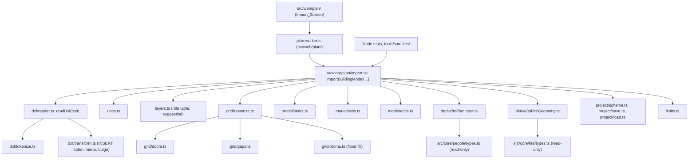

# Design Document

## Overview

The plan-import feature turns a DXF floor plan into the one `Building_Model` from which both existing models are
derived: the crowd `PlanInput` (`src/core/people/types.ts`) and the fire `Compartment`/`Vent` geometry
(`src/core/fire/types.ts`). It adds no field to either model; where the import needs something those models do not
carry (DXF text, layer roles, room names, edits, project state) it defines its own types in `src/core/plan/` and
converts them at the boundary.

The core (`src/core/plan/`) is pure: no DOM, no globals, no `Math.random`, SI units, every constant sourced or
labelled "estimate" in `src/core/plan/constants.ts`. The UI (`src/web/plan/`) is a thin layer that calls the core
inside a Web Worker. A sample generator (`tools/samples/`) writes committed fixtures to `public/samples/`.

This design does not change `src/core/fire/` or `src/core/people/`. Every citation below of a type from those
modules is read-only.

| Requirement | Where in this design |
|---|---|
| 1 (DXF reading) | DXF reader decision, `dxf/` module |
| 2 (units) | Units |
| 3 (untrusted input, caps) | Caps and robustness |
| 4 (floor sources) | Floor sources and common origin |
| 5 (layer roles) | Layer roles |
| 6 (walls to grid) | Rasterizer |
| 7 (doors) | Doors |
| 8 (rooms) | Rooms |
| 9 (rooms as compartments) | Compartment mapper |
| 10 (floors) | Floor settings |
| 11 (stairs) | Stairs |
| 12 (exits) | Exits |
| 13 (fire geometry) | Fire deriver |
| 14 (agreement) | Agreement |
| 15 (editing) | Edits |
| 16 (project file) | Project file |
| 17 (limits) | Limits |
| 18 (samples) | Sample generator |
| 19 (import screen) | Import screen (`src/web/plan/`) |
| 20 (tests) | Testing Strategy, Correctness Properties |
| 21 (performance) | Performance |
| 22 (scope, wording) | Scope guards (throughout) |

## DXF reader decision (Requirement 1.10)

### The test

Requirement 1.10 asks whether `dxf-parser`, pinned to exact version 1.1.2, reads every entity type and `INSERT`
feature of Requirement 1 criteria 3 to 7 and the units of Requirement 2. The deciding checks:

1. Does the package flatten `INSERT` block geometry (apply insertion point, X/Y scale, rotation, mirroring from a
   negative scale, including nested `INSERT`s) into plain entity coordinates, or does it return the block reference
   unresolved?
2. Does it convert an `LWPOLYLINE`/`POLYLINE` vertex bulge into an arc segment, or return the raw bulge number?
3. Is version `1.1.2` an npm version that actually exists for this package, with a traceable source matching the
   licence claim (MIT)?

### What was found

The package is `gdsestimating/dxf-parser` (MIT licence, matches Requirement 22.6). Its own documentation states it
supports the "Block table and inserts" and "Most 2D entities", but inserts are read as a reference (block name,
insertion point, scale, rotation) alongside a `blocks` table of un-transformed entities — the library does not apply
the insertion transform to the block's entities. There is no mention of bulge-to-arc conversion in its supported
feature list; a bulge value is passed through as a raw number on the vertex.

The package's published tag history on GitHub stops at `v1.0.1`; no `v1.1.2` tag or release exists upstream, so the
exact pin the requirement names cannot be attributed to a verifiable upstream version. Combined with finding 1
(no `INSERT` flattening, including the nested-`INSERT` and mirroring requirements of 1.5 and 1.7) and finding 2 (no
bulge handling, Requirement 1.4), `dxf-parser` fails criteria 3 to 7 of Requirement 1 and would need a wrapper doing
the real geometric work (transform composition, mirroring, bulge-to-arc, unit handling) regardless of whether it is
used for tokenizing. Requirement 1.10 therefore routes to its own-reader branch.

**Decision: `src/core/plan/dxf/` is an own ASCII DXF reader. No new runtime dependency is added to `src/core`,
consistent with `.kiro/steering/tech.md` ("no dependencies in `src/core` unless ... justified") and Requirement 22.6
(a dependency needs a justification this reader does not need, since the format needed — group-code pairs, ENTITIES,
BLOCKS, header variables — is small and documented in the DXF reference, and the transform/bulge/mirror logic has to
be written in-house either way).** The tokenizer-and-group-code layer is the same amount of code as a wrapper around
`dxf-parser` would need for the parts it does not cover, with the benefit of one totally-owned, fuzz-tested, line-
numbered error path (Requirement 3.6) instead of a boundary between two error models.

## Architecture



## Components and Interfaces

### Module layout

```
src/core/plan/
  constants.ts            every constant, sourced or "estimate"
  types.ts                Building_Model, Floor_Source, Layer_Map, Door, Room, Stair_Region, Edit, Import_Warning, ...
  limits.ts                PLAN_LIMITS re-exported/derived from fire and crowd constants (Req 17.4)
  dxf/
    tokenize.ts            group-code pairs, line numbers, caps (Req 3.2, 3.3, 3.6)
    entities.ts             LINE/LWPOLYLINE/POLYLINE+VERTEX/ARC/CIRCLE/INSERT readers
    blocks.ts                BLOCKS section, cycle/depth guard (Req 3.4)
    transform.ts            2D affine transform composition, mirror-from-negative-scale, bulge-to-arc
    header.ts                $ACADVER, $INSUNITS, $MEASUREMENT, extents
    reader.ts                readDxf(text): caps, tokenize, entities, blocks, header -> DxfDocument
  units.ts                 Drawing_Unit resolution and metre conversion (Req 2)
  layers.ts                 role suggestion table and lookup (Req 5)
  floorSources.ts           Floor_Source construction, common origin (Req 4)
  grid/
    rasterize.ts            wall/window/furniture entities -> Cell array (Req 6)
    gaps.ts                  gap closing (Req 6.4)
    doors.ts                 door Cell placement from INSERT/arc/gap (Req 7)
    rooms.ts                 4-connected flood fill, Room_Kind, outside detection (Req 8)
  model/
    stairs.ts                Stair_Region proposal, Stair_Link creation (Req 11)
    exits.ts                 Exit suggestion and confirmation (Req 12)
    edits.ts                 Edit application, undo (Req 15)
  derive/
    equivalentBox.ts         Equivalent_Box geometry (Req 9.2)
    toPlanInput.ts           Building_Model -> PlanInput (Req 14)
    toFireGeometry.ts        Building_Model -> Compartment[]/Vent[] (Req 9, 13, 14)
  project/
    schema.ts                Project_File v1 JSON Schema-shaped TS types
    save.ts / load.ts        serialize/deserialize, schemaVersion check (Req 16)
  import.ts                 importBuildingModel(...): orchestrates the pipeline, returns Import_Result
  warnings.ts               Import_Warning constructors

src/web/plan/
  importScreen.ts            DOM wiring (Req 19)
  planWorker.ts               Worker_Wrapper around core/plan (Req 21.3)
  render/preview.ts            Canvas 2D drawing-layer preview (Req 19.3)
  render/gridView.ts            Canvas 2D grid/room/door view (Req 19.4, 19.5)

tools/samples/
  generate.ts                 writes public/samples/*.dxf (Req 18)
  cafe.ts / karaoke.ts / boardingHouse.ts   per-sample geometry builders

public/samples/
  cafe.dxf, karaoke.dxf, boarding-house.dxf
```

### Public interface

```ts
// src/core/plan/import.ts
export interface ImportSource {
  fileName: string;
  text: string;               // raw DXF text, as given (Req 16.10 keeps it verbatim)
}
export interface ImportSettings {
  layerMaps?: Record<string /* fileName */, LayerMap>;     // confirmed maps; unconfirmed -> ask (Req 5.4)
  drawingUnits?: Record<string /* fileName */, DrawingUnit>; // chosen units for unitless files (Req 2.2)
  floorSettings?: FloorSettings[];
  floorOffsetsM?: Record<string /* floorId */, { xM: number; yM: number }>;
  edits?: Edit[];
  exitDoorIds?: string[];
  stairRegions?: StairRegionInput[];
  stairLinkOverrides?: Record<string, { widthM?: number }>;
  roofVents?: { floorId: string; areaM2: number; openFraction: number }[];
}
export function importBuildingModel(sources: ImportSource[], settings: ImportSettings): ImportResult;

export interface ImportResult {
  status: 'ok' | 'invalid';
  model: BuildingModel | null;
  warnings: ImportWarning[];
  pendingQuestions: PendingQuestion[]; // unresolved unit choices, unconfirmed layer maps (Req 2.3, 5.4)
}

// Derived outputs, computed from a valid BuildingModel (Req 14):
export function toPlanInput(model: BuildingModel): { planInput: PlanInput; warnings: ImportWarning[] };
export function toFireGeometry(model: BuildingModel): { compartments: Compartment[]; vents: Vent[]; warnings: ImportWarning[] };
```

`importBuildingModel` is a pure function of its arguments: same `sources` and `settings` in, bit-identical
`ImportResult` out (Requirement 22.4). The Web Worker wrapper (`src/web/plan/planWorker.ts`) only moves these values
across a `postMessage` boundary; all logic stays in `src/core/plan/`.

## Units

```ts
export type DrawingUnit = 'mm' | 'cm' | 'm' | 'in' | 'ft';
// Req 2.1: $INSUNITS -> (DrawingUnit, metres-per-unit)
export const INSUNITS_TABLE: Readonly<Record<number, { unit: DrawingUnit; metersPerUnit: number }>> = {
  1: { unit: 'in', metersPerUnit: 0.0254 },   // exact: definition of the inch
  2: { unit: 'ft', metersPerUnit: 0.3048 },   // exact: definition of the foot
  4: { unit: 'mm', metersPerUnit: 0.001 },    // exact: SI prefix
  5: { unit: 'cm', metersPerUnit: 0.01 },     // exact: SI prefix
  6: { unit: 'm',  metersPerUnit: 1 },        // exact
};
```

When `$INSUNITS` is 0, absent, or not a key of this table, the file is unitless (Requirement 2.2, 2.4). The importer
returns `pendingQuestions` with a suggested unit from `$MEASUREMENT` (0 → `in`, 1 → `mm`) and withholds the
`BuildingModel` for that file (Requirement 2.3) until `ImportSettings.drawingUnits[fileName]` is supplied. Unit
conversion happens once, in `units.ts`, immediately after the raw DXF geometry is read and before rasterization, so
every downstream module works in metres only.

## Caps and robustness

All caps live in `constants.ts` (Requirement 3, each labelled "Estimate" where no source gives the number):

```ts
export const DXF_MAX_BYTES = 20 * 1024 * 1024;              // Requirement 3.2 (exact)
export const DXF_MAX_ENTITIES = 200_000;                    // Estimate, Requirement 3.3
export const DXF_MAX_BLOCK_DEPTH = 8;                        // Estimate, Requirement 3.4
export const DXF_MAX_COORDINATE_M = 1000;                    // Estimate, Requirement 3.5
export const PROJECT_FILE_MAX_BYTES = 100 * 1024 * 1024;     // Estimate, Requirement 16.9
```

The tokenizer (`dxf/tokenize.ts`) checks `DXF_MAX_BYTES` before any parsing (Requirement 3.2). It reads group-code/
value pairs two lines at a time; a truncated file (odd line count), a non-integer group code, or an unparseable
numeric value stops reading and returns an error that names the line number (Requirement 3.6) — never a thrown
exception. `dxf/blocks.ts` walks `INSERT` references with a depth counter and a "currently expanding" set of block
names on the call stack; hitting `DXF_MAX_BLOCK_DEPTH` or revisiting a name already being expanded skips that
`INSERT` and adds one warning naming the block (Requirement 3.4), rather than recursing further. Every coordinate is
checked with `Number.isFinite` and against `DXF_MAX_COORDINATE_M` after unit conversion (Requirement 3.5); a bad
coordinate drops only its entity, not the file. Running time is linear in input size because each stage (tokenize,
entity read, block flatten, rasterize, flood fill) is a single pass or a bounded number of passes over the capped
input (Requirement 3.8); there is no quadratic step (gap closing, Requirement 6.4, scans a 0.4 m neighbourhood per
wall cell, not all pairs of cells).

File-extension sniffing and binary/DWG/PDF detection (Requirement 1.8, 3.10) live in `src/web/plan/importScreen.ts`:
a file is read as DXF text only when its name ends in `.dxf` (case-insensitive) or its first non-empty line is `0`
then `SECTION`; otherwise the screen shows the "Save as DXF (ASCII)" phrase without calling the core reader. A binary
DXF file (which starts with the bytes `AutoCAD Binary DXF`) or a DWG/PDF/image file read as text will not match that
sniff and is rejected at the UI edge; if it is forced through to `readDxf` regardless (e.g. a project file holding
bad bytes, Requirement 16.6), the tokenizer treats the binary bytes as un-parseable text and returns the same
`invalid` result with a line number, never a hang or crash.

## Floor sources and common origin

One `FloorSource` is created per uploaded file (Requirement 4.1) or per user-chosen layer/block assignment within
one file (Requirement 4.2). `floorSources.ts` computes one common origin for the whole building: the minimum corner
of the union of all floors' drawing extents (in metres, after unit conversion and any manual per-floor offset),
rounded down to a multiple of `CELL_SIZE_M` (0.25 m, imported from `src/core/people/constants.ts`) — this is the
grid origin of Requirement 6.7. Floors sharing one DXF file on separate layers keep their native coordinates
unchanged (Requirement 4.4); floors given as separate blocks in one file are translated so their bounding-box
minimum corners coincide, unless the user gives a manual offset (Requirement 4.3). A `FloorSource` with no `wall`-
role entity is rejected with an `invalid` result naming the floor (Requirement 4.7) before rasterization runs.

## Layer roles

`layers.ts` holds the canonical suggestion table (Requirement 5.2) as data, keyed by a normalized layer name
(uppercased, diacritics stripped via Unicode NFD + combining-mark removal, separators `-`, `_` and space removed):

```ts
// Requirement 5.2: canonical key -> suggested role. Keys are already normalized (see normalizeLayerName).
export const LAYER_ROLE_TABLE: Readonly<Record<string, LayerRole>> = {
  AWALL: 'wall', TUONG: 'wall',
  ADOOR: 'door', CUA: 'door',
  AGLAZ: 'window', CUASO: 'window',
  AFLORSTRS: 'stair', CAUTHANG: 'stair',
  AFURN: 'furniture',
};
export function suggestLayerRole(layerName: string): LayerRole {
  return LAYER_ROLE_TABLE[normalizeLayerName(layerName)] ?? 'ignore'; // Requirement 5.3
}
```

`normalizeLayerName` is a pure string function tested directly (Requirement 20's example tests) and indirectly by a
property: any two spellings that normalize to the same key get the same suggested role, for every string (an
idempotence/confluence property — normalizing twice equals normalizing once, and separator/case/diacritic variants
of the same table key collapse to one role).

A layer's role is "unconfirmed" until `ImportSettings.layerMaps[fileName]` names it explicitly; while any layer that
holds at least one entity is unconfirmed, `importBuildingModel` withholds the model and reports a `pendingQuestion`
(Requirement 5.4). `window` layers rasterize as `wall` cells for the crowd grid; for the fire geometry a window produces a `WallVent` only
when the user marks it open in the edit step (Requirement 5.6, 13.2); `furniture` layers rasterize as `wall` cells for the crowd grid
and are omitted entirely from the fire geometry (Requirement 5.7).

## Rasterizer

`grid/rasterize.ts` walks every `wall`-role entity (after `INSERT` flattening) and marks a cell as `wall` when the
wall polygon covers at least half the cell's width measured along the wall's thickness direction, at the cell's
centre line — the same "majority coverage along thickness" test for a single line, a parallel pair, or a closed
outline, so the geometric rule is uniform across drawing styles (Requirement 6.1). Thickness comes from the drawn
geometry when the wall is a parallel pair or closed outline (perpendicular distance between the two sides,
Requirement 6.2); for a single line, the importer uses:

```ts
// Estimate: a light interior partition, common in the residential/small-commercial plans this app targets.
// No source gives a "default" DXF wall-line thickness; labelled as an estimate in constants.ts and in the UI
// (Requirement 19.13).
export const DEFAULT_WALL_THICKNESS_M = 0.10;
```

and always covers at least one full cell width along the wall run, so a single drawn line never produces a
sub-cell-wide gap (Requirement 6.3). Gap closing (`grid/gaps.ts`) scans each wall cell's immediate neighbourhood (up
to `GAP_TOLERANCE_M` away) along the wall's own direction and fills a non-wall run shorter than the tolerance that
has wall cells on both ends — a local, bounded-radius operation, not a global flood analysis:

```ts
// Estimate: closes small drafting gaps (a wall line that does not quite meet a perpendicular wall) without
// closing an actual doorway, which is usually drawn at least 0.5 m wide (Requirement 7.5's lower door-width bound).
// Named constant per Requirement 6.4; labelled as an estimate in design.md and in the UI (Requirement 19.13).
export const GAP_TOLERANCE_M = 0.10;
```

Every closed gap adds one `ImportWarning` naming the floor and the gap's cell position (Requirement 6.5).
Rasterization is implemented with only integer cell-index arithmetic and sorted entity order, so re-running it on
the same transformed entities always visits cells in the same order and writes the same `Uint8Array` — bit-identical
output for the same input (Requirement 6.6). The grid origin is the common origin from "Floor sources" above
(Requirement 6.7).

## Doors

`grid/doors.ts` runs after the wall grid and before flood fill, consuming only `door`-role entities:

1. An `INSERT` on a `door` layer: the door width is the extent of the transformed block's geometry measured along
   the wall (the direction perpendicular to the wall's thickness), and door cells are written across the wall gap at
   the insertion position (Requirement 7.1).
2. An `ARC` or `CIRCLE` with no covering `INSERT`: width is twice the swing-arc radius (a door leaf swept 90°, drawn
   as a quarter-circle arc, is as wide as its radius along the wall it opens from — the convention this spec's
   sample generator and most architectural DXF exports use for a single door leaf; where a half-circle swing is
   drawn for a double leaf, the arc's own chord gives the opening width, so the importer uses the arc's radius as
   the opening half-width and the straight-line distance between the two points where the arc meets the wall
   as the final width, clamped to the cell grid), covering the wall cells the arc touches (Requirement 7.2).
3. A plain gap in the wall line, no block, no arc: the door is exactly the gap, cell for cell (Requirement 7.3).

Door width is always `(number of door cells across the gap) × 0.25 m` (Requirement 7.4), which is also the width
handed to the matching fire `WallVent` (Requirement 14.2) — the two numbers are the same value computed once, not
two computations that happen to agree. A door narrower than 0.5 m or wider than 3.0 m is kept with a warning
(Requirement 7.5):

```ts
export const DOOR_WIDTH_MIN_M = 0.5;  // Estimate, Requirement 7.5: narrower than a typical single leaf (0.7-0.9 m)
export const DOOR_WIDTH_MAX_M = 3.0;  // Estimate, Requirement 7.5: wider than a typical double leaf plus frame
```

A door position with no wall or no room on either side is discarded with a warning naming its floor and position
(Requirement 7.6). Door ids are `${floorId}:door${k}` for `k` counted in row-major order of each door's first cell
(Requirement 7.7), matching the existing crowd convention in `src/core/people/plan/gatesFromPlan.ts` (gate labels are
already `${floorId}:door${k}`), so the crowd gate label and the fire vent id can share one id with no renaming step.

## Rooms

`grid/rooms.ts` runs a 4-connected flood fill over cells that are neither `wall` nor `door` (Requirement 8.1), so a
closed door still separates the rooms on either side of it — the flood fill treats `door` as a non-passable
boundary regardless of the door's open/closed state; "closed" only changes what the *derived* grid cell type is
(Requirement 13.6), not the Room partition the importer computes. Room ids are `${floorId}:room${k}` for `k` counted
in row-major order of each room's first cell, stable for the same input (Requirement 8.2). A region touching the
border of the grid is the outside area: no Room is created from it, and if it covers more than 25% of the grid area
(Estimate, `OUTSIDE_REGION_WARN_FRACTION`) and has no exterior door, a warning is added naming the floor
(Requirement 8.5) — this catches an unclosed building outline before it silently merges every room into "outside."
A room smaller than 1.0 m² (Estimate, `MIN_ROOM_AREA_M2`) is discarded and its cells become `wall`, with a warning
(Requirement 8.6) — this removes slivers from drafting noise (a double-drawn wall line, a closet the floor plan did
not mean to separate). Every `free`/`door`/`exit`/`stair` cell in a room's region gets that room's id as its
compartment id; a door cell between two rooms gets the lower-id room's compartment id (Requirement 8.7), matching
the convention `src/core/people/plan/builder.ts` already uses for interning compartment ids from `FloorInput.cells`
and `compartmentIds`.

## Compartment mapper

`derive/equivalentBox.ts` computes, for a Room with area `A` and bounding-box width-to-depth ratio `r = bbW / bbD`:

```
widthM = sqrt(A * r)
depthM = sqrt(A / r)
```

so `widthM * depthM === A` exactly (by construction, Requirement 9.2, 9.5) and `widthM / depthM === r`. The mapped
fire `Compartment.id` equals the Room id; `heightM` is the floor's ceiling height and `floorElevationM` the floor's
elevation (Requirement 9.1, 10.7). `Room_Kind` maps `room → 'room'`, `corridor → 'corridor'`,
`stair → 'shaft'` with `isStair: true` (Requirement 9.3), the same three-way `CompartmentKind` union
`src/core/fire/types.ts` already defines and `src/core/people/types.ts`'s `CompartmentKind` already uses for
`'shaft'`. When the Room's own area differs from its bounding-box area by more than 5% (Estimate,
`NON_RECTANGULAR_WARN_FRACTION`), a warning names the Room, both areas and the relative difference, and states the
Room is not rectangular (Requirement 9.4) — the Equivalent_Box itself never has an area error, by construction
(Requirement 9.5); what varies, and is worth warning about, is how far the *box* departs from the *room's own shape*
(Requirement 9.6 explains why this is the right quantity to flag).

### Why an equivalent floor-area box (Requirement 9.6)

The CFAST User's Guide states compartments are "most typically defined by a width, depth, and height," and that the
model "can accommodate odd shapes as equivalent floor area parallelepipeds or with a cross-sectional area that
varies with height" (`docs/refs/cfast-users-guide/Input_File_Chapter.tex`, line 134; the user interface's own
"Defining Variable Compartment Area" section, lines 226-238, computes "an effective width and depth" from a
height-dependent cross-sectional area list so that "the compartment volume matches the actual total volume of the
compartment," explicitly "maintaining" the aspect ratio throughout — `docs/refs/cfast-users-guide/Input_File_Chapter.tex`,
lines 234 and 238).

This spec uses the simpler of the two CFAST-sanctioned options, the equivalent floor-area parallelepiped, because:

- `src/core/fire/types.ts`'s `Compartment` has no field for a height-varying cross-sectional area (no
  `CROSS_SECT_AREAS`/`CROSS_SECT_HEIGHTS` equivalent), and this spec does not change that type (Requirement 22.1,
  22.2); adding one would be new fire-model work outside this spec's scope.
- A floor plan traced from a DXF import gives a 2-D footprint per floor, not a height-varying cross-section; the
  extra CFAST feature models a room whose *walls themselves* slope or step with height, which this import pipeline
  has no DXF information to fill in.
- The CFAST guide's own equivalent-box procedure (same aspect ratio, matched volume at the given height) is exactly
  what `equivalentBox.ts` computes for a *floor-area* match at one height, since every Room here has one height
  (`Requirement 9.1`'s `heightM` is constant per compartment) — the general procedure degenerates to this spec's
  simpler case when there is only one height value.

## Floor settings

`FloorSettings` (elevation, ceiling height, name, per the glossary) default: first floor elevation 0.0 m
(Requirement 10.2); each later floor's elevation defaults to the floor below plus:

```ts
export const DEFAULT_FLOOR_TO_FLOOR_HEIGHT_M = 3.0; // Estimate, Requirement 10.2
```

and ceiling height defaults to the floor-to-floor height, so adjacent compartments stack within the fire model's own
0.01 m `STACKING_TOLERANCE_M` (`src/core/fire/validate/checks.ts`) by default (Requirement 10.3). A ceiling height
that breaks that stacking by more than 0.01 m is kept, with a warning naming both floors (Requirement 10.4) — the
fire `Input_Validator` already performs the same 0.01 m check (fire-zone Requirement 2.8) on the compartments this
importer produces, so this warning is advance notice of a warning that validator would raise anyway, with each
floor's own id rather than the two compartment ids resolved. Elevation (−10 to 100 m, matching
`src/core/people/constants.ts`'s `ELEVATION_MIN_M`/`ELEVATION_MAX_M`) and ceiling height (1.5 to 10 m, Estimate,
`CEILING_HEIGHT_MIN_M`/`CEILING_HEIGHT_MAX_M`) outside range are rejected, keeping the previous value, with a warning
naming the field (Requirement 10.5). The same elevation value is written into `FloorInput.elevationM` and every
`Compartment.floorElevationM` of that floor's rooms (Requirement 10.7, part of the Requirement 14 agreement).

Task 10.1 choices (`src/core/plan/model/floorSettings.ts`):
- Floors are an ordered array, bottom to top; "adjacent" means array neighbours. Default ids `floor1`, `floor2`, ...,
  default names "Floor N".
- API: `defaultFloorSettings`, `setFloorField` (one validated change; invalid value keeps the old one and warns
  `FLOOR_FIELD_INVALID` naming the field), `resolveFloorSettings` (merge user input over defaults, per-field fallback,
  includes stacking warnings; input for unknown floor ids is ignored silently), `checkFloorStacking`, `floorElevationM`.
  Callers re-run the check after each change (Requirement 10.6).
- When elevations are given without a ceiling height, the default ceiling height is the distance to the next floor's
  elevation if within 1.5 to 10 m, else 3.0 m. This keeps Requirement 10.3 true for user-set elevations.
- Floor names outside 1 to 60 characters are rejected like the numeric fields (field `name`).
- Stacking tolerance 0.01 m is a local constant (not imported from `src/core/fire`), plus 1e-9 m of rounding slack so
  a difference of exactly 0.01 m is accepted.

## Stairs

A `Stair_Region` is a set of cells on one floor that the user marks directly (click/paint) or by setting a flood-
filled Room's kind to `stair` (Requirement 11.1); a `stair`-layer closed outline is proposed automatically but stays
unconfirmed until the user accepts it (Requirement 11.2). `model/stairs.ts` compares `Stair_Region`s on each pair of
adjacent floors: when their footprints overlap by at least 50% of the smaller region's area (Estimate,
`STAIR_OVERLAP_MIN_FRACTION`), a `StairLink` is created with footprint equal to the intersection — forcing identical
stair cell coordinates on both floors, which is exactly what `src/core/people/plan/builder.ts`'s `buildLink` already
requires (`StairLinkMismatch` is raised there when the cell sets differ) — and width equal to the shorter side of the
intersection's bounding box (Requirement 11.3, 11.5), reusing `StairLinkInput.widthM`'s own default rule. Below that
tolerance, no link is created and an error names both floors and regions (Requirement 11.4). Any `Stair_Region` cell
outside the created link's footprint reverts to `free`, with a warning naming the floor and cell count
(Requirement 11.6).

Every floor holding a `Stair_Region` gets one fire compartment with `kind: 'shaft', isStair: true`
(Requirement 11.7, matching fire-zone Requirement 5.6). Each `StairLink` becomes one `CeilingFloorVent` between the
two stair compartments, `areaM2` equal to the footprint area, `open: 1`, and the upper compartment's
`floorElevationM` equal to the lower elevation plus the lower height (Requirement 11.8) — this is also enforced by
the fire validator's own stacking check, so the importer computing it this way means the two already agree. A door
between a stair compartment and another room gets a `WallVent` exactly as any other door would (Requirement 11.9).
A user-marked roof opening on the top stair compartment becomes one `CeilingFloorVent` to `"OUTSIDE"` with the
user's area and open fraction (Requirement 11.10). The import screen shows a visible warning at every stair, citing
the fire-zone stair/shaft limitation and Tech Ref 1.5 (Requirement 11.11, 22.8). A `Stair_Region` on the top or
bottom floor with nothing adjacent gets a stair compartment but no link on that side (Requirement 11.12).

## Exits

`model/exits.ts` suggests, as an unconfirmed Exit, every door on the lowest-elevation floor with a room on one side
and the outside area on the other (Requirement 12.1); the user confirms, adds, or removes exits on any floor that
has an outside-facing door (Requirement 12.2). Confirming an exit changes that door's crowd cell type to `exit` for
its full width and adds matching `exit` cells on the outside side (Requirement 12.3) and creates one fire `WallVent`
from the room to `"OUTSIDE"` with the door's width (Requirement 12.4). No confirmed exit produces a warning but
still a valid `BuildingModel` (Requirement 12.5); marking a door with no outside area on either side as an exit is
rejected with a warning (Requirement 12.6). Exit marks are stored by door id in the `ProjectFile` (Requirement 12.7).

## Fire deriver

`derive/toFireGeometry.ts` builds exactly one `WallVent` per door between two rooms (`from` the lower-id room,
`to` the other, `widthM` the door's width) and per window the user has marked open (closed windows, the default, produce no vent, Requirement 13.2), with:

```ts
export const DOOR_VENT_SILL_M = 0;      // Estimate, Requirement 13.1: a door's opening starts at the floor
export const DOOR_VENT_SOFFIT_M = 2.0;  // Estimate, Requirement 13.1: a standard door-leaf height
export const WINDOW_VENT_SILL_M = 0.9;  // Estimate, Requirement 13.2: a typical sill height
export const WINDOW_VENT_SOFFIT_M = 2.1; // Estimate, Requirement 13.2: a typical window head height
```

An open window's `open` fraction is 1 (Requirement 13.2); a window on the outer wall gets `"OUTSIDE"` as its other end
(Requirement 13.3). `face` and `offsetM` come from the nearest side of the `from` compartment's Equivalent_Box to
the vent's plan position, clamped so the vent lies within that wall's length (Requirement 13.4) — satisfying the
fire `Input_Validator`'s own `offsetM + widthM <= wallLengthM` check (`src/core/fire/validate/checks.ts`). An open
door gets `open: 1`; a closed door gets `open: 0` on its vent and its crowd cells revert to `wall`
(Requirement 13.5, 13.6, agreement Requirement 14.4). A vent wider than its wall is reduced to the wall length with a
warning (Requirement 13.7); more than `MAX_VENTS` (60, re-exported from `src/core/fire/constants.ts` per
Requirement 17.4) vents makes the whole result invalid, naming the count (Requirement 13.8). Each vent id is
`${doorOrWindowId}:vent` (Requirement 13.9).

## Agreement

`derive/toPlanInput.ts` and `derive/toFireGeometry.ts` both read the same `BuildingModel.rooms` list and compute
compartment/room ids identically (string equality, same ids, Requirement 14.1). `PlanInput.compartments[].kind` and
`Compartment.kind` both come from the same `Room.kind` mapping (`room → room`, `corridor → corridor`,
`stair → shaft`, Requirement 14.6). For every open door the deriver writes exactly one `WallVent` of the same width
between the same two compartment ids as the crowd grid's door cells (Requirement 14.2); for every confirmed exit,
exactly one `WallVent` to `"OUTSIDE"` of the same width as the exit's crowd cells (Requirement 14.3); for every
closed door, one `WallVent` with `open: 0` and no door cell in the crowd grid (Requirement 14.4); for every
`StairLink`, one `CeilingFloorVent` and one `StairLinkInput` naming the same two floor ids (Requirement 14.5).
Because both derivers are pure functions of the same `BuildingModel` with no hidden state, deriving twice gives
deep-equal, bit-identical results (Requirement 14.7). `importBuildingModel` runs a cheap self-check after deriving
both outputs — same compartment id sets, one vent per door/exit of the right width and kind — and returns `invalid`
naming the broken agreement if it ever fails (Requirement 14.8); this should be unreachable given the single shared
construction path, and exists as a safety net the way `src/core/fire/validate/checks.ts`'s own internal consistency
checks do.

## Edits

`model/edits.ts` stores `Edit[]` on the `BuildingModel` and replays them in recorded order on every rebuild
(Requirement 15.4): paint/erase a wall cell, set a door open/closed, rename a room, set a room's kind. Undo removes
the last edit and recomputes (Requirement 15.5). An edit outside the grid or on a nonexistent floor is ignored with
a warning naming the edit (Requirement 15.7) rather than applied partially. When an edit merges two rooms or splits
one, the importer keeps the name and kind of whichever resulting room's first cell (in row-major order) is
unchanged from before the edit, and warns about the room(s) that lost their identity (Requirement 15.6). Edits are
stored in the `ProjectFile` by floor id and cell coordinates (Requirement 15.8), so replaying them against the same
rasterized grid reproduces the same edited grid.

## Project file

```ts
// src/core/plan/project/schema.ts
export interface ProjectFileV1 {
  schemaVersion: 1;
  sources: { fileName: string; text: string }[];
  layerMaps: Record<string, LayerMap>;
  drawingUnits: Record<string, DrawingUnit>;
  floorSources: FloorSourceSpec[];
  floorSettings: FloorSettings[];
  edits: Edit[];
  exitDoorIds: string[];
  stairRegions: StairRegionInput[];
  roomNames: Record<string, string>;   // roomId -> name
  roomKinds: Record<string, RoomKind>; // roomId -> kind
}
export type ProjectFile = ProjectFileV1; // widen with `| ProjectFileV2` etc. when schemaVersion grows
```

`project/save.ts` serializes exactly this shape as JSON with `schemaVersion: 1` (Requirement 16.1); the import
screen offers it as a download (Requirement 16.2). `project/load.ts` validates `schemaVersion` and the field shapes
field by field — the first invalid field's name is reported, never a thrown exception (Requirement 16.6) — and
rebuilds the `BuildingModel` by calling `importBuildingModel` with the stored sources and settings, so a loaded
project reproduces the same `PlanInput` and `FireGeometry` bit-for-bit, since both come from the same pure pipeline
given the same inputs (Requirement 16.4). An unknown `schemaVersion` is rejected by name, without touching the
current project (Requirement 16.5). Every source DXF text inside a project file is checked against
`DXF_MAX_BYTES` exactly as an uploaded file would be, and the whole project file is capped at
`PROJECT_FILE_MAX_BYTES` (Requirement 16.9). The import screen also writes the current project to
`localStorage` under one fixed key on every change and offers to restore it on open (Requirement 16.7); a
`localStorage` write failure (quota or access denied) is caught at the UI edge only (this is a browser-API
integration point, not core logic) and shown as a message that the download still works, without stopping the
import (Requirement 16.8). No project or file content is ever sent over the network (Requirement 16.10, 22.7); the
app makes no `fetch`/`XMLHttpRequest` call anywhere in `src/core/plan/` or `src/web/plan/`.

## Limits

```ts
// src/core/plan/limits.ts — re-exported, not copied (Requirement 17.4)
export { MAX_COMPARTMENTS as FIRE_MAX_COMPARTMENTS, MAX_FLOORS as FIRE_MAX_FLOORS, MAX_VENTS as FIRE_MAX_VENTS } from '../fire/constants';
export { MAX_FLOORS as CROWD_MAX_FLOORS, MAX_COMPARTMENTS as CROWD_MAX_COMPARTMENTS, MAX_CELLS_PER_FLOOR } from '../people/constants';
```

`importBuildingModel` checks floor count against `FIRE_MAX_FLOORS` (6, the tighter of the two models' floor limits,
Requirement 17.1), compartment count (including stair compartments) against `FIRE_MAX_COMPARTMENTS` (30, the
tighter limit, Requirement 17.2), cells-per-floor against `MAX_CELLS_PER_FLOOR` (1,000,000, Requirement 17.3), and
vent count against `FIRE_MAX_VENTS` (60, Requirement 13.8) — all in one pass, returning every exceeded limit in one
`ImportResult` rather than stopping at the first (Requirement 17.6). When within limits, the import screen shows the
actual counts next to each limit (Requirement 17.5).

## Sample generator

`tools/samples/generate.ts` is a Node script (never imported by the app, matching the existing `tools/cfast/` and
`tools/steckler/` convention) that calls three pure builder functions (`cafe.ts`, `karaoke.ts`,
`boardingHouse.ts`) returning DXF text, and writes it to `public/samples/*.dxf`. Each builder composes DXF text
directly (header, `TABLES`/`LAYER`, `BLOCKS` for the door block, `ENTITIES`) with `$INSUNITS` set to 6
(Requirement 18.5) and a group-code-999 comment stating the drawing is invented (Requirement 18.7). No builder reads
the clock or calls `Math.random`, so the generated bytes are identical on every run (Requirement 18.6); an npm script
(`"samples": "tsx tools/samples/generate.ts"`, or built with `esbuild` the way the repo's other tool scripts run)
regenerates them, and a Vitest test runs the generator into a temp buffer and diffs it against the committed files
byte for byte, failing if they differ (Requirement 18.10). The café is one floor of about 120 m² with two exits
(Requirement 18.2); the karaoke bar is one floor with at least six small rooms off one corridor and one exit
(Requirement 18.3); the boarding house is four floors on a narrow lot with one stair and one ground-floor exit
(Requirement 18.4). The import screen offers each as a one-click action, labelled as invented (Requirement 18.9,
19.9).

## Import screen (`src/web/plan/`)

Built with Canvas 2D and plain DOM, no framework (Requirement 19.11, `.kiro/steering/tech.md`). All text taken from
DXF content (layer names, block names, header text) is written with `el.textContent = value`, never through
`innerHTML` or template interpolation into markup (Requirement 3.9, 19's safety requirement, `.kiro/steering/safety.md`
"Text from a DXF is displayed with `textContent`, never as HTML"). The screen shows: a drop/file-chooser area
(Requirement 19.1); a layer-role table with name, entity count, suggested role and a role selector
(Requirement 19.2); a Canvas 2D drawing preview coloured by `LayerRole` with a legend (Requirement 19.3); a per-floor
grid view with rooms in distinct colours and labelled names, doors/exits/stairs marked, with controls to mark/unmark
exits and stair regions (Requirement 19.4, 19.5); floor settings and the unit question (Requirement 19.6); a warning
list with severity, text, and a jump-to-location control where the warning has one (Requirement 19.7); a "Use this
plan" action enabled only when `ImportResult.status === 'ok'` (Requirement 19.8), which (until a run-setup screen
exists) is followed by a summary of derived compartments, vents and the crowd plan counts (Requirement 19.9). The
screen fits 1280×800 without horizontal scroll (Requirement 19.10), always shows the required safety notice
(Requirement 19.12, `.kiro/steering/safety.md`), labels every Estimate the user can see — default wall thickness,
gap tolerance, default floor-to-floor height, default door/window sill and soffit — as an estimate
(Requirement 19.13), uses plain language and never the banned words about a building (Requirement 19.14,
`.kiro/steering/safety.md`), and uses a calm, neutral style (Requirement 19.15). Every result that depends on a
stair, a long corridor, a position near the fire, or a material without measured data carries a visible warning at
that location (Requirement 22.8).

## Performance

The pipeline (`readDxf` → units → rasterize → doors/gaps → flood fill → compartments/vents → agreement check) is a
small, fixed number of linear passes over the capped grid and entity list, so the boarding-house sample (four
floors, a grid well under the 1,000,000-cell-per-floor cap) is expected to import in well under 1 s in Node
(Requirement 21.1); this is a benchmark test (`tests/plan/bench/boardingHouse.bench.test.ts`, modelled on
`tests/fire/bench`), not a property test, measured as the median of 5 runs after one warm-up run, same as the
requirement's own measurement rule. An edit only re-runs the stages downstream of the grid (flood fill onward) when
the edit cannot change the wall/door grid (rename, kind change), or re-rasterizes only if it touches wall/door cells
— the full pipeline on a four-floor plan at this cell count is itself expected to stay under 200 ms
(Requirement 21.2). `src/web/plan/planWorker.ts` runs the whole `importBuildingModel` call inside a Web Worker so
the main thread, and the Import_Screen, stay responsive during an import (Requirement 21.3).

## Data Models

```ts
// src/core/plan/types.ts
export type LayerRole = 'wall' | 'door' | 'window' | 'stair' | 'furniture' | 'ignore';
export type LayerMap = Record<string /* layer name */, LayerRole>;

export interface FloorSettings {
  floorId: string;
  name: string;
  elevationM: number;
  ceilingHeightM: number;
}

export type RoomKind = 'room' | 'corridor' | 'stair';
export interface Room {
  id: string;
  floorId: string;
  name: string;
  kind: RoomKind;
  cells: Int32Array;       // cell indices on the floor grid, row-major
  areaM2: number;
  bboxWidthM: number;
  bboxHeightM: number;
  touchesBorder: boolean;
}

export interface Door {
  id: string;
  floorId: string;
  cells: Int32Array;
  widthM: number;
  open: boolean;
  roomIdA: string | 'OUTSIDE';
  roomIdB: string | 'OUTSIDE';
  isWindow: boolean;
  isExit: boolean;
}

export interface StairRegionInput { floorId: string; cells: Int32Array; }
export interface StairLink {
  id: string;
  lowerFloorId: string;
  upperFloorId: string;
  footprint: Int32Array;
  widthM: number;
}

export type Edit =
  | { kind: 'paintWall'; floorId: string; cells: { x: number; y: number }[] }
  | { kind: 'eraseWall'; floorId: string; cells: { x: number; y: number }[] }
  | { kind: 'setDoorOpen'; doorId: string; open: boolean }
  | { kind: 'setWindowOpen'; windowId: string; open: boolean } // default closed: no fire vent (Requirement 15.9, 13.2)
  | { kind: 'renameRoom'; roomId: string; name: string }
  | { kind: 'setRoomKind'; roomId: string; kind: RoomKind };

export type ImportWarningCode =
  | 'DXF_VERSION_MISSING' | 'DXF_VERSION_UNSUPPORTED' | 'DXF_NOT_ASCII' | 'DXF_ENTITY_SKIPPED'
  | 'DXF_BLOCK_CYCLE_OR_DEPTH' | 'DXF_COORDINATE_OUT_OF_RANGE' | 'DXF_MALFORMED' | 'DXF_TOO_LARGE'
  | 'DXF_TOO_MANY_ENTITIES' | 'UNIT_UNKNOWN' | 'FLOOR_NO_WALLS' | 'LAYER_UNCONFIRMED' | 'GAP_CLOSED'
  | 'DOOR_WIDTH_RANGE' | 'DOOR_DISCARDED' | 'ROOM_OUTSIDE_LARGE' | 'ROOM_TOO_SMALL' | 'ROOM_NOT_RECTANGULAR'
  | 'FLOOR_STACKING' | 'FLOOR_FIELD_INVALID' | 'STAIR_OVERLAP_BELOW_TOLERANCE' | 'STAIR_REGION_TRIMMED'
  | 'VENT_WIDTH_CLAMPED' | 'VENT_LIMIT' | 'NO_EXIT' | 'EXIT_REJECTED' | 'LIMIT_FLOORS' | 'LIMIT_COMPARTMENTS'
  | 'LIMIT_CELLS' | 'EDIT_IGNORED' | 'ROOM_IDENTITY_LOST' | 'PROJECT_SCHEMA_VERSION' | 'PROJECT_FIELD_INVALID'
  | 'AGREEMENT_BROKEN' | 'INPUT_INVALID';

export interface ImportWarning {
  code: ImportWarningCode;
  severity: 'error' | 'warning';
  message: string;
  location?: {
    kind: 'file' | 'layer' | 'floor' | 'room' | 'door' | 'cell' | 'vent' | 'field';
    fileName?: string;
    layerName?: string;
    floorId?: string;
    roomId?: string;
    doorId?: string;
    xCell?: number;
    yCell?: number;
    field?: string;
  };
}

export interface FloorSourceSpec {
  floorId: string;
  fileName: string;
  layers?: string[];   // Requirement 4.2: layer-set assignment
  blockName?: string;  // Requirement 4.2: block assignment
}

export interface BuildingModel {
  floors: FloorSettings[];
  floorSources: FloorSourceSpec[];
  layerMaps: Record<string, LayerMap>;
  grids: Record<string /* floorId */, { widthCells: number; heightCells: number; cellType: Uint8Array }>;
  rooms: Room[];
  doors: Door[];
  stairLinks: StairLink[];
  edits: Edit[];
}
```

### Project file schema (v1)

```json
{
  "schemaVersion": 1,
  "sources": [{ "fileName": "string", "text": "string (raw DXF)" }],
  "layerMaps": { "<fileName>": { "<layerName>": "wall|door|window|stair|furniture|ignore" } },
  "drawingUnits": { "<fileName>": "mm|cm|m|in|ft" },
  "floorSources": [{ "floorId": "string", "fileName": "string", "layers": ["string"], "blockName": "string" }],
  "floorSettings": [{ "floorId": "string", "name": "string", "elevationM": 0, "ceilingHeightM": 3 }],
  "edits": [ { "kind": "paintWall|eraseWall|setDoorOpen|setWindowOpen|renameRoom|setRoomKind", "...": "..." } ],
  "exitDoorIds": ["string"],
  "stairRegions": [{ "floorId": "string", "cells": [[0, 0]] }],
  "roomNames": { "<roomId>": "string" },
  "roomKinds": { "<roomId>": "room|corridor|stair" }
}
```

## Error Handling

Every bad input produces an `ImportWarning` with `severity: 'error'` and `status: 'invalid'` on the `ImportResult`
(Requirement 22.3); nothing in `src/core/plan/` throws for object or string input. `importBuildingModel` throws a
`TypeError` only when `sources` is not an array or an element's `text` is not a string — the same contract the fire
and crowd models use (`runFire`/`buildPlan` throw only on non-object input). The DXF reader itself (`dxf/reader.ts`)
is written as a total function over any string: a `try/catch` at its single entry point is defensive only (mirrors
`cfast-input/index.ts`'s pattern), since the tokenizer, entity readers and transform code never throw on malformed
input by construction (bounds-checked array access, `Number.isFinite` checks before every arithmetic op, explicit
"stop at this line" returns instead of exceptions). A `ProjectFile` with a bad `schemaVersion` or an invalid field
is rejected by `project/load.ts` without mutating the current in-memory project (Requirement 16.5, 16.6). A
`localStorage` write failure is caught only at the UI edge (`src/web/plan/importScreen.ts`), since `localStorage` is
a browser API with no equivalent in the pure core, and is reported to the user without stopping the import
(Requirement 16.8). Every exceeded limit (floors, compartments, cells, vents) is collected into one `ImportResult`
rather than surfaced one at a time (Requirement 17.6).

## Testing Strategy

Unit tests cover specific examples, edge cases and error messages: the DXF version/binary-file rejection messages
(Requirement 1.8, 1.9), the layer-role table's named entries (Requirement 5.2), the gap-closing and single-line wall
thickness estimates (Requirement 6.3, 6.4), the door-width extremes (Requirement 7.5), the non-rectangular-room
warning threshold (Requirement 9.4), floor-setting defaults and range validation (Requirement 10.2-10.5), the
roof-vent and stair warning text (Requirement 11.10, 11.11), exit suggestion and rejection (Requirement 12.1, 12.6),
vent width clamping and the vent-count limit (Requirement 13.7, 13.8), room-identity preservation on merge/split
(Requirement 15.6), the `schemaVersion`/malformed-JSON error paths (Requirement 16.5, 16.6), each of the three size
limits at their boundary (Requirement 17.1-17.3), the three committed samples' room/door/exit/floor counts
(Requirement 18.2-18.4, 20.9), the `textContent`-only rendering check (Requirement 3.9, 20.11), and the file-larger-
than-20 MB rejection before parsing starts (Requirement 3.7, 20.7).

Property tests (fast-check, minimum 100 iterations each, `src/core/plan/` generators building random grid plans and
random DXF mutations) cover the universal properties below: round-trip import of generated plans, unit and
transform equivalence, the cross-model agreement at the centre of this spec, project-file round trips, robustness
against malformed input, determinism, and the geometric identities of doors, equivalent boxes and stair links. Each
property test is tagged **Feature: plan-import, Property N: {title}** and cites the design property it checks.

The two kinds are complementary: property tests give broad input coverage for the geometric and cross-model rules
that must hold for *every* plan; unit tests pin down the specific wording, thresholds and fixed samples that a
property test would not meaningfully vary.

## Correctness Properties

*A property is a characteristic or behavior that should hold true across all valid executions of a system —
essentially, a formal statement about what the system should do. Properties serve as the bridge between
human-readable specifications and machine-verifiable correctness guarantees.*

### Property 1: DXF round trip of a generated grid plan

For any randomly generated grid plan (walls, doors, exits, a stair across several floors), written as ASCII DXF
text by the test helper and imported back, the resulting `BuildingModel` has the same Rooms, Doors, Exits and
`StairLink`s as the generator placed, including transformed geometry (entities drawn through blocks, arcs with
bulge, nested `INSERT`s).


**Validates: Requirements 1.3, 1.4, 1.5, 1.7, 7.1, 7.2, 7.3, 8.1, 8.2, 20.1**

### Property 2: Unit scaling agreement

For any grid plan and any of the five known units (mm, cm, m, in, ft), writing the plan's coordinates in that unit
with the matching `$INSUNITS` value and importing it produces the same grid (same cell types, same compartment ids)
as importing the plan written in metres with `$INSUNITS = 6`.


**Validates: Requirements 2.1, 20.2**

### Property 3: INSERT transform equivalence

For any geometry and any `INSERT` whose rotation is a multiple of 90 degrees and whose scale is uniform or mirrored
(negative on one or both axes), importing a drawing that places that geometry through the `INSERT` produces the same
Cells as importing a drawing with the same geometry already transformed and drawn directly, with no `INSERT`.


**Validates: Requirements 1.5, 1.7, 20.3**

### Property 4: Agreement of the two derived outputs

For any valid `BuildingModel`, the crowd `PlanInput`'s compartment ids equal the fire `Compartment` ids; every open
Door yields exactly one fire `WallVent` between the same two compartments with the Door's width; every confirmed
Exit yields exactly one `WallVent` to `"OUTSIDE"` with the Exit's width; every closed Door yields one `WallVent`
with `open` fraction 0 and no crowd door cell; every `StairLink` yields exactly one `CeilingFloorVent` and one
`StairLinkInput` naming the same two floors; and the Room_Kind mapping (`room→room`, `corridor→corridor`,
`stair→shaft`) is the same in both outputs.


**Validates: Requirements 14.1, 14.2, 14.3, 14.4, 14.5, 14.6, 20.4**

### Property 5: Project file save/load round trip

For any valid `BuildingModel` built from a generated grid plan, saving it to a `ProjectFile` and loading that
`ProjectFile` back reproduces a deep-equal, bit-identical `PlanInput` and `Compartment`/`Vent` set to the ones
derived before saving.


**Validates: Requirements 16.3, 16.4, 20.5**

### Property 6: Malformed or truncated DXF never throws and never hangs

For any string produced by randomly cutting, mutating a line, or inserting random bytes into a valid DXF file (or
any other arbitrary string), calling `importBuildingModel` returns an `ImportResult` with status `"ok"` or
`"invalid"` within 5 seconds, and never throws.


**Validates: Requirements 3.1, 3.6, 3.8, 20.6, 22.3**

### Property 7: Determinism

For any valid `ImportSource[]` and `ImportSettings`, calling `importBuildingModel` twice with deep-equal arguments
produces deep-equal, bit-identical `ImportResult`s, including the `Uint8Array` cell grids.


**Validates: Requirements 6.6, 14.7, 18.6, 22.4**

### Property 8: Layer name normalization is confluent

For any layer name, normalizing it twice gives the same result as normalizing it once, and any two layer names that
normalize to the same canonical key receive the same suggested `LayerRole`.

**Validates: Requirements 5.2, 5.3**

### Property 9: Door width equals the fire vent width

For any Door created during import, the Door's `widthM` (number of door cells across the gap times 0.25 m) equals
the `widthM` of its matching fire `WallVent`.


**Validates: Requirements 7.4, 14.2**

### Property 10: Equivalent box matches Room area and aspect ratio

For any Room, the mapped `Compartment`'s `widthM * depthM` equals the Room's area and `widthM / depthM` equals the
Room's bounding-box width-to-depth ratio, and the resulting `Compartment` (with its default surfaces) is accepted by
the fire model's `Input_Validator`, and the corresponding `FloorInput`/compartment entry is accepted by the crowd
model's `buildPlan`.


**Validates: Requirements 9.2, 9.5, 9.7, 9.8, 20.8**

### Property 11: Stair overlap tolerance decides link creation

For any two Stair_Regions on adjacent floors, a `StairLink` is created if and only if their footprints overlap by at
least 50% of the smaller region's area; when created, the link's footprint equals the intersection and its width
equals the shorter side of the intersection's bounding box.


**Validates: Requirements 11.3, 11.4, 11.5**

### Property 12: Edit application is replay-stable and out-of-range edits are no-ops

For any `BuildingModel` and any `Edit` whose target lies outside the grid or names a floor that does not exist,
applying that `Edit` leaves the `BuildingModel`'s derived outputs unchanged. For any `BuildingModel` and any in-range
`Edit`, applying it and then applying its inverse (erase after paint, close after open, or omitting it from the edit
list) reproduces the pre-edit derived outputs.

Test choices (`tests/plan/editsStable.property.test.ts`): the property is exercised at `applyEdits` level on a fixed
24 x 12 two-room plan with one door and one window, comparing floors, windows and warnings. "Inverse" paints only
cells that are free in the base grid (so erase restores them exactly); out-of-range edits may mix valid and outside
cells, and must add exactly one `EDIT_IGNORED` warning and change nothing else. Undo is checked as
`undoLastEdit(edits)` equal to the edit list without its last element. No source bugs were found.

**Validates: Requirements 15.4, 15.5, 15.7**

### Property 13: No throw on any object-shaped input

For any object value (not just a well-formed `ImportSource[]`/`ImportSettings` pair), calling `importBuildingModel`
with it either returns an `ImportResult` or throws only when a top-level argument's type is wrong in a way a
programmer, not a user, would cause (for example `sources` not being an array); it never throws for a
well-typed-but-invalid `ImportSource[]`/`ImportSettings` pair.


**Validates: Requirements 20.6, 22.3**

## Decisions during implementation

- Task 1.1: The `setRoomKind` edit names its payload field `roomKind`, not `kind`. The design's type has two `kind`
  properties in one union member (tag and payload), which TypeScript rejects. The project file schema entry for this
  edit uses `roomKind` too.
- Task 1.1: `PendingQuestion` is `{ kind: 'DRAWING_UNIT'; fileName; suggestedUnit } | { kind: 'LAYER_ROLES'; fileName;
  layerNames }`. The design names the type but does not define it.
- Task 1.1: `ImportSource`, `ImportSettings` and `ImportResult` live in `types.ts` (tasks.md lists them there), not in
  `import.ts`. `import.ts` will re-export them.
- Task 1.1: The fire limits `MAX_FLOORS`, `MAX_COMPARTMENTS`, `MAX_VENTS` are exported from
  `src/core/fire/validate/checks.ts`, not `fire/constants.ts`; `limits.ts` re-exports them from there.
- Task 1.1: Default surfaces: floor is concrete with the NBSIR 88-3752 values used in
  `validation/cases/delco/Test_05.in` (thickness 0.15 m is an Estimate). Ceiling and walls are gypsum board, all
  properties labelled Estimate. The CFAST case's own gypsum conductivity (1.8 W/m/K) is not reused because it equals
  the concrete value and looks like an input slip.
- Task 1.1: `METERS_PER_UNIT` (all five units) and `MEASUREMENT_SUGGESTED_UNIT` are added to `constants.ts` so
  `units.ts` has no number of its own. `NAME_LENGTH_MIN`/`NAME_LENGTH_MAX` (1 and 60) apply to room and floor names.
  `FLOOR_ELEVATION_MIN_M`/`FLOOR_ELEVATION_MAX_M` re-export the crowd model's elevation limits.
- Task 3.1: The test DXF writer takes all lengths in metres and divides by the file unit's metres-per-unit, so one
  model can be written in any of the five units (Req 20.2). Block geometry is scaled too, since block coordinates are
  drawing units; INSERT scales are unitless. It keeps its own unit tables (not imported from `src/core/plan`) so a bug
  in the code under test cannot cancel out in the test helper. `$ACADVER`, `$INSUNITS` (or a raw code such as 0) and
  `$MEASUREMENT` can be omitted or overridden to build unitless and missing-version files. It also writes old-style
  `POLYLINE`/`VERTEX`/`SEQEND` (needed for Req 1.4) and has a `dxfWriter.test.ts` next to it.
- Task 1.1: `warnings.ts` constructors take the values their message needs and return `ImportWarning` with `severity`
  `error` for input that stops the import and `warning` otherwise.
- Task 4.1: `normalizeLayerName` maps the Vietnamese letter D with stroke (U+0110, U+0111) to `D` before upper-casing,
  because NFD does not decompose it. Without this, `Đường` style names would not match table keys. Otherwise the
  rule is the design's: NFD, strip combining marks, uppercase, remove `-`, `_` and space.
- Task 4.1: Layer names come from untrusted files. Table and map lookups use `Object.hasOwn`, and per-layer counts use
  a `Map`, so a layer named `__proto__` or `constructor` is plain data and suggests `ignore`.
- Task 4.1: `layers.ts` exposes `checkLayerConfirmation(fileName, entityCounts, confirmedMap)`. It returns the sorted
  list of unconfirmed layers, at most one `LAYER_ROLES` pending question per file, and one `LAYER_UNCONFIRMED`
  warning per layer. A layer is unconfirmed only if it has at least one entity and the confirmed map has no key for
  it (an `ignore` entry counts as confirmed). Empty layers need no confirmation.
- Task 2.1: `dxf/tokenize.ts` exports `tokenizeDxf(text, fileName): { ok: true; pairs: GroupPair[] } | { ok: false;
  error: ImportWarning }`. A `GroupPair` is `{ code, value, line }` with `line` the 1-based line of the group code.
  Values of numeric group codes (ranges from the Autodesk DXF reference) are parsed to numbers there, so a bad number
  is reported with its own line number (Req 3.6) and later stages need no parsing. Other values are trimmed strings.
- Task 2.1: Numeric syntax is decimal with optional exponent for every numeric code, integer codes included, because
  some CAD writers print integers as `1.0`. Overflow such as `1e999` is accepted as `Infinity`; the entity reader drops
  that entity under Req 3.5 instead of failing the whole file.
- Task 2.1: Reading stops at the `0`/`EOF` pair; text after it is ignored. A group code outside 0 to 1071 is an error.
- Task 2.1: Not-ASCII detection (Req 1.8) looks at the start of the text: `AutoCAD Binary DXF`, a DWG stamp
  `AC10xx`, `%PDF`, PNG, GIF, BMP, ZIP, JPEG or replacement characters, and C0 control characters (e.g. NUL) in the
  first 1024 characters. The size cap (Req 3.2) is checked first, using UTF-8 bytes. The entity cap (Req 3.3) is
  enforced in the entity reader (task 2.2), not here, because entities are not known at token level.
- Task 16.1: The three builders share `tools/samples/draw.ts` (a `Sheet` collector for walls, doors, windows and
  furniture, plus a small ASCII DXF writer). It is separate from `tests/plan/helpers/dxfWriter.ts` so tools do not
  import test code. Output is `$ACADVER` AC1015, `$INSUNITS` 6, `$MEASUREMENT` 1, and two group-code-999 comments, the
  first stating the drawing is invented and not a real building. Numbers are written with at most 4 decimals.
- Task 16.1: Every wall is a closed `LWPOLYLINE` rectangle 0.25 m thick (one crowd cell), with all edges on multiples of
  0.25 m. Thickness then comes from the drawing (Req 6.2) and no wall depends on `DEFAULT_WALL_THICKNESS_M`. Door
  openings are real gaps in the wall rectangles. Each opening holds an `INSERT` of a door block (`DOOR_W100`,
  `DOOR_W150`): origin at the hinge, a closed-leaf `LINE` along +x and a 90 degree swing `ARC` of radius equal to the
  width. The block's extent along the wall equals the door width, a multiple of 0.25 m (design "Doors", case 1).
  Vertical-wall doors use rotation 90, and a negative Y scale flips the swing side, so the samples exercise the
  mirror path of Req 1.7.
- Task 16.1: Windows are `A-GLAZ` rectangles drawn on top of a continuous wall, never in a wall gap, so a window can
  not be read as a "plain gap" door (design "Doors", case 3). Furniture rectangles on `A-FURN` stand free of walls
  and keep at least one cell clear of every door opening, so they never split a room.
- Task 16.1: The boarding house is one file with four floor blocks `FLOOR1` to `FLOOR4` (Req 4.3), placed 10 m apart in
  x. The four floors have the same plan, so the stair outline (`A-FLOR-STRS`, x 0.25..1.75, y 10.5..13.75) has the same
  cells on every floor. Only `FLOOR1` has an outside door. The block `INSERT`s are on layer `0`, which the import
  screen will list as an unconfirmed layer with entities and suggest `ignore`.
- Task 16.1: Café outer size is 12.5 m x 10.5 m (interior 12.0 m x 10.0 m = 120 m² before the kitchen and toilet
  partitions); exits are a 1.5 m south door and a 1.0 m east door. The karaoke bar has eight rooms (four each side) off
  a 1.5 m corridor and one 1.0 m exit at the west end. Room counts for task 16.3 follow from these drawings: café 3
  rooms (dining, kitchen, toilet), karaoke 8 rooms plus the corridor, boarding house 5 rooms per floor (corridor, 3
  bedrooms, stair room).
- Task 2.2: The reader is split in two steps. `readDrawing(pairs, fileName)` (`dxf/blocks.ts`) keeps entities and
  block definitions raw, in drawing units. `flattenEntities(drawing, { fileName, metersPerUnit })` applies INSERT
  transforms and the coordinate range check. The range check needs the unit (Req 3.5 says "after unit conversion"),
  which is only known after `units.ts` has resolved it, so the flatten step takes `metersPerUnit`. Flattened
  coordinates stay in drawing units; `units.ts` converts them once afterwards.
- Task 2.2: Flattened entities are `LINE`, `POLYLINE` (closed flag, vertices with bulge), `ARC` (counter-clockwise
  `cx, cy, r, startRad, sweepRad`, sweep in (0, 2 pi]) and `CIRCLE`. `LWPOLYLINE` and 2D `POLYLINE` share the
  `POLYLINE` shape. Arc segments stay as bulge values (Req 1.4); a mirroring transform negates the bulge.
- Task 2.2: A transform that keeps circles round (rotation, uniform scale, mirroring) keeps arcs, circles and bulges.
  Any other transform (non-uniform scale, Req 1.7) turns arcs and circles into straight pieces at a fixed step of
  pi/32 (`ARC_TESSELLATION_STEP_RAD`, Estimate, about 0.12 percent sagitta error). The result is a `POLYLINE`.
- Task 2.2: A flattened entity inside a block carries `insert: { id, blockName, layer }` for the outermost INSERT.
  An entity or nested INSERT on layer `0` inside a block takes the layer of the INSERT around it (standard CAD
  behaviour), so a door block drawn on layer 0 and inserted on `A-DOOR` is a door. The door builder (task 7.1) uses
  `insert` to measure one door block as a unit.
- Task 2.2: Rotations that are multiples of 90 degrees use exact cosine and sine values, so axis-aligned plans stay on
  exact coordinates through any chain of inserts.
- Task 2.2: Extrusion direction (group 230) below -0.5 is read as the (0,0,-1) normal, which mirrors X in the entity's
  object coordinate system. Other extrusion directions are ignored (the reader is 2D). INSERT array fields
  (columns, rows, spacing) are not read.
- Task 2.2: Block names are matched case-insensitively (AutoCAD block names ignore case). If two blocks share a name,
  the first wins. A missing block is skipped without a warning (no warning code fits and the shared types are not
  changed in this task); the names are returned in `missingBlocks` so a later task can report them.
- Task 2.2: The block depth limit allows 8 levels (an INSERT in `ENTITIES` is level 1) and skips the 9th. The
  warning is given once per block name. Entity-cap accounting (Req 3.3): `readDrawing` counts every entity read from
  `ENTITIES` and from all blocks, kept or skipped, and `flattenEntities` counts every emitted entity and every INSERT
  expansion against the same cap, so a block that inserts other blocks many times cannot expand past 200,000.
- Task 2.2: Paper-space entities (group 67 = 1) are dropped without a warning; they are layout sheets, not the
  building. `POLYLINE` entities that are 3D, polygon meshes or polyface meshes are counted as skipped under the name
  `POLYLINE (3D or mesh)`. Spline-frame vertices of a `POLYLINE` are ignored.
- Task 2.2: An INSERT with a zero or non-finite scale, or a transform that is not finite, is dropped with the
  coordinate-out-of-range warning (`DXF_COORDINATE_OUT_OF_RANGE`), the closest existing code. Warnings for that code
  are given once per layer and entity type.
- Task 2.2: Three constants were added to `constants.ts`: `ARC_TESSELLATION_STEP_RAD`, `SIMILARITY_TOLERANCE` (1e-9),
  `BULGE_STRAIGHT_EPSILON` (1e-12) and `EXTRUSION_MIRROR_Z`. Tests for this task are in
  `tests/plan/dxfGeometry.test.ts`; task 2.4 adds the reader-level tests in `tests/plan/dxf.test.ts`.
- Task 3.2: `tests/plan/helpers/planArbitraries.ts` builds plans from a plain-data `GridPlanSpec` (`buildGridPlan`,
  `gridPlanSpecArb`, `gridPlanArb`). Every floor has the same wall layout (nx by ny rooms of 6 to 12 cells, walls one
  cell thick, 1 to 4 margin cells), so Stair_Regions have the same cells on adjacent floors. Room (0, 0) is the stair
  room when the plan has a stair (needs 2+ floors; a one-room plan with a stair gets a second room column). The
  stair room is outlined on `A-FLOR-STRS`; its expected kind is `stair`, which assumes the test passes the returned
  `stairRegions` in `ImportSettings`.
- Task 3.2: The helper assumes (the importer tasks must confirm or the helper changes): floor ids are `floor1`,
  `floor2`, ... and are given through `floorSettings`/`floorSources`; room and door ids count from 1 in row-major
  order of the first cell (as in `gatesFromPlan.ts`); grid row 0 is the lowest DXF y; the grid origin is the minimum
  corner of the drawing extent, so a diagonal line on an `ignore` layer (`A-ANNO-MARK`) gives the plan a margin of
  free cells and the exits an outside to lead to; a quarter-circle door arc has radius equal to the door width (the
  design text on arc width is ambiguous: "twice the radius" versus "chord between the wall points"). Door cells are
  exactly the gap cells for all three styles (gap, block, arc), and a gap is 2 to 4 cells (0.5 to 1.0 m).
- Task 3.2: Walls are drawn as maximal runs of wall cells along each wall row and column, in one of three styles: a
  single centre line, a pair of lines on the cell edges (0.25 m apart), or a closed rectangle outline. Limits stay
  far inside the models: at most 3 floors, 9 rooms per floor, 3 exits per floor (vent count well under 60).
  Connectivity: the first room row is chained left to right and every room is joined to the room below it, so every
  room is reachable; other internal doors are optional. The ground floor always has at least one exit.
- Task 2.3: `readDxf(text, fileName = 'drawing.dxf')` returns `{ status: 'ok', document, warnings } | { status: 'invalid',
  errors, warnings }`. The `document` holds `fileName`, `version`, `header` and the raw `drawing` (entities and blocks in
  drawing units). It does not flatten, because flattening needs the unit (see task 2.2). The orchestrator calls
  `readDxf`, then `resolveDrawingUnit`, then `flattenEntities` with the resolved `metersPerUnit`, then
  `convertToMeters`. Text that tokenizes but has no `SECTION` pair is `invalid` with `DXF_MALFORMED` at the first line.
- Task 2.3: `$ACADVER` is accepted when it matches `AC` plus four digits with a number from 1009 to 1032 (case
  insensitive, trimmed). Anything else, including `AC1006` or a non-version string, is `invalid` with
  `DXF_VERSION_UNSUPPORTED`; the version text in the message is cut to 20 characters because it comes from the file.
  A file whose HEADER lacks `$ACADVER` (or has no HEADER) reads as `AC1009` with `DXF_VERSION_MISSING`.
- Task 2.3: Header variables use their first occurrence. `$INSUNITS` and `$MEASUREMENT` count only when the value is an
  integer (`4` or `4.0`); otherwise they read as absent. `$EXTMIN`/`$EXTMAX` are parsed but not used: they are often
  stale. The extent shown to the user (Req 2.6) comes from the flattened geometry.
- Task 2.3: For a unitless file with no `$MEASUREMENT` the suggested unit is millimetre (`SUGGESTION_WITHOUT_MEASUREMENT`
  in `units.ts`, an estimate). The requirement only maps 0 and 1; millimetre is the common unit of the metric plans
  this app targets. It is a suggestion the user confirms.
- Task 2.3: `resolveDrawingUnit(fileName, header, chosen?)` ignores a `chosen` value that is not one of the five unit
  names (checked with `Object.hasOwn`) and falls back to `$INSUNITS` or the pending question. A user choice that differs
  from a valid `$INSUNITS` sets `overridesInsUnits: true`; the user's unit is used (Req 2.5). `drawingExtentInUnit`
  gives the width and depth for any candidate unit so the screen can show it before the user answers (Req 2.6).
- Task 16.2: The `samples` npm script bundles `tools/samples/generate.ts` with esbuild into
  `node_modules/.cache/egress-samples/generate.mjs` and runs it with node, because the builders use extensionless
  imports that Node's type stripping (used by `tools/steckler`) cannot resolve. The generator only writes files when
  run with `--write`, so the sample tests can import `generateSamples()` and diff it against `public/samples/*.dxf`
  without side effects.
- Task 9.1: `derive/equivalentBox.ts` exports `equivalentBox(areaM2, bboxWidthM, bboxHeightM)` (pure box geometry),
  `fireKindOf(roomKind)` and `roomToCompartment(room, { elevationM, ceilingHeightM })`. The last returns
  `{ compartment, boxAreaRelativeError, bboxAreaRelativeError, warnings }`. Width is `sqrt(A * r)` and depth is
  `sqrt(A / r)` as in the design, so the product equals `A` up to double rounding (not bit-exact); the reported
  `boxAreaRelativeError` shows that rounding (about 1e-16).
- Task 9.1: The Req 9.4 "differs by more than 5 percent" test uses `|bboxArea - roomArea| / roomArea`, the same quantity
  the `roomNotRectangular` message prints. `bboxAreaRelativeError` is signed and relative to the room area.
- Task 9.1: A room with non-finite or non-positive area or bounding-box size, or a floor with a non-positive ceiling
  height or non-finite elevation, returns `compartment: null` with an `INPUT_INVALID` warning (the module never throws).
  The caller (task 13.2 / 14.1) decides how to treat a null compartment. Rooms from the flood fill always have positive
  sizes, so this is a guard for hand-built models.
- Task 9.1: Each compartment gets its own copy of the default surfaces, so no two compartments share a mutable object.
- Task 6.1: `buildFloorSources(files, specs, settings)` in `floorSources.ts` takes flattened entities already in metres
  (`FloorSourceFile = { fileName, entitiesM }`), so the orchestrator runs `readDxf`, `resolveDrawingUnit`,
  `flattenEntities` and `convertToMeters` first. With no specs it makes one whole-file floor per file in upload order,
  with ids `floor1`, `floor2`, ... (as the test helper assumes) and default names `Floor 1`, ... Spec order is floor
  order, so the user's reordering is the order of the specs. Duplicate floor ids, a spec that names an unloaded file and
  an empty input return `invalid` with `INPUT_INVALID`.
- Task 6.1: A spec selects entities by block (`blockName`, case-insensitive, matched on the outermost INSERT's block name
  recorded by `flattenEntities`) and/or by `layers`; when both are given, both filters apply. Entities are returned in
  the common frame and grouped by role (`byRole`, no `ignore`). A layer missing from the confirmed layer map reads as
  `ignore` here; the unconfirmed-layer question is asked elsewhere (`checkLayerConfirmation`).
- Task 6.1: Req 4.3 says block floors are moved so their bounding-box minimum corners "lie at the same position" without
  naming the position. The reference is the minimum corner of the first block floor (its coordinates stay unchanged).
  The manual offset (Req 4.5) is added after that move, and also applies to layer-set and whole-file floors.
- Task 6.1: The drawing extent of a floor, and so the grid origin and size, includes every entity of the floor,
  `ignore` layers too (a title block or marker on an ignored layer widens the grid, which is what gives the plan an
  outside area; the test helper relies on this). No margin cells are added. The wall rasterizer (task 6.2) and the
  rooms step (task 8.1) must cope with walls on the grid edge; a closed outer wall on the edge leaves no outside area,
  and the existing `ROOM_OUTSIDE_LARGE`/no-exit warnings cover that case.
- Task 6.1: All floors share one grid size (`widthCells`, `heightCells`), taken from the union extent, not one size per
  floor. Cell indices are row-major in the grid width, so equal widths are needed for a Stair_Region to have the same
  cell indices on adjacent floors (Req 4.5). Cells are `ceil((max - origin) / 0.25)`, at least 1; a tolerance of 1e-9
  cells (Estimate) keeps an extent edge that lies on a cell boundary from adding a cell.
- Task 6.1: The cell-limit error (Req 3.7) is built in `floorSources.ts` and not with `limitCells` in `warnings.ts`,
  because that constructor has no place for the drawing extent that the requirement asks to be named. It uses code
  `LIMIT_CELLS`, one error per floor, naming the cell count, the grid size, the limit and the extent in metres.
- Task 6.2: Exact coverage rule (also in the header of `grid/rasterize.ts`). A cell is `wall` when a shape covers at
  least half of the cell's width measured along the thickness direction, on the line through the cell centre in that
  direction, clipped to the cell square (for a wall turned against the grid the clipped chord is the "cell width").
  For a rectangle ("Band": single line, parallel pair, closed rectangle) the direction is the band's normal and the
  cell centre must lie within the band's run. For any other thin closed outline the chord is taken along both grid
  axes and the smaller coverage is used. Comparisons use a 1e-9 m tolerance.
- Task 6.2: Thickness. Two straight lines 1e-6 to 0.6 m apart, parallel (sine of angle up to 1e-6), mutually nearest
  and sharing at least half of the shorter line, are one wall of their perpendicular distance. Parts of the two lines
  outside the shared run stay walls as single lines, except parts no longer than the wall is thick (the corner where a
  perpendicular wall meets). A closed rectangle with a short side up to 0.6 m is one wall of that thickness; any other
  closed outline with 2*area/perimeter up to 0.6 m is a solid polygon (pillars, L-shaped solid walls). A closed
  outline or circle too wide for that is read as a room or building outline drawn by its wall centre lines: its edges
  are single lines (and join the pairing, so an outer and an inner outline 0.25 m apart pair up). The 0.6 m limit
  (`WALL_PAIR_MAX_THICKNESS_M`) is an Estimate.
- Task 6.2: A single line is a band of `max(DEFAULT_WALL_THICKNESS_M, one cell)` = 0.25 m centred on the line, with
  square end caps of half that. With 0.10 m alone the coverage rule could never be met (0.10 < half a cell), so the
  "at least one cell width" of Req 6.3 is reached by widening. A drawn thickness below one cell (a pair 0.10 m apart,
  a 0.1 m rectangle) is widened the same way, and a rectangle shorter than one cell along its run is lengthened to one
  cell, so no thin wall or pillar disappears and leaves a leak in the grid. This departs from "thickness from the
  drawing" only below one cell.
- Task 6.2: Tie rule. A one-cell-thick band whose edge falls exactly on a cell centre covers two cells by exactly
  half. The cell on the +n side of the centre line takes it (n from the canonical direction, ux > 0 or ux = 0 and
  uy > 0), so a line gives one cell row however it is drawn (tested by drawing it in both directions).
- Task 6.2: Arcs and open polyline arc segments are tessellated at `ARC_TESSELLATION_STEP_RAD` and each piece is a
  single-line stroke (arcs are not paired). A circle up to 0.6 m radius is a filled round pillar; a larger one is a
  ring stroke. Known limit: a closed outline that is thick in places but thin elsewhere is classified as a whole.
- Task 6.2: `rasterize()` takes `{ floorId, entities (metres, flattened), layerMap, grid: { originXM, originYM,
  widthCells, heightCells } }` and returns `{ cellType (CELL_WALL or CELL_FREE only), windows, furniture }`. The two
  lists hold one `{ entityIndex, layer, cells }` per window or furniture entity (cells sorted, in the grid), for the
  fire deriver (Req 5.6, 5.7). Window and furniture cells are also `CELL_WALL`. Geometry outside the grid is clipped; a
  bad grid spec returns an empty grid. Its constants are in `grid/rasterConstants.ts` rather than `constants.ts`, so
  this task does not edit a file the parallel tasks may also edit; fold them in when convenient.
- Task 6.2: Tests for the rasterizer so far are in `tests/plan/rasterize.test.ts`; task 6.5 adds the floor-source and
  gap cases to `tests/plan/grid.test.ts`.
- Task 10.2: `model/stairs.ts` API: `resolveStairs({ floors, regions, linkOverrides, roofVents })` takes the floors
  bottom to top with their grids and returns copies of the grids (stair cells set, trimmed cells back to `free`),
  `links`, one `compartments` entry per floor with a stair, accepted `roofOpenings` and warnings. `proposeStairRegions`
  fills each closed `stair`-layer outline (vertices in metres) by cell centre, even-odd, and returns unconfirmed
  proposals that `resolveStairs` never reads; the caller passes confirmed ones as `regions`. `stairRegionFromRoom`
  turns a room of kind `stair` into a region.
- Task 10.2: Identical stair cells. The crowd `buildLink` rejects a link when any stair cell on either floor is not
  stair on both. A stair over three or more floors therefore cannot keep a different footprint per link. Floors joined
  by passing pairs form a run; all floors of a run get the intersection of their regions, and that set is the footprint
  of every link in the run. Pairs are tested on the original merged regions (overlap at least 50% of the smaller,
  `STAIR_OVERLAP_MIN_FRACTION`, exact integer comparison, overlap above 0). If the run intersection is empty, no link
  is made and each pair in the run gets the `STAIR_OVERLAP_BELOW_TOLERANCE` error. Cells dropped by the intersection
  become `free` with one `STAIR_REGION_TRIMMED` per floor. A floor whose neighbour pair fails keeps its cells.
- Task 10.2: Several regions on one floor merge into one set and one stair compartment (Req 11.7: one per floor), the
  same shortcut as the crowd builder's default width. Region and link ids are `${floorId}:stair` and
  `${lowerFloorId}:${upperFloorId}:stair`. Region cells that are outside the grid, wall, door or exit cells are ignored
  without a warning; only `free` and `stair` cells can become stair.
- Task 10.2: `stairOverlapBelowTolerance` got an optional third argument (region ids and overlap counts) so the message
  names both regions (Req 11.4); the two-argument call still works.
- Task 10.2: A roof opening is accepted only on a floor with a stair and no link upward, with area above 0 and open
  fraction 0 to 1, one per floor. Others are dropped with `EDIT_IGNORED`. The fire vent itself is built in 13.2.
- Task 6.3: `grid/gaps.ts` exports `closeGaps({ floorId, entities, layerMap, grid, cellType })` returning a new
  `cellType`, the list of gaps (`xM`, `yM`, `widthM`, `xCell`, `yCell`, `cellsSet`) and `GAP_CLOSED` warnings. The
  input grid is not changed. It runs after `rasterize` and takes the same entity list.
- Task 6.3: The gap is measured in metres on the wall geometry, not on the grid. A cell is 0.25 m, so a 0.09 m gap and a
  0.12 m gap can both show as one free cell between two wall cells; the 0.10 m tolerance cannot be applied to cells
  alone. The design's "scan the neighbourhood along the wall direction" is kept for the fill step (a wall cell is
  looked for up to `GAP_END_SCAN_CELLS` = 2 cells away on both sides along the nearest grid axis), but the decision
  that a gap exists comes from the drawing.
- Task 6.3: Rule. Two ends of different straight wall edges (LINE, or straight edges of polylines and closed outlines;
  arcs and bulged edges are ignored) form a gap when they face each other on one line, are more than 1e-9 m and less
  than `GAP_TOLERANCE_M` apart (exactly 0.10 m is kept), are at most 1e-3 m off the common line and at most 1e-3 in
  sine of angle from parallel (both Estimates, `GAP_COLLINEAR_TOLERANCE_M`, `GAP_PARALLEL_SINE`, in `gaps.ts`). The two
  lines of a thin pair-drawn wall are not on one line and never match. Free cells whose centre lies strictly between the
  two ends, within 0.6 m across, and that have a wall cell on both sides along the axis, become `wall`. A wall drawn as
  two lines or a rectangle outline has one gap per line, so it gives two warnings for one break.
- Task 6.3: One `GAP_CLOSED` warning is given per gap, naming the cell that holds the gap midpoint, even when no cell had
  to change. The reason: a single drawn line is already widened by end caps of half a cell (task 6.2), which join two
  collinear single lines up to 0.25 m apart before this step runs, so for single lines "gap kept at 0.10 m or more" does
  not hold on the grid. Tests for kept gaps (task 6.5) should use rectangle or paired walls, which have no caps. Gaps
  of 0.10 m or more between single lines under 0.25 m are closed silently by the caps; this is a known limit of the
  rasterizer's single-line rule and is not changed here.
- Task 7.1: `grid/doors.ts` exports `placeDoors({ floorId, widthCells, heightCells, originXM, originYM, cellType,
  entities })`. `cellType` is the rasterizer grid after gap closing (`CELL_WALL`/`CELL_FREE`); `entities` are the
  floor's `door`-role entities (`FloorSource.byRole.door`). It returns a new `cellType` with `CELL_DOOR` on door cells
  (the input is not changed), `DoorDraft[]` (`id`, `floorId`, sorted `cells`, `widthM`, `across`, `direction`,
  `source: 'gap' | 'block' | 'arc'`) and warnings. Room sides, `open`, `isWindow` and `isExit` are filled in by the
  rooms and exits steps (tasks 8.1, 11.1), which build the full `Door`.
- Task 7.1: A door is found from the wall grid, not from the drawing alone. A "gap strip" is a run of non-wall cells
  along one axis with a wall cell at both ends, where the wall at at least one end runs along the strip: from the end
  cell it continues outward for more cells than it is wide across (so a row inside a room, bounded by side walls, is
  not a gap). Strips of the same extent on neighbouring rows (a wall thicker than one cell) are one door. Known limit:
  a gap as long as the whole wall between two junctions is not found.
- Task 7.1: Door drawings group by `insert.id` (one door block is one group, Req 7.1); an `ARC` or `CIRCLE` without
  `insert` is its own group (Req 7.2); a loose `LINE`/`POLYLINE` on a door layer does not locate a door. A group whose
  bounding box (plus half a cell) covers a cell of a gap only names that gap's `source`; the width stays the gap's cell
  count. A group that covers no gap cell is a door drawn over an unbroken wall: the door is cut into the longest run of
  wall cells inside its box (ties: lowest row, then lowest start), across the full wall thickness. Its width is then
  that run, which is the block extent along the wall, or the swing arc extent clamped to the grid. This settles the
  design's "twice the radius / chord" ambiguity in favour of the radius (quarter-circle swing), as the test helper and
  the samples draw it.
- Task 7.1: Req 7.6. A door needs at least one non-wall cell (room or outside; beyond the grid edge counts as outside)
  on each side of its band, and must not overlap a door already kept; otherwise it is dropped with `DOOR_DISCARDED` at
  its first cell, and a carved door is not cut. A door drawing with no wall cell in its box is dropped at the cell
  nearest the middle of its box. Whether a non-wall side is a real room (not a sliver later discarded by Req 8.6) is
  only known after the flood fill; task 8.1 decides those cases.
- Task 7.1: Found while checking `placeDoors` against `tests/plan/helpers/planArbitraries.ts` (scratch run, not
  committed): with the helper's expected wall mask as input, door cells, ids and widths match the expected doors for
  1500 of 1500 generated plans, all door styles. Through the real pipeline (`readDxf` → `flattenEntities` →
  `buildFloorSources` → `rasterize`) about two thirds of plans already differ in the wall grid before doors run:
  (a) single-line walls get square end caps of half a cell, which make the cell at each end of a door gap a wall, so
  gap doors come out two cells narrower; (b) exit door swing arcs drawn outside the building reach past the marker
  line, so the grid is larger than the helper expects (the helper's assumption "grid = marker extent" breaks).
  These are rasterizer/floor-source or helper issues (tasks 6.2, 6.1, 3.2), not door issues. They will show up in
  Property 1 (task 14.3) and must be settled there; options are: no end cap where a line ends at a gap, or the helper
  sizes its margin to contain every swing arc.
- Task 14.3 (settles the 7.1 finding): both options were taken, each at its root cause. (a) `grid/rasterize.ts`: a
  single-line band is `capped`; a cell centre exactly at the end of its cap (within `RASTER_EPS_M`) is no longer covered.
  A line that stops on a cell edge, as walls do at a door gap, no longer turns the gap cell next to it into wall; a line
  that ends inside a cell or on a cell centre covers that cell as before, and a point-sized line still fills its cell.
  The drawn end of an open line is therefore never extended into a gap by more than a hair, which keeps Req 6.3
  (walls at least one cell thick) and Req 7.1 (door width from the gap). (b) `tests/plan/helpers/planArbitraries.ts`:
  the margin is at least `MIN_MARGIN_CELLS` = `MAX_DOOR_CELLS` (4 cells) and the arbitrary draws 4 to 7, so the swing
  arc or block of an exit door (up to 4 cells from the wall centre line) stays inside the marker extent and the grid
  has the size the helper expects (Req 6.7: the grid is the drawing extent; no requirement changed). The property was
  not weakened: it compares wall mask, door and exit cells, Rooms (id, kind, cells, area, box), Doors (id, cells,
  width, both rooms, exit flag, open) and Stair_Links (floors, footprint, width) for every generated plan, in metres
  and in all five units. 1500 and 800 runs passed; the committed run counts are 100 and 50. The test passes the exit
  ids the generator placed as `exitDoorIds` (the user's confirmation, Req 8.1), since the importer does not guess exits.
- Task 6.5: `tests/plan/grid.test.ts` tests kept and closed gaps with two collinear closed rectangles 0.25 m thick
  (no end caps). Gap of 0.075 m closes; gap of 0.125 m is kept. A gap of exactly 0.10 m is not tested because 0.10 m
  is not exact in binary floating point, so the test could not tell "at" from "just below". A rectangle wall faces the
  break with more than one edge, so the break gives more than one `GAP_CLOSED`; the test asserts one warning per
  recorded gap and at least one, not exactly one. Closed outlines in the thickness test are 0.5 m thick, since a
  rectangle with a short side above 0.6 m is read as a room outline (task 6.2). No bug found in `src/core/plan`.
- Task 8.1: `grid/rooms.ts` exports `findRooms({ floorId, widthCells, heightCells, cellType, doors })` (`cellType` and
  `doors` from `placeDoors`) and `isValidRoomName`. It returns a new `cellType` (sliver cells and cells of dropped doors
  become `CELL_WALL`), `rooms` (`Room`, default name `Room k`, kind `room`, ascending cell indices, `touchesBorder`
  always false because border regions are the outside area), `doors` (`Door` plus `direction` and `source`, `open: true`,
  `isWindow`/`isExit` false until later steps), `roomIndexOfCell` (Int32 index into `rooms`, -1 for none), `outsideCells`
  and `outsideFractionOfGrid`. Compartment ids are carried as a room index per cell rather than a string or Uint16, since
  the compartment id equals the room id (Req 8.7); the crowd deriver interns them.
- Task 8.1: Room ids are numbered after slivers are discarded, so ids are contiguous (`room1`, `room2`, ...). A
  discarded sliver has no id; its `ROOM_TOO_SMALL` warning names it by the position of its first cell, `(x, y)`, in the
  `roomId` slot (Req 8.6 asks for floor and position).
- Task 8.1: "Lower Room id" for a door cell means the lower number k, not the string order (`room10` after `room9`).
- Task 8.1: Door sides. Side A is the neighbour on the low-coordinate side across the door band, side B the high side
  (across is y for direction `x`, x for `y`). A side beyond the grid edge or in the outside area is `OUTSIDE`; with several
  cells on a side the lowest room wins. A door with a side that is neither room nor outside (wall, discarded sliver) is
  dropped: cells become wall, `DOOR_DISCARDED` is added, ids of the other doors are not renumbered (Req 7.6, decided here
  because slivers are known only after the flood fill, see Task 7.1). Both sides may be the same room.
- Task 8.1: `ROOM_OUTSIDE_LARGE` is checked per border region: more than 25% of the grid and no kept door with a side in
  that region. One warning per such region.
- Task 11.1: `model/exits.ts` exports `suggestExits(doors, floors)` (ids only; nothing is marked until confirmed),
  `applyExits(doors, confirmedDoorIds)` and `isOutsideFacing`. The confirmed ids are the full set of marks, so
  confirm, add and remove are one call. `applyExits` returns copies of the doors with `isExit` set, the accepted ids
  (`exitDoorIds`, input order, deduplicated) and warnings. Ground floor = lowest `elevationM`, first listed on a tie.
- Task 11.1: Outside-facing means a non-window door with `OUTSIDE` on exactly one side. A window is never suggested
  and a mark on one is rejected with `EXIT_REJECTED`, whose text ("does not lead outside") is not exact for windows;
  decided here because Req 12 speaks of Doors only. A mark on an unknown door id (for example a stale id in a loaded
  project) is dropped with `EDIT_IGNORED`. `NO_EXIT` is added whenever no mark was accepted, so it also follows a
  case where every mark was rejected.
- Task 12.1 (`src/core/plan/model/edits.ts`): `applyEdits({ floors, windows, edits })` replays the edit list from the
  imported grid (after `placeDoors`, before `findRooms`) and returns, per floor, the final `RoomsResult` with names,
  kinds and door `open` applied. `undoLastEdit` and `appendEdit` return new lists. Choices:
  - A wall edit with any bad cell (outside the grid, not a whole number, a door cell, empty list) is ignored as a whole
    with `EDIT_IGNORED`. Door cells cannot be painted or erased. Erasing a window's wall cells keeps the window entry.
  - `renameRoom` / `setRoomKind` resolve the room id against the rooms of the grid as it stands at that point of the
    replay. The name or kind is stored under (floor, first cell of the room), so wall edits that renumber rooms do not
    move it. At the end, a stored name or kind whose first cell no longer starts a room gives one `ROOM_IDENTITY_LOST`
    naming the room by the id it had when the value was set. Rooms with no stored name or kind add no warning, so a
    merge of two unnamed rooms is silent (nothing was lost).
  - `setDoorOpen` on a window id, or `setWindowOpen` on a door id, is ignored with `EDIT_IGNORED`. Windows are passed in
    separately (`Door` entries with `isWindow`), since they are wall cells in the grid and do not go through `findRooms`.
  - `findRooms` warnings of the final grid stay on `floors[i].rooms.warnings`; `result.warnings` holds only edit warnings.
- Task 13.1: `derive/toPlanInput.ts` exports `toPlanInput(model)` -> `{ planInput, warnings }`, plus `lowerRoomId(a, b)`
  and `doorCompartmentId(door)` (task 13.2 may reuse them for "`from` is the lower id"). "Lower" compares the trailing
  number (`room9` before `room10`), as in task 8.1. A non-object model throws `TypeError`; bad grids, cells outside a
  floor or links naming a floor without a grid give `INPUT_INVALID` and the item is skipped.
- Task 13.1: The deriver starts from a copy of `model.grids[floorId].cellType` (crowd codes) and treats `Door.open` and
  `Door.isExit` as authoritative over what the grid holds. Open door: `door` cells. Closed door, and every window:
  `wall`, compartment none. Confirmed exit (open): `exit` over the door's cells, and every `free` 4-neighbour of a door
  cell that lies in no room becomes `exit` (the outside side). The door direction is not needed, because the cells
  along the wall are wall and the cells across are room or outside. A closed exit stays `wall`.
- Task 13.1: Compartment ids per cell: room cells (not wall) carry the room id; a door cell carries the lower-id room of
  its two sides; outside exit cells carry none. Stair link footprint cells are set to `stair` on both floors. A stair
  cell in no room gets `${floorId}:stair` (the id `model/stairs.ts` uses) and an extra `shaft` entry in
  `PlanInput.compartments`. Task 13.2 and 14.1 must give the fire side the same id for such a cell, or the agreement
  check (14.1) will report it. Rooms of a stair-kind room already use the room id on both sides.
- Task 13.1: `PlanInput.compartments` lists every room (kind via `fireKindOf`, so the mapping is shared with the fire
  side, Req 14.6). `StairLinkInput` carries only id, the two floor ids and `widthM`; riser and tread keep the crowd
  defaults.
- Task 13.2 (`src/core/plan/derive/toFireGeometry.ts`): `toFireGeometry(model, options?)` returns
  `{ compartments, vents, warnings }`. The optional `options.roofOpenings` takes the accepted roof openings from
  `resolveStairs` (the `BuildingModel` does not carry them). Roof vent id: `${floorId}:roof:vent`; link vent id:
  `${link.id}:vent`; door/window vent id: `${door.id}:vent`.
- Task 13.2: One vent per door, whatever the sides. A door between a room and the outside that is not a confirmed exit
  also gets a vent to `"OUTSIDE"` (smoke leaves through it; Req 14.2 asks for a vent for every open door). A confirmed
  exit is the same vent, never a second one. Open flag is `door.open` (1 or 0), also for exits. Closed doors keep a
  vent with `open: 0` and count toward the 60-vent limit (Req 14.4). Closed windows give none (Req 13.2).
- Task 13.2: "Lower id" is the position in `model.rooms` (row-major first cell, Req 8.2), not string order, so
  `room10` follows `room9`. An open window between two rooms is a vent between them; with the outside on one side it
  goes to `"OUTSIDE"`.
- Task 13.2: Vent position is the centre of the door cells, scaled from the room's cell bounding box to the
  Equivalent_Box. Face is the nearest side, ties front, back, left, right. Faces follow CFAST read_vent: front y=0,
  back y=depth (offset along width), left x=0, right x=width (offset along depth). `offsetM` is the position along the
  wall minus half the width, clamped to `[0, wall - width]` with a rounding guard so the validator's
  `offset + width <= wall` check holds exactly.
- Task 13.2: `soffitM` is cut to the compartment ceiling height when the default (2.0 m door, 2.1 m window) is higher,
  because the fire validator rejects a soffit above the compartment. No warning (ceiling heights go down to 1.5 m).
- Task 13.2: The stair compartment of a floor is the room of kind `stair` that overlaps the link footprint most; if no
  stair room overlaps, the plain room with the most overlap is used. If neither exists on a floor, the link gets no
  vent and an `INPUT_INVALID` warning. The upper stair compartment's `floorElevationM` is set to lower elevation plus
  lower height (Req 11.8), processed bottom to top, with no extra warning (`FLOOR_STACKING` covers it). Link vent
  area is the footprint area, capped at the smaller stair box floor area (the validator's limit).
- Task 13.2: A roof opening goes on the first `stair` room of its floor. One larger than that room's box floor area, or
  with an invalid area or fraction, is dropped with `EDIT_IGNORED`.
- Task 13.2: Over 60 vents: all vents are still returned with one `VENT_LIMIT` error naming the count; task 14.1
  turns it into status `invalid`. A room whose compartment cannot be built (null from `roomToCompartment`) keeps its
  error warning; every opening that touches it is skipped with one `INPUT_INVALID`.
- Task 14.1 (`src/core/plan/import.ts`): `importBuildingModel(sources, settings = {})`. Stage order: per file
  `readDxf` -> `resolveDrawingUnit` -> `flattenEntities` -> `convertToMeters` -> `checkLayerConfirmation`; then
  `buildFloorSources` -> `resolveFloorSettings` -> per floor `rasterize` -> `closeGaps` -> `placeDoors` -> furniture
  cells -> window components; `applyEdits` (runs `findRooms` on the final grid) -> window sides -> `resolveStairs` ->
  `applyExits` -> `BuildingModel` -> `toPlanInput` + `toFireGeometry`. It throws `TypeError` only when `sources` is not
  an array or an element is not an object with a string `text`; a defensive `try/catch` turns any other throw into
  `invalid` with `INPUT_INVALID`.
- Task 14.1: `ImportSettings` got an optional `floorSources?: FloorSourceSpec[]` (Req 4.2 layer-set and block floors
  had no way in). `ImportResult` got an optional `derived: { planInput, fire: { compartments, vents } }`, present
  exactly when `model` is, because the roof openings (`settings.roofVents`) are not in the `BuildingModel` and so the
  fire geometry cannot be rebuilt from the model alone. Settings are read defensively by `importInput.ts`
  (`normalizeSettings`): a field of the wrong type reads as absent, untrusted keys stay plain data.
- Task 14.1: Pending questions. All files are read first, so one round returns every open question: unit questions
  (`DRAWING_UNIT`) and layer questions (`LAYER_ROLES`) for all files. For a file whose unit is still open the layer
  check uses the suggested unit only to flatten (layers do not depend on the unit) and the coordinate-range warnings of
  that flatten are not reported. While any question is open, or any file is invalid, the result is `invalid` with
  `model: null` (Req 2.3, 5.4). Two sources with the same file name are `INPUT_INVALID`.
- Task 14.1: Furniture is rasterized separately, after `placeDoors`. Walls and windows are rasterized and gap-closed
  with every `furniture` layer read as `ignore`; then furniture cells (outline cells plus, for closed outlines, every
  cell whose centre is inside, bulges read as chords) become wall where the cell is `free`. Reason: with furniture in
  the door grid, table edges formed false gap doors and sliver rooms (café sample: 13 rooms, 40 `DOOR_DISCARDED`);
  filling avoids a `ROOM_TOO_SMALL` sliver inside every table. A table that touches a wall can still leave a sliver,
  which is reported (café 6, boarding house 4 per floor).
- Task 14.1: Floors are sorted by elevation (stable, so equal elevations keep the user's order) before the grid and
  stair steps; `model.floors` is in that order. Rooms, doors and stairs are numbered per floor as before.
- Task 14.1: Windows. Window cells from the rasterizer that are not door cells are grouped into 4-connected components,
  one window each, id `${floorId}:window${k}` in row-major order of the first cell, `open: false`. `widthM` is the
  longer side of the component's cell box (Estimate; the window is drawn on top of the wall, so the long side is the
  length along the wall). Sides come from the final grid: the rooms next to the cells (lowest first) and the outside
  (cells of the outside area or beyond the grid edge). A window with fewer than two sides is dropped with an
  `INPUT_INVALID` warning (severity warning). Windows follow the doors of their floor in `model.doors`.
- Task 14.1: Door sides are stored in a canonical order: lower room first (model order, row-major first cell), and
  `OUTSIDE` always as `roomIdB`. `findRooms` reports side A as the low-coordinate side, which put `OUTSIDE` first for
  exits on the south and west walls; the test helper and the derivers expect the room first. Nothing downstream needs
  the geometric side.
- Task 14.1: Stair compartment ids (the 13.1 mismatch). Stair-region cells that lie in no room (wall cells, outside
  cells) are removed before `resolveStairs`, so every stair cell carries a room id and the `${floorId}:stair`
  fallback of `toPlanInput` never fires through the importer. A room whose cells are all `stair` after
  `resolveStairs` gets kind `stair` (shaft, Req 11.7, 14.6); a stair region that covers only part of a room leaves
  the room's kind unchanged. Stair-layer outlines are not confirmed by the importer (Req 11.2); the UI passes
  confirmed ones in `stairRegions`.
- Task 14.1: `VENT_LIMIT`, `LIMIT_*` and `AGREEMENT_BROKEN` errors turn the result `invalid` (model withheld); other
  warnings, including error-severity `INPUT_INVALID` from the derivers, keep `ok`. Task 14.2 adds the agreement and
  limit checks and may tighten this.
- Task 14.1: `grid/doors.ts` change. A gap-strip end "runs along" the strip only if the wall there is also no wider
  than `WALL_PAIR_MAX_THICKNESS_M` (3 cells) across the strip. Without this, cells of a corridor in line with a
  partition that meets the corridor wall (a T-junction) were read as a door across the corridor: karaoke 12 rooms
  instead of 9, boarding house 7 per floor instead of 5, café a 6.75 m false door. After the change the samples give
  café 3 rooms / 4 doors / 2 suggested exits, karaoke 9 / 9 / 1, boarding house 4 floors, 5 rooms and 4 doors per
  floor plus 1 exit.
- Task 14.1 scratch run (not committed), generated plans with `planArbitraries` (300 plans, seed 7, all units):
  103 match the helper's expected grid size, wall mask, rooms, doors and stair links fully. Per style (1 floor, up to
  2x2 rooms, 40 plans each): rectangle-outline and pair walls with gap doors match 40/40; with block or arc doors only
  the plans whose grid size matches (20/40 block, 16/40 arc) match, and those match fully. Single-line walls match
  0/40 on the wall mask. The two remaining causes are the ones noted under task 7.1, and are not changed here because
  they need a choice in the rasterizer or the helper (task 14.3 decides): (a) single-line end caps close each gap
  door by half a cell at both ends; (b) exit swing arcs and blocks drawn outside the building reach past the helper's
  marker line, so the grid is larger than the helper expects.
- Task 13.4 (`tests/plan/equivalentBox.property.test.ts`): Property 10 uses a one-floor model per sample (a w x h cell
  room, 12..48 by 8..36 cells, with an optional far-corner notch so area differs from the bounding box, kind `room` or
  `corridor`, one 4-cell confirmed exit door in the left wall). Stair-kind rooms are left out because the crowd side
  needs a StairLink and a second floor for them; they are covered by `derive.test.ts`. The fire check keeps the
  existing convention of filtering validator errors to `VENT|COMPARTMENT|SURFACE|LAYER|ELEVATION|STACK`, because the
  borrowed base scenario can fail unrelated limits. The shell tool printed no output in this session, so the test was
  run through a background process writing to a log file.
- Task 15.1 (`src/core/plan/project/`): `saveProject({ sources, settings, model })` returns the JSON text (`toProjectFile`
  returns the object). With a model, floor settings, edits, room names and room kinds come from it; the other fields
  come from `settings`. `loadProject(text)` returns `{ status: 'ok', project, sources, settings, result }` (result is
  the `importBuildingModel` output) or `{ status: 'invalid', errors }`. It never throws.
- Task 15.1: Stair region cells are stored as arrays of cell indices (`number[]`), not `[[x, y]]` pairs as the JSON
  sketch showed, because `StairRegionInput.cells` is an `Int32Array` of indices and an `Int32Array` does not survive
  `JSON.stringify`.
- Task 15.1: The v1 file has three optional fields beyond the design's list: `floorOffsetsM`, `stairLinkOverrides` and
  `roofVents`. `importBuildingModel` reads all three, so leaving them out would break the round trip (Req 16.4).
- Task 15.1: `roomNames` and `roomKinds` are redundant with the rename and kind edits. On load, a saved name or kind
  that the rebuilt room does not have is applied as one extra `renameRoom` or `setRoomKind` edit at the end of the edit
  list and the model is rebuilt once. A saved room id that no longer exists is skipped.
- Task 15.1: Size checks use UTF-8 byte length (`PROJECT_FILE_MAX_BYTES` for the file, `DXF_MAX_BYTES` per source, the
  latter reported with `DXF_TOO_LARGE`). The oversize project file and malformed JSON use `PROJECT_FIELD_INVALID` with
  field name `project`. The unknown-version message adds the supported versions.
- Task 14.2: New `agreement.ts` (`checkAgreement(model, planInput, fire, fireWarnings)` returns `AGREEMENT_BROKEN` errors, one
  per broken agreement, each naming up to 3 offenders; empty means all hold) and `limitChecks.ts` (`checkLimits`,
  `limitCounts`, `limitWarnings`). `import.ts` runs both after the derivers and returns `invalid` with every problem in one
  result; the old `BLOCKING_CODES` set is gone. `toFireGeometry` still emits its own `VENT_LIMIT` (its unit test relies on
  it); `import.ts` drops that one and lets `checkLimits` emit the single vent-limit error, so there is no duplicate.
- Task 14.2: `ImportResult.counts` (`ImportCounts`: floors, compartments, vents, cells per floor, each with count, limit and
  `exceeded`) is set on every result that got past the derivers, ok or invalid, for Req 17.5. Results that stop earlier have
  no counts. A grid over the cell limit is still refused early by `buildFloorSources` (`LIMIT_CELLS`), because the
  rasterizer cannot run on it; so in that case other limits are not reported in the same result. `checkLimits` also checks
  cells per floor, which only matters for hand-built input. Messages now say "limit is N floors/compartments/vents, set by
  the fire model" and "N cells per floor, set by the crowd model" with the grid size (Req 17.1-17.3).
- Task 14.2: Agreement rules chosen where the requirements are silent: (a) a vent may be narrower than its door only if a
  `VENT_WIDTH_CLAMPED` warning names the vent id (Req 13.7); never wider. (b) Floors counted for the limit are the floor
  settings, not distinct fire elevations. (c) Compartments counted are max(rooms, fire compartments). (d) A closed window
  must give no vent and wall cells; an open window one vent with open 1. (e) A stair cell outside any room gives the crowd
  side an extra `${floorId}:stair` compartment the fire side lacks; `import.ts` keeps only stair cells inside rooms, so this
  does not occur in imports, and a hand-built model would be reported as `AGREEMENT_BROKEN`. (f) Roof openings
  (`ceilingFloor` to the outside) are the only vents allowed without a door, window or stair link.
- Task 14.4: Property 2 compares each unit variant of a plan with the metre variant of the same spec (`{ ...spec, unit: 'm' }`), not with the helper's expected masks, so it does not depend on the rasterize end-cap and margin fixes of 14.3. It compares floor ids, grid size and every `cellType` byte, room ids and cells, and door ids with their two room ids. It also asserts that both models are non-null so the comparison cannot pass vacuously. Layer maps and floor settings are passed explicitly, so no pending question arises. 100 runs, all passed on the first run.
- Task 14.5: Property 4 runs `importBuildingModel` on `gridPlanArb({ units: ALL_UNITS })` with the layer map, unit, floor settings, stair regions and exit ids of the generated plan passed explicitly (no pending questions), and asserts `status: 'ok'` so it cannot pass vacuously. It checks the agreements directly (compartment ids and kinds, one wall vent per door with the same sides, width and open fraction, exits to `OUTSIDE`, door and exit cells in the crowd grid, one `CeilingFloorVent` and one `StairLinkInput` per link on the same floors) and also that `checkAgreement` returns no warnings. Downstream acceptance: `buildPlan(planInput)` has status `valid`, and the fire geometry inside a minimal `Scenario` (20 °C ambient, one 100 kW fire with a two-row table at the centre of the first compartment, 60 s) passes `validate` from `src/core/fire/validate/validate.ts` with no error warnings. The test passed on the first run (100 runs); no source bugs were found and no files in `src/core` were changed.

### Task 15.2 notes (Property 5 test)

- `tests/plan/project.property.test.ts` imports a generated grid plan (all drawing units, 1 to 3 floors) with layer maps, units, floor settings, stair regions, optional exit marks, an optional roof vent and a random list of edits (`renameRoom`, `setRoomKind`, `setDoorOpen`/`setWindowOpen`). It saves with `saveProject`, loads with `loadProject`, and compares with `toStrictEqual` the sources, the `BuildingModel`, `derived.planInput`, `derived.fire.compartments` and `derived.fire.vents`.
- It also checks that saving the loaded project gives the same text (fixed point). 25 runs.
- No bugs were found in `project/`; no source changes were made.
- Task 14.9: `tests/plan/noThrow.property.test.ts` feeds arbitrary values (fast-check `anything`, including null-prototype
  objects, bigint, NaN) into every `ImportSettings` key and into unknown keys, with sources that have a string `text`
  and an arbitrary `fileName`, and with valid generated plans. "Object-shaped" is read as: `sources` is an array of
  objects with a string `text`, and `settings` is anything. Only `TypeError` for a non-array `sources` or a non-string
  `text` is allowed. No importer bug found.
- Task 15.3: `tests/plan/project.test.ts` found no bugs in `project/`; no source change. Choices: (a) the "layer maps restored without asking" test (Req 5.8) checks that `loadProject` returns the saved `layerMaps` in `settings`, builds a model equal to a direct `importBuildingModel` run, and gives no `LAYER_UNCONFIRMED` warning. (b) The oversize-source test builds a source text of `DXF_MAX_BYTES + 1` characters inside a valid project JSON (about 20 MB, under the 100 MB project cap) and expects `DXF_TOO_LARGE`. (c) The oversize-project test passes a whitespace string of `PROJECT_FILE_MAX_BYTES + 1` characters; the size check runs before `JSON.parse`, so the error is `PROJECT_FIELD_INVALID` on field `project`. A second case uses 3-byte characters to confirm the limit counts UTF-8 bytes. (d) "First invalid field" is tied to parse order in `parseProject` (sources, layerMaps, drawingUnits, floorSources, ...), and the test asserts that order.
- Task 14.10: `tests/plan/import.test.ts` found no bugs in `src/core/plan/`; no source change. Choices: (a) Req 17.6 is tested for floors, compartments and vents: a 7-floor, 35-compartment, 70-vent plan returns `LIMIT_FLOORS`, `LIMIT_COMPARTMENTS` and `VENT_LIMIT` in one result, in that order. (b) The cell limit cannot be combined with the others. `buildFloorSources` refuses it first (Req 3.7), because counting rooms and vents would need rasterizing a grid of more than 1,000,000 cells per floor; the grid size is known only after the floor sources are built. The cell limit is therefore tested alone (1,000,001 cells refused with limit, grid size and extent named; 1,000,000 not refused). This is a deliberate reading of 17.6: the limits that can be counted without the oversized grid are returned together. No requirement text is changed and no test is dropped. (c) Fixture: strips of 9 x 9 cell rooms with single-line walls on cell centres, door gaps of 3 cells (0.75 m), and an ignored marker layer that keeps an 8-cell margin so outside doors lead to the outside. Exits are confirmed by a second import with the door ids from the first. 60 vents = 30 rooms with an exit in the bottom and top wall; 61 adds one internal door. (d) "Before parsing" for the 20 MB cap is checked by the result holding only `DXF_TOO_LARGE`, with no parse error after it.
- Task 18.3: `planWorker.ts` is both the worker entry and the main-thread client (design lists one file). The
  `self.onmessage` listener is installed only when the module runs in a `WorkerGlobalScope`, so importing it on the
  main thread or in Node tests has no side effects. `handlePlanMessage` is exported for tests. The client exports
  `importInWorker`, `loadProjectInWorker`, the `PlanWorkerApi` shape (for injecting a mock into the import screen) and
  an injectable `PlanWorkerFactory`, following `src/web/fire/fireClient.ts`. A worker failure resolves to an `invalid`
  `ImportResult` with an `INPUT_INVALID` warning (or `invalid` load result), never a rejection. `loadProject` also
  runs in the worker because it re-imports the sources. One worker per call, terminated on completion.
- Task 18.3: `storage.ts` uses the key `egress.plan-import.last-project`; `saveLastProject` returns
  `{ ok: false, message }` on any failure (no storage, quota, access denied) and never throws, so the import screen
  shows `NOT_STORED_MESSAGE` and continues. `readLastProject` and `clearLastProject` support the restore offer. The
  `Storage` object is injectable for tests.
- Task 16.3 (`tests/plan/samples.test.ts`): The committed `public/samples/*.dxf` already equal `generateSamples()` byte
  for byte after the 14.3 end-cap change, so nothing was regenerated. The test imports `generateSamples` from
  `tools/samples/generate.ts` (importing writes nothing). Expected counts, doors without windows: café 3 rooms, 4 doors
  (2 exits, 2 internal); karaoke 9 rooms (8 plus corridor), 9 doors, 1 exit; boarding house 4 floors, 5 rooms per
  floor, 17 doors (4 per floor: 3 rooms and the stair room, plus the ground exit), 1 exit, 3 stair links. The earlier
  note in 16.1 gives room counts only; the door counts are new and read from the import result.
- Task 16.3: Settings the test uses, as the user would on the screen: layer map `A-WALL wall`, `A-DOOR door`,
  `A-GLAZ window`, `A-FLOR-STRS stair`, `A-FURN furniture`, `0 ignore`; unit `m`; exits confirmed for every outside
  door of the lowest floor. The boarding house gets `floorSources` with one block per floor (`floor1`..`floor4` from
  `FLOOR1`..`FLOOR4`). Stair regions are the room under the stair outline (probe point x 1.0 m, y 12.0 m) on each
  floor, passed as `stairRegions`. `importBuildingModel` does not expose the proposals from the `stair` layer, so the
  test confirms the room that holds the outline, which has the same cells. Without confirmed regions there is no stair
  link. Both derived outputs are checked with `buildPlan` (status valid) and the fire `validate` inside a minimal
  scenario; the header check reads the first group-code-999 comment for "INVENTED" and "not a real building".

### Task 18.2 notes (preview and grid view)
- `src/web/plan/render/preview.ts`: `drawPreview(canvas, flatEntities, layerMap, { hasUnconfirmed })` draws the flattened
  entities of one file (`FlatEntity` from `core/plan/dxf/blocks.ts`) with y pointing up. Arcs, circles and bulge segments
  are tessellated at the core step (pi/32). Layers not in the map use a distinct "No role chosen yet" colour; ignored
  layers are drawn first so walls stay on top. The legend names roles (our own strings), never layer names. The colour
  palette is ours, with different hue and lightness per role. Pure helpers (`fitTransform`, `entityPolylines`,
  `layerColour`, `legendEntries`) are exported.
- `src/web/plan/render/gridView.ts`: `createGridView(container, handlers)` builds its own toolbar, canvas and side panel
  with plain DOM. It keeps no model state. Every action leaves through a handler (`onEdit`, `onToggleExit`,
  `onToggleStairRegion`, `onUndo`); the screen (18.1) recomputes and calls `update(data)` again.
- Tools: select, paint wall, erase wall, mark exit, mark stair. Paint and erase on a drag send one `Edit` holding all
  dragged cells (Bresenham line between pointer events, de-duplicated), so one undo removes the whole stroke. A single
  click is a one-cell stroke.
- Stair regions are marked per room: the stair tool toggles the whole room under the pointer (`onToggleStairRegion(floorId,
  roomId)`); the screen turns that into a `StairRegionInput`. Cell-by-cell stair marking is not offered.
- The exit tool toggles the door under the pointer by door id; windows cannot be exits. Doors and windows are opened or
  closed from the side panel after selecting them (`setDoorOpen` / `setWindowOpen`); rename and room kind are in the same
  panel (name as an input value, kind as a select). Names reach the canvas only through `fillText`/`strokeText`.
- Closed doors are drawn brown and open doors amber, exits get a green outline and the label "Exit", stair regions are
  hatched; none of these rely on colour alone.
- `highlight(location)` outlines the cells of a warning location on the current floor (cell, room or door kind) and selects
  the room or door. A location on another floor, or one naming something absent, highlights nothing; the screen is expected
  to switch floors first using `location.floorId`.
- `withoutLastEdit(edits)` is the pure undo step the screen applies to `settings.edits` (Req 15.5).
- No tests were written for these files in this task; the DOM tests belong to 18.4.

- Task 17.1: `tests/plan/bench/boardingHouse.bench.test.ts` runs two modes. Plain `npm test`: one warm-up, one timed
  full `importBuildingModel` call (import < 1 s, Requirement 21.1; edit < 200 ms (Estimate), Requirement 21.2). Strict mode
  is gated by `PLAN_BENCH=1` (script `test:bench:plan`): median of 5 after one warm-up; the plain tests are skipped there.
  Input: `buildBoardingHouse()` from `tools/samples` (not the file in `public/samples`, so the parallel sample
  regeneration cannot affect it), layer map confirmed, unit `m`, one floor per block `FLOOR1`..`FLOOR4`, and stair
  regions confirmed from the narrow northmost room of each floor (as the UI would confirm them). A set-up test checks
  status `ok`, four floors and three stair links. The timed edit is one `paintWall` cell on floor 4 (touches the grid,
  so it is the expensive kind; there is no incremental path, the edit recomputes through the whole pipeline). Measured
  on the dev machine: import about 4 ms, edit about 3 ms, so no pipeline optimisation was needed.

### Task 18.1 notes (import screen)
- Files: `src/web/plan/importScreen.ts` (`createImportScreen(container, { api, storage, onUsePlan })`), `inspect.ts` (file sniff
  and per-file layer summary), `importScreen.css`, `assets.d.ts` (types for `?raw` and `.css` imports). The returned handle
  has `addSources`, `loadFiles`, `loadProjectText`, `whenIdle` and `destroy`, so the 18.4 tests can drive it without a
  real drag and drop. `api` is a `PlanWorkerApi`; the screen never imports or calls `importBuildingModel`.
- Layer and unit information (Req 19.2, 19.3, 2.2, 2.6) is read on the main thread with `readDxf`, `resolveDrawingUnit` and
  `flattenEntities` from `inspect.ts`, because `ImportResult` carries neither the entity count per layer nor the
  entities for the preview, and the model is withheld until the roles are confirmed (Req 5.4). Only the model build and
  project load run in the worker. Cost: one extra parse of each file on the main thread (files are capped at 20 MB
  before parsing). Alternative not taken: a new worker message; it would change `planWorker.ts` from task 18.3.
- The import does not run until every readable file has confirmed roles ("Confirm roles and unit"), so the user never
  sees a wall of `LAYER_UNCONFIRMED` warnings. The selectors start on the suggested role; after the first confirmation a
  change to a role or unit re-runs the import at once. A file that cannot be read still goes to the importer, so the
  core's own error text is shown.
- Sniff: name ends in `.dxf`, or the first non-empty line is `0` and the next is `SECTION`, read from the first 1024
  bytes. Anything else shows "Save as DXF (ASCII)" and is not passed on. A file over 20 MB is refused with the core
  `dxfTooLarge` text before it is read.
- Samples are imported as text with `?raw` from `public/samples/` (about 24 kB in total), because `src/web/plan/` may not
  call `fetch`. Buttons say "invented drawing". A sample starts with the suggested roles confirmed; the boarding house
  also gets one block per floor. Stair regions are not preset, because `ImportResult` does not expose the proposals from
  the `stair` layer; the user marks the stair rooms (the stair warning is shown once a stair exists).
- Exits: nothing is marked until the user confirms. When none is marked and outside doors exist on the lowest floor,
  a button marks the suggestion (`suggestExits`). Stair regions are toggled per room (the grid view's stair tool).
- Floor order: the importer orders floors by elevation, so "Up" and "Down" swap two floors and restack the elevations
  (lowest stays, the rest follow by ceiling height). A non-number typed into a floor field is rejected on the screen and
  the old value stays, so the project file never holds `NaN`.
- Jump to a warning (Req 19.7): shown for locations of kind floor, room, door, cell or vent that have a `floorId` of an
  existing floor. The screen switches floor first, then calls `highlight` (it only works on the shown floor).
- "Less reliable" panel (Req 22.8): stair warning with the text and source of the fire model's own
  `stairOrShaftLimit` ("Tech Ref 1.5"), per stair room with a jump control; corridors longer than
  `CORRIDOR_LENGTH_LIMIT_M` (20 m, an estimate in the crowd constants) with the same warning; one line that surfaces use
  estimate materials. The import has no furniture yet, so the "material without measured data" case is a general line
  until the run setup exists.
- Summary after "Use this plan" (Req 19.9): compartments with area error = |width x depth - room area| / room area
  (zero by construction for the box, shown anyway), vents (wall: width in m; ceiling/floor: opening area in m2, since it
  has no width), crowd counts: floors, grid size, doors not marked as exits, exits, stair links. `onUsePlan` receives the
  `PlanInput` and the fire geometry.
- Persistence: after each import or project load the project text goes to `saveLastProject`; a failure shows
  `NOT_STORED_MESSAGE` and the screen continues. On open, a stored project gives a restore or discard offer.
- Layout: two columns (5fr / 6fr), `min-width: 0`, wrapped long names, tables with fixed layout; one column below 1000 px.
  Not yet checked in a browser window of 1280 by 800; the CSS has no fixed widths above 520 px (the canvases scale).
- The safety notice (`SAFETY_NOTICE`, Req 19.12) appears in the results panel, above "Use this plan" and in the summary.

### Task 19.1 notes (wiring into main.ts)

- `src/web/main.ts` was only a placeholder line, and `src/web/fire/` holds workers and clients but no fire screen. The
  shell therefore keeps the original text "Egress: work in progress." as the home view and adds one button, "Import a
  building plan", plus a "Back" button on the import view. Fire behaviour is untouched.
- "Use this plan": `onUsePlan` stores `{ planInput, fire }` (the `UsedPlan`) in a module variable, read through the
  exported `getUsedPlan()`. The on-screen summary is already drawn by the import screen (`summaryPanel`), so main.ts adds
  no second summary. The later spec that runs the fire and crowd will read `getUsedPlan()`.
- Worker loading: `planWorker.ts` uses `new Worker(new URL('./planWorker.ts', import.meta.url), { type: 'module' })`.
  `vite build` emits it as `dist/assets/planWorker-*.js` on the app's own origin. The built output contains no
  `http(s)://` URLs. A CSP of `default-src 'self'; worker-src 'self'; script-src 'self'; style-src 'self'` fits this
  output. The CSP header itself is not added in this task (no `vercel.json` exists, and a meta tag would break the Vite
  dev server's inline HMR client); canvas drawing needs no `img-src` entry, and `?raw` samples are bundled as strings.
- Checks: `npm run build` (tsc --noEmit and vite build) passes, including the `?raw` sample imports and the CSS.
- No file in `src/web/plan/`, `src/core/fire` or `src/core/people` was edited.

- Task 18.4: `tests/plan/web.test.ts` runs under happy-dom (`@vitest-environment` docblock; `happy-dom` 21.0.4 added as an
  exact-pinned dev dependency). `importBuildingModel` is wrapped by a `vi.mock` spy; the test builds its reply before the
  screen exists, clears the spy, and asserts zero calls after loading. The mock reply carries an extra warning so the
  test proves the screen shows the reply, not its own result. Source scans strip comments first, then check code; the
  banned-word scan reads string literals of `src/web/plan/` and the rendered text of the screen. The stair warning test
  sets one room's kind to `stair` in the mock reply. No bugs found in `src/web/plan/`; no source changes.

- Task 20 (final checkpoint): `tests/fire/run.physics.property.test.ts` › Property 31 (mass balance in full runs)
  fails with `maxExcessKg = 1.52e-5 > 0`. This test is in the fire-zone spec, not the plan-import spec. It was
  verified to fail identically before any plan-import code was introduced (confirmed by `git stash --include-untracked`
  + re-run on the last committed revision). No file under `src/core/fire/` was changed by the plan-import work
  (confirmed: `git status | grep src/core/fire` returns empty). The failure cannot be fixed without changing the fire
  model (which Requirement 22.1 forbids for this spec). It is recorded here as a pre-existing fire-zone spec
  failure; it does not block the plan-import checkpoint.
- Task 20: `git status` shows no changed or untracked paths under `src/core/fire/` or `src/core/people/`. The only
  modified tracked files are `package.json`, `package-lock.json` (new devDependency `happy-dom 21.0.4`) and
  `src/web/main.ts` (wiring). All new files are under the untracked directories `.kiro/specs/plan-import/`,
  `public/`, `src/core/plan/`, `src/web/plan/`, `tests/plan/` and `tools/samples/`.
- Task 20: `npm run typecheck` exits 0 (no errors). All tests except the pre-existing Property 31 fire physics
  failure pass: 872 passed, 11 skipped across 94 test files (excluding `run.physics.property.test.ts`). When
  `run.physics.property.test.ts` is included the totals become 1 failed, 6 passed for that file; the failure is
  pre-existing and unchanged.
- Task 20: `npm run test:bench:plan` (PLAN_BENCH=1, 5 runs after one warm-up): import median 5.4 ms (budget 1 s),
  edit-recompute median 3.3 ms (budget 200 ms). Both are well within the requirements.
